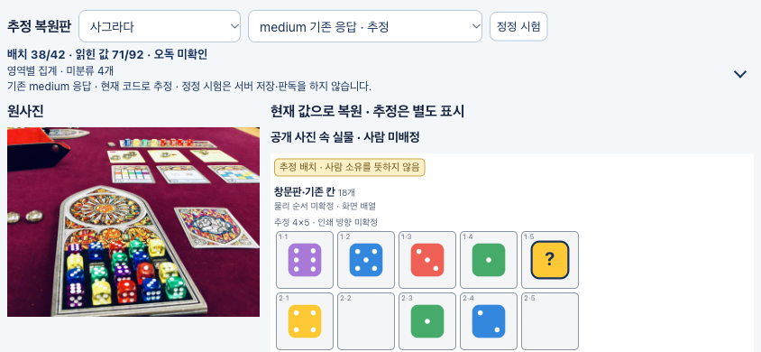
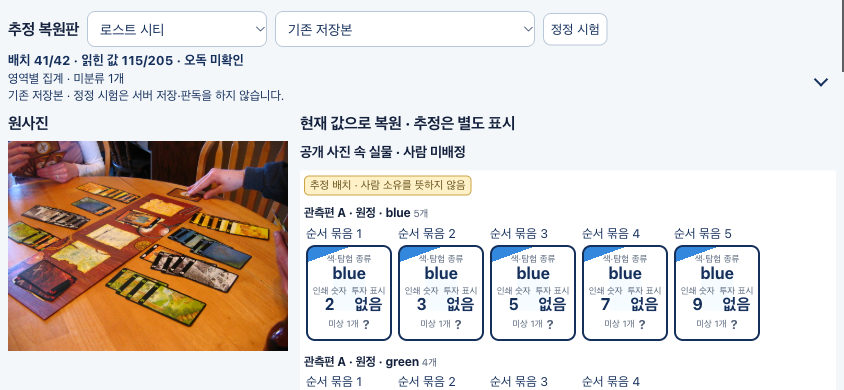
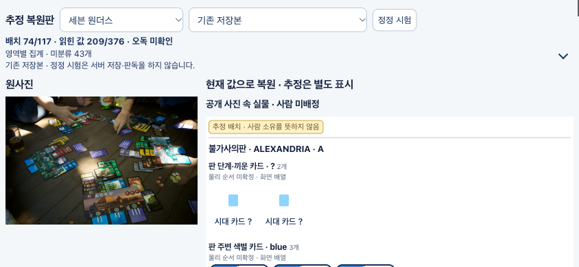

# 자동 위치 복원 — 최종 결과

**아스트라 max 2개 새 세션으로 원인 분석·설계·제품 수정·독립 원사진 대조를 마쳤다.** 기능 구현은 완료했고 자동 복원은 개선됐지만, 모든 위치가 해결된 상태는 아니다. 같은 원사진3장·기존9응답을 재사용했으며 새 사진 판독 API 호출은0회다.

| 원사진 대조 범위 | 수정 전 | 최종 |
|---|---|---|
| LC baseline 판·편·원정/버림 역할 | 맞음16 · 미연결25 · 유보1 | 맞음41 · 미연결0 · 유보1 |
| LC 같은 실제 카드줄의 고정 관측쌍 | 연결10 · 미연결53 | 일치63/63 · 다른 줄 오합침0 |
| 7W 판 무리 소속 | 맞음33 · 오소속0 · 미연결64 · 유보20 | 맞음74 · 오소속0 · 미연결23 · 유보20 |
| Sagrada 전경 baseline/high/medium | 18칸 유지 | 18칸 유지 |
| Sagrada low | 실제 판0 · 표시 격자0 | 실제 판0 · 표시 격자18칸 일치 |

위는 관측행/관계의 제한된 사진 판정이며 전체 실물·전체 사진 정확도나 사람 인증이 아니다. 7W의 실제5무리에 응답 기준판은4개다. 관측되지 않은 판을 만들어 채우지 않았고, low 표시 격자를 실제 배치 성공에 더하지 않았다. LC medium의 잘못되거나 모호한 bbox와 low의 넓은 bbox도 정답으로 가산하지 않았다.

## 달라진 동작

1. 같은 receipt의 live 판과 관측판이 유일하게 동치면 하나의 파생 판 후보로 연결해 LC의 중복 판 차단을 푼다.
2. 관측된 카드 띠·역할·판 경계 접촉으로 7W 소속을 복구하고, 여러 판이 경쟁하면 유보한다.
3. 색 모름 카드도 유일한 관측 줄에 묶되 원래 `suit:null`·숫자는 유지한다.
4. 판 관측이 없는 반복 격자는 명시적인 표시 가설로 그린다. 기존 renderer·아트·수동 정정·저장/재개를 재사용한다.

## 실제 현재 화면

아래는 현재 제품 renderer의 Chrome 캡처이며 원사진을 나란히 보여준다. 모바일 크기 에뮬레이션이고 실제 iPhone Safari 확인은 아니다. 공유 viewer의 정정은 브라우저 안의 임시 변경이다.

### 사그라다 medium

### 로스트 시티 baseline

### 세븐 원더스 baseline

[사그라다 low 세로 화면](supervisor/screenshots/sagrada-low-portrait.png) · [LC 세로 화면](supervisor/screenshots/lost-cities-portrait.png) · [7W 세로 화면](supervisor/screenshots/seven-wonders-portrait.png)

## 검증과 남은 차이

전체 **1,430/1,430**, 전체 타입·Vercel 빌드·viewer 빌드 통과. 직접 HTTP 정정/저장/재개3/3, 고정9응답 재생, 원자료21파일 및 소스/출력 SHA 일치를 확인했다. 실제 화면에서 게임 전환·선택·LC 가로 스크롤·실물 ID 중복0을 확인했다.

7W 미연결23/유보20, Sagrada low의 실제 판 연결0, LC의 일부 원bbox 대응 및 값 오독, 실제 iPhone Safari는 남았다. 30초나 모델 기본 강도 변경은 이번 목표로 삼지 않았다. **이번에는 수동으로 고친 결과를 자동 결과에 더하지 않았다.**

기존 Sites 공유 페이지 갱신은 클라이언트 Git 연결 미지원(409, `sites_git_client_upgrade_required`)으로 막혔다. 기존 공유 사이트는 이전 버전이며 이 보고서의 캡처가 최신이다. Site 소스·게시 버전은 변경하지 않았다.

[독립 최종 사진 대조](photo-evaluation/FINAL_V2_REPORT.md) · [구현·명령](README.md) · [감독 통합 근거](supervisor/verification.json) · [꼭 볼 변경3곳](DIFF_GUIDE.md)

## 코드 변경

[제품·직접 테스트7파일 커밋](https://github.com/RengGyu/KeepBoard/commit/818c7f18107486d2a5c2b5ccab74a8c77f8f96d7). 원인·설계·검증·사진 판정·캡처는 이 폴더에 별도 보관한다.
