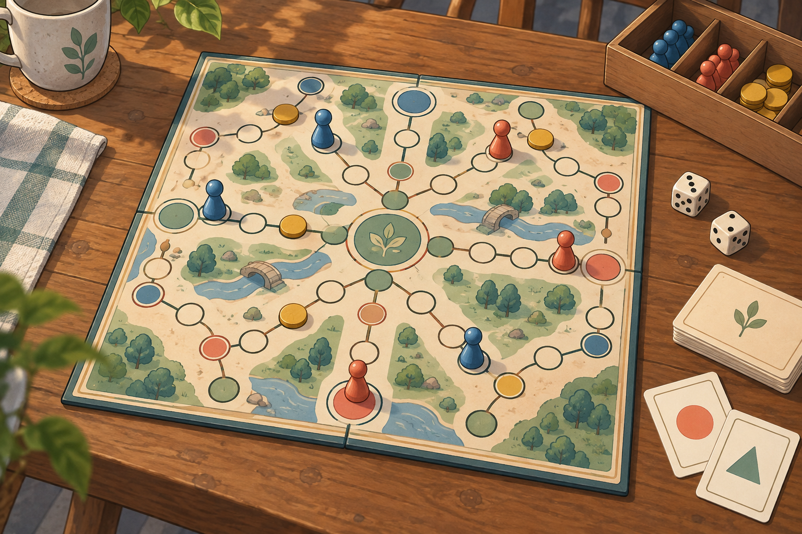
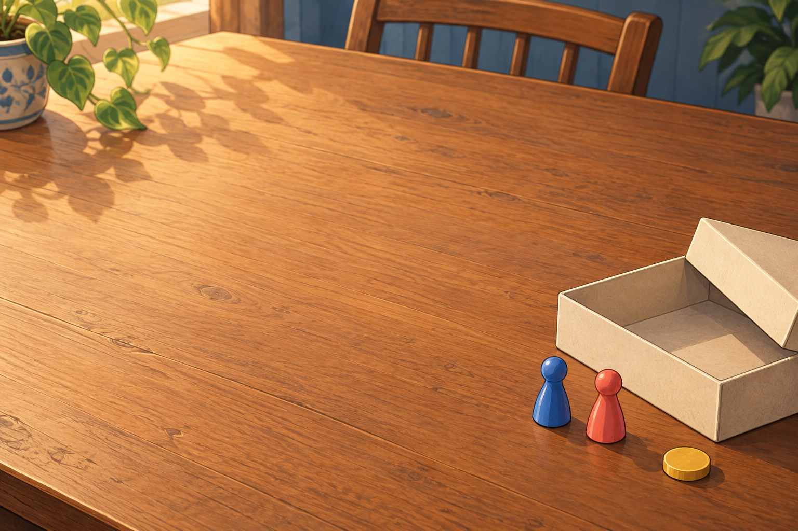

# 만화풍 일반 보드게임 아트 Part A

Built-in `image_gen.imagegen`으로 참조 이미지 없는 **새 generate 2회**, 각 호출 한 장면을 제작했다. 기존 이미지 편집·필터·CLI·별도 API·추가 변형은 사용하지 않았다. PNG 원본을 그대로 복사해 보존했으며 제품 참조는 변경하지 않았다.

| 파일 | 한 줄 의도 | 실제 크기·형식 |
|---|---|---|
| `public/brand/cartoon-v2/home/home-hero-v2.png` | 일반 사각 경로 보드의 멈춘 판을 남기고 다시 돌아오는 분위기 | 1536×1024, 3:2, PNG |
| `public/brand/cartoon-v2/home/empty-table-v2.png` | 열린 무표지 상자와 말 두 개가 기다리는, 여백이 넓은 게임 테이블 | 1536×1024, 3:2, PNG |

정확한 전체 프롬프트와 호출 수는 [prompts.json](prompts.json)에 보존했다. 공통 스타일 문장을 두 호출에서 똑같이 사용했다: `slightly anime-inspired casual board-game illustration, stylized 2D, hand-drawn clean contours, rounded shapes, gentle cel shading, lively but restrained, collectible game-art character appeal`.

## 직접 검수

**VERIFIED:** 두 PNG를 실제로 열어 확인했다. 첫 장은 사각 접이식 경로판 전체, 카드·주사위·파랑/코랄 말·꿀색 토큰·열린 무표지 상자가 보인다. 둘째는 화면 중앙·왼쪽에 넓은 여백, 오른쪽 가장자리에 열린 상자·파랑/코랄 말 한 쌍·토큰이 있다. 두 그림은 부드러운 짙은 윤곽, 그려진 명암, 같은 목재 테이블 세계관을 공유한다. 인물·문구·로고·워터마크·6각 섬·항구·유명 성벽 패턴은 보이지 않는다. 콜라주나 UI 화면이 아니다.

**한계:** 요청한 얕은 종이 질감보다 목재 결·주변 실내 묘사가 강하다. 첫 장에는 추가로 컵·식물 장식이 생성됐다. 지정 HEX 색의 픽셀 단위 일치는 보증하지 않으며, 두 이미지는 독립 생성이라 동일한 테이블 기하나 소품 배치를 완전히 고정하지 않는다. 결과는 생성 일러스트이며 실제 게임 규칙·관측 상태를 표현하는 명세가 아니다. 앱 적용·크롭·UI 렌더 검증은 이번 범위 밖이다.

