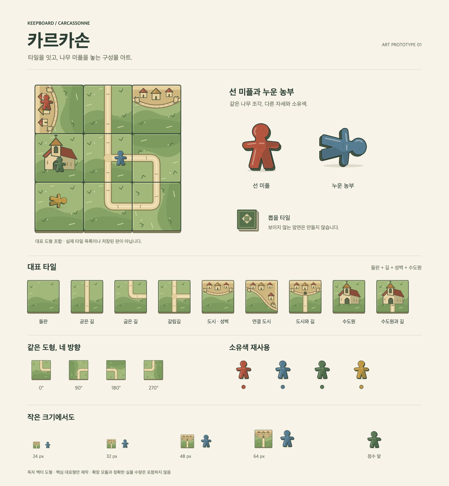

# 카르카손 구성물 아트 시제품

현재 카탄 `ComponentArt`의 크림색 종이, 짙은 초록 윤곽, 절제된 재료색, 목재 옆면을 맞춘 **독자 SVG 도형**이다. 외부 상업 원화·다운로드 이미지·이미지 생성 서비스는 사용하지 않았다. 기존 카탄/제품 UI/API/팩/연구 명세는 변경하지 않았다.



- [PNG 1440×1560](../public/carcassonne-art-preview.png) — CUA Chrome 실제 렌더 캡처에서 시트 영역을 추출한 이미지.
- [벡터 시트](../public/carcassonne-art-preview.svg), [독립 HTML](../public/carcassonne-art-preview.html), [브라우저 원본 캡처](../public/carcassonne-art-preview.jpg)
- 앱 서버의 `/carcassonne-art-preview.html`에서도 열린다. 새 제품 화면이 아닌 독립 아트 미리보기다.
- [개별 SVG 폴더](../public/carcassonne-art/), [전체 명세→아트 매핑](carcassonne-art-mapping.json)

## 명세와 제작 범위

기준은 [carcassonne.json](research/game-specs-120/games/carcassonne.json)의 `tiles / followers / score`와 map/track/supply/draw 영역이다. 명세 confidence는 reported이며 실제 수량은 null이다. **아트 변형의 개수를 실제 게임 부품 수로 사용하지 않는다.** 출처 파일 SHA256을 매핑에 기록했다.

| 명세 항목 | 제작한 대표형 | 개별 에셋 |
|---|---|---|
| tiles · 도시/도로/수도원/들판 경계와 회전 | 들판, 곧은 길, 굽은 길, 갈림길, 도시 성벽, 연결 도시, 도시+길, 수도원, 수도원+길 | `public/carcassonne-art/tile-{field,road-straight,road-bend,road-junction,city-cap,city-corner,city-road,monastery,monastery-road}.svg` |
| tiles · 미확인 앞면 | 임의 지형을 넣지 않은 미확인 타일 | [tile-unknown.svg](../public/carcassonne-art/tile-unknown.svg) |
| followers · 선 미플/누운 농부/소유색 | 같은 목재 도형을 선 자세와 90° 누운 자세, 빨강/파랑/초록/노랑으로 재사용 | `public/carcassonne-art/follower-{standing,farmer}-{red,blue,green,gold}.svg` |
| score · 소유색을 가진 점수 말 | 같은 선 미플을 재사용. 점수 숫자·순환 횟수를 그림에 만들지 않음 | [score-marker.svg](../public/carcassonne-art/score-marker.svg) |
| draw · 비공개 타일 더미 | 독자적인 중립 뒷면과 종이 두께 | [tile-stack.svg](../public/carcassonne-art/tile-stack.svg) |

합계 20개 개별 SVG다. 타일 대표형은 **명세에 적힌 지형을 구분하기 위한 아트 프리셋**이다. 상업 판본의 모든 실물 타일 조합/인쇄된 특정 타일 ID 목록이라고 주장하지 않는다. 더미의 세 겹 종이는 두께 묘사이며 실제 장수 정보가 아니다.

## 표현 계약

```tsx
import { CarcassonneArt, CarcassonneTileLayers } from './CarcassonneArt';
import './carcassonne-art.css';

<CarcassonneArt kind="tile" variant="road-bend" rotation={90} size={80}/>
<CarcassonneArt kind="tile" variant="city-road" size={80}/>
<CarcassonneArt kind="follower" color="#61879d" size={48}/>
<CarcassonneArt kind="follower" variant="farmer" color="#bc6048" size={48}/>
<CarcassonneArt kind="score-marker" color="#63825c" size={48}/>
<CarcassonneArt kind="tile-stack" size={64}/>
```

- named export: `CarcassonneArt`, `CarcassonneTileLayers`, `CARCASSONNE_TILE_PRESETS`.
- 공통 viewBox=`0 0 120 120`, 기본 size=64. 타일 앞면은 x/y=8..112, 옆면은 y=116까지다. 모서리 반경3.5~4, 윤곽1.5~1.7로 카탄의 조금 부드러운 모서리/선 강도와 맞췄다.
- kind=`tile | follower | score-marker | tile-stack`. variant는 위 타일 프리셋, standing/farmer/unknown이다. 미지정/알 수 없는 타일은 미확인 그림으로 남긴다.
- rotation=`0 | 90 | 180 | 270`은 타일 지형층만 회전한다. follower.variant=farmer는 같은 목재 조각을 누운 자세로 표현한다. **미플 자세와 타일 회전은 별개다.**
- color는 미플/점수 말의 소유색이다. 지형 종류의 의미를 바꾸는 색 대체에 쓰지 않는다. label은 aria-label과 title, className은 상위 스타일 연결에 사용한다.
- `features?: {road?: straight|bend|junction|south; city?: cap|corner; monastery?: boolean}`으로 아트 층을 합성할 수 있다. `CarcassonneTileLayers`는 120좌표계의 내부 도형만 내보내므로 상위에서 타일 경계로 clip한다. 임의 합성이 실제 존재/합법 타일임을 보장하지 않는다.
- React `useId`로 clipPath ID를 분리한다. 여러 타일을 한 장에 넣어도 다른 타일의 clip을 참조하지 않는다. 개별 SVG는 ``로 쓰면 독립 문서다.
- CSS는 선택적으로 별도 import한다. 기본색은 SVG 안의 CSS 변수 fallback에도 있어 단독 SVG/서버 렌더가 가능하다. 기존 `--art-ink / --art-cream / --art-paper / --art-coral`과 `--cc-meadow / --cc-wall / --cc-roof`를 재사용한다.

들판의 실제 feature ID, 길/도시의 연결 관계, 미플의 세부 부착 위치, 원본 evidence/crop, 수량/모름, 소유자 ID는 **아트가 아닌 장면 데이터**다. 들판이 도로·도시로 나뉜다는 명세를 타일 중심점 하나로 축약하지 않으며, 이번 그림만으로 연결/농부 득점을 판단하지 않는다.

## 실제 렌더·검증

**VERIFIED:** CUA로 Chrome의 `http://localhost:4317/carcassonne-art-preview.html`을 열고 실제 전체 렌더를 확인했다. 타일 외곽·옆면·모서리·미플이 잘리지 않고, 곧은 길/굽은 길/도시/수도원과 선/누운 미플·네 소유색이 구분되는 것을 시트에서 확인했다. 24/32/48/64px 원래 크기 인스턴스를 포함한다. 24px에서는 세부 지붕/벽돌은 생략되어 보이므로 **지형 내부 구분은 48px 이상**, 미플은32px 이상을 권장한다. 색상만으로 소유자 접근성을 완성했다고 주장하지 않는다.

- `node --import tsx docs/carcassonne-art/render-preview.tsx` **exit0**, 개별20SVG/전체벡터시트/HTML/매핑 생성.
- `npm run typecheck` **exit0**.
- 생성기 포함 전용 TypeScript 검사 **exit0**: `./node_modules/.bin/tsc --noEmit --allowImportingTsExtensions --module esnext --moduleResolution bundler --target es2022 --esModuleInterop --strict --skipLibCheck --jsx react-jsx docs/carcassonne-art/render-preview.tsx`.
- 기존 Vite로 **독립 라이브러리 빌드 exit0**, `/tmp/keepboard-carcassonne-art-build-wH5azo/carcassonne-art.js` 11.88KB. configFile/publicDir 사용 없이 해당 컴포넌트만 빌드했으며 제품 dist/서버는 변경·재시작하지 않았다.
- SVG21개(개별20+시트) XML 파싱, ID 중복0, 미해결 clip 참조0, 개별 viewBox 통일을 확인했다.
- SVG를 sips로 직접 PNG 변환하는 경로는 지원하지 않아 exit13이었다. 최종 PNG는 CUA 전체 Chrome JPEG 캡처에서 sips로1440×1560 시트 영역을 추출한 결과다. SVG가 선명한 벡터 원본이며 PNG는 실제 렌더 미리보기다.

재생성 스크립트는 SVG/HTML/매핑만 갱신한다. 아트를 바꾸면 브라우저 새로고침 후 PNG 캡처도 다시 해야 한다.

**범위 밖:** 모든 실물 타일 조합/연결 사전, 강·수도원장·여관·성당 등의 확장, 농부 득점/전체 규칙 엔진, 스캔 인식, 제품 장면 편집기 연결, 실제 판본의 정확한 부품 수, 배포. 이번은 기존 명세에 근거한 아트 시제품이다.

## 신규 파일

- `src/CarcassonneArt.tsx`, `src/carcassonne-art.css`
- `public/carcassonne-art/*.svg` 20개
- `public/carcassonne-art-preview.svg`, `.html`, `.jpg`, `.png`
- `docs/carcassonne-art.md`, `docs/carcassonne-art-mapping.json`, `docs/carcassonne-art/render-preview.tsx`
