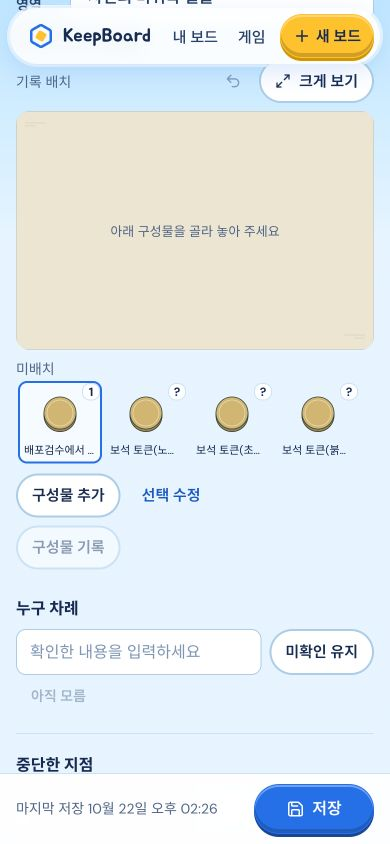

# 공통 사진 인식 production 반영

VERIFIED · **https://keepboard-kappa.vercel.app** · READY

- 배포 `dpl_8QgCsS8tX5D9L3n5NRuFvzvJuFJQ`, 2026-10-22 14:24:40 KST.
- 고정 URL https://keepboard-61ht5p7z2-renggyus-projects.vercel.app
- Backend4319 **PID70743 / output session7621**, 동일 Store `/tmp/keepboard-preview/data`.
- proxy64200 / tunnel64203 / gateway18287 유지. configured=true / gateway / deepseek-flash / deepseek / high 불변.

동결 source109개(소스106+주요 dist3) 대조 불일치0. 테스트276/type/build0 기존 증거를 재사용해 반복하지 않았다. clean prebuilt stage674파일만 업로드, source/docs/PDF/zip/env/Store 제외. deploy/inspect exit0. 공개 HTML/JS/CSS·art manifest·board mapping·web manifest6개200/정확SHA 일치. local/public health200, catalog120 = assisted118/native2. [정적/API](public-assets.json) · [배포/해시](verification.json)

| 산출물 | SHA256 |
|---|---|
| index.html | 525567d3f466845a1feac78b7e53babd60545a95474d2bfcdbb63652f8a9ed96 |
| index-BBR7mnzn.js | 9a227d6c541828daac7834c790b6e4c1eb215e1c9c3bed7dbe5ad5c07464262b |
| index-CtKEVc8C.css | 05358a7b7e490fce2a9f9f2f273785538a7d6a303c6773d7a14096efa4fe29ad |

## 공개 실제 검수

새 합성 세션 `6fe2427b-6aa5-4051-9887-55524dbf736a` — `[배포검수] 공통 사진 인식 · 합성 그림` 하나만 생성했다. 기존 사용자 보드/사진은 열지 않았다.

CUA390 실제 클릭: 이미 업로드된 합성 PNG의 **사진 읽기**→실제 DeepSeek 응답의 market3개+미귀속 tray4개 후보 표시→파랑 표식 수량·표시 수동 정정→각 영역 **이 후보 적용**→상단저장→reload→정정값 확인. API로 같은 합성 기록만 대조해 accepted2영역/7실물, snapshot1, candidate0, 원본 보존을 확인했다. 모바일 overflow0/broken0, viewport reset. [합성 검증](synthetic.json)

실AI 이번1회, 앞선 로컬 합성1회와 **총2회 한도 소진**, retry0. CUA 클릭부터 후보가 보였다고 확인한 관측 간격8.31초이며 모델 순수시간 측정은 아니다. 합성 도식이라 모델은 일부 숫자/수량을 모름으로 남겼고 대표 그림은 물리적 정체·색의 보증이 아니다. 전게임 실사진 정확도/실폰·카메라 성공을 주장하지 않는다. [호출 ledger](live-ledger.json)

## 데이터와 운영

교체 전 opaque 전체 백업 `/private/tmp/keepboard-integrated-backup-pep0uegi`(0700, 해시 파일명/로컬 restore index0600). 이전 backend49131의 command/cwd/PORT/data-root를 대조하고 그 listener만 SIGTERM 후 같은 Store로 기동했다. 기존 **59파일 모두 바이트 동일**, 변경/누락0. 추가2파일은 위 합성 session1 + 합성 PNG1로 분류했다. PIN/settings/routing 포함 기존 자료를 수정하지 않았다. [보존](preservation.json)

장기 운영은 기존처럼 Mac backend/proxy/tunnel/gateway 실행과 `/tmp` Store 보존이 필요하다. 문제 시 현재 Store를 유지한 채 검증된 이전 source/backend 및 이전 Vercel 배포로 복귀하며, 새 사용자 쓰기를 덮는 일괄 데이터 복원은 하지 않는다. 설정/모델/alias는 변경하지 않았다. 소스·산출물 동결, 소유권 반환.
