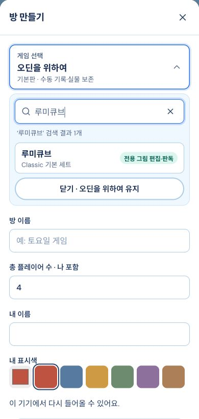

# 통합 KeepBoard production 배포

**VERIFIED · https://keepboard-kappa.vercel.app · READY.** 방 기능+119 수동 기록판+F001–F020 교정+9a45d40 테마의 frozen frontend/backend를 함께 반영했다. 새 합성 preview가 아니다.

- Deployment: `dpl_5tvBrcy2UigCpmMU4obnEUvk8Nqs`
- 고정 URL: https://keepboard-q2s9nsa0k-renggyus-projects.vercel.app
- 생성시각: **2026-10-22 12:05:07 KST**. deploy/inspect exit 0, production READY ([deploy.log](deploy.log), [inspect.log](inspect.log)).
- Backend4319: **PID43978**, 장기 output session **50867**. Store **`/tmp/keepboard-preview/data`** 그대로.
- 실행: `KEEPBOARD_DATA_DIR=/tmp/keepboard-preview/data PORT=4319 NODE_ENV=production npm run start`, cwd 본 프로젝트.
- Proxy4320 **64200**, tunnel **64203**, AIgateway4330 **18287** 유지. 다른 preview도 유지했다.

## 배포/보존

동결 source154파일과 최종 dist SHA를 배포 전에 다시 비교했다([frozen-check.json](frozen-check.json)). 259/259·type/build exit0 기존 근거를 재사용하고 소스 변경/불필요한 전체검사·빌드 반복은 하지 않았다.

검증 dist만 별도 clean stage에 복사했다([stage.json](stage.json), [static-manifest.json](static-manifest.json)). **674파일**, zip/PDF/src/server/docs/.env/Store/키 제외. 기존 프로젝트 ID/인증과 `/api`·`/uploads` → `https://mba-estate-aid-gordon.trycloudflare.com` 경로만 재사용했다. 새 계정/설치/git 작업 없음.

기존 실제 PID/cwd와 환경 중 data-dir/port/NODE_ENV만 whitelist 확인 후 backend **14239만 정상 종료**, 동일 Store로 최신 source를 기동했다. 기존 routing/key/모델 설정은 변경하지 않았다. 작업 전 opaque 전체 백업을 **`/private/tmp/keepboard-integrated-backup-xfypmza7`**에 만들었다(parent0700, hash 파일명·로컬 restore index0600). 내용·원래 파일명/PIN/키를 출력·업로드하지 않았다.

전환 직후 기존 **48/48파일 바이트 동일**. 합성 검수 후에는 **47파일 바이트 동일 + PIN 인덱스1 의도된 추가**다. 인덱스의 모든 기존 PIN record가 백업과 deep-equal이고 새 항목은 이번 합성방1개뿐이다. 기존 PIN 변경/누락0. 새 파일3개는 합성방2개와 합성1px upload1개다. 기존48파일 모두 바이트 불변이라고 주장하지 않는다. AI routing/settings는 바이트 불변이다([preservation-final.json](preservation-final.json)).

**복구 원칙:** API 문제 시 public 변경/새 쓰기를 중단하고 같은 Store의 검증된 source로4319만 재기동한다. 이전 production static `dpl_HHjRVEvu8cGyTYRoZqZrZfPGxj6e`와 그 clean stage는 보존돼 정적 rollback이 가능하다. 백업은 최후의 자료 보존용이며 이후 사용자 쓰기를 덮어쓰는 일괄 데이터 복원은 하지 않는다. 이전 backend의 메모리 내 로드 버전을 별도 재현해 둔 것은 아니므로 완전한 과거 binary rollback 검증이라고 주장하지 않는다.

## 공개 검증

**HTTPS 독립 cookie jar H/member/outsider 3개, 61검사 PASS** ([public-room.json](public-room.json), [실행 스크립트](verify-public.py)).

- Vercel rewrite 경유 `kb_device`: public host-only·Secure·HttpOnly·SameSite=Lax, 독립 신원3개. 같은 쿠키 재입장/좌석 유지.
- 방 생성/idempotency·링크 preview/재입장·코드 참가·중복색409·정원409·본인 이름/색 수정.
- member public PATCH403, host 타인 private PATCH403, outsider GET403. 타인 내용/내부 membership/invite는 세션 응답에 없음.
- 공용과 개인의 숫자 **1/7/13 각 실물 타일**·개인 메모 저장/commit/reopen 보존. host에는 member rack/메모가 안 보임.
- 본인 PIN 설정→잠김→오답거절→정답열기→잠금, 현재PIN 없이 해제403, host/다른cookie의 PIN·토큰·원본 사진 우회403.
- 1px 합성 PNG를 실제 앱의 **dataURL JSON** 경로로 업로드하고 HTTPS 원본200/PNG bytes·MIME를 확인. 타인/outsider 원본403. 합성 evidence는 DELETE로 현재 기록에서 제외했다. 물리 upload 원본은 기존 불변 정책대로 남을 수 있다.

사진 API는 **multipart 미지원**이다. 첫 하네스가 거절을409로 단정해 중단됐으며 첫 방과 실패기록을 남겼다([public-room-first.json](public-room-first.json)). 이후 하네스만 비지원 요청의 거절 상태를 구분하도록 바꾸고 61검사를 완료했다. 제품을 수정하거나 multipart 성공으로 주장하지 않는다. 두 합성방 외 기존 사용자 세션/사진/후보는 조회·수정하지 않았다. 실AI/사진판독0회.

검수방(초대·쿠키·PIN·token은 기록하지 않음):

1. `21d9f04c-cb2d-4cbc-954c-8f4e372f958a` — 첫 하네스 중단, 공용/개인 save까지 확인.
2. `019d1ec3-afd5-45b4-80a6-e0f14650dc8e` — `[배포검수] 방·개인받침대·저장 2026-10-22`, 61검사 완료.

## 정적/API·실제 화면

최종 public HTML·JS·CSS 및 cartoon4장/manifest/아트 index·boards mapping/18게임 교정 mapping·최종 소유색 건물/다리·Tokyo extra-green6면 등 **38개 응답200·SHA exact match** ([asset-verification.json](asset-verification.json)). deep URL도 index hash 일치, TLS 인증서 검증 유지.

| 산출물 | SHA256 |
|---|---|
| `index-B_n9th97.js` | `64351d773612a3aeacc8e2052147b9efd911e0ce99571a1d9dabd648c96fb6a8` |
| `index-CsGPTF4d.css` | `0bd60563bb49952ba229fb37dd5b945e9d45050dc1804283983befb31b39c177` |
| `index.html` | `5fc7704b88980a0a19ffff77596f2c8887f3dce257581c03468435ffb60c825b` |

local/public health200·catalog120, `configured=true/provider=gateway/model=deepseek-flash/upstreamProvider=deepseek/reasoningEffort=high` 전후 동일. 설정 확인은 AI 정확도 검증이 아니다.

CUA Chrome3가 다시 연결돼 **공개 실제 앱 390×844**에서 새 방 패널→게임 선택→루미큐브 검색1개→선택을 클릭했다. 패널/page overflow0, 깨진 이미지0, viewport reset 완료. 기존 사용자 목록은 캡처하지 않고 dialog 영역만 저장했다. 새 방을 실제 브라우저로 제출하지 않았으며 방·저장·PIN은 위 독립 HTTPS API 검증과 구분한다.

## 한계·유지 조건

119 기록판은 실물 수동 기록 표면이며 상용 인쇄판/전게임 규칙/120자동인식 완료가 아니다. F018/F020 최종 owner-building 및 Tokyo extra-green 전체6면은 공개 파일 SHA/정적 회귀까지 확인했고 최종 실제 DOM 비교는 여전히 미확인이다. 기존 관련 contact PNG는 최종 owner-building 수정 전 자료다. 실폰 손가락/키보드·실카메라·AI 판독 정확도는 검증하지 않았다.

**Mac backend4319/proxy4320/tunnel64203 및 AI 사용 시 gateway4330이 계속 실행돼야 한다.** Vercel은 정적 호스팅이고 Mac 절전/재부팅·quick tunnel 종료 시 API가 끊긴다. `/tmp` Store의 OS 정리 위험도 기존대로다. 이번에 영구 서버/스토리지 이전·운영 모델 변경은 하지 않았다. 동결 제품 소유권 반환.
