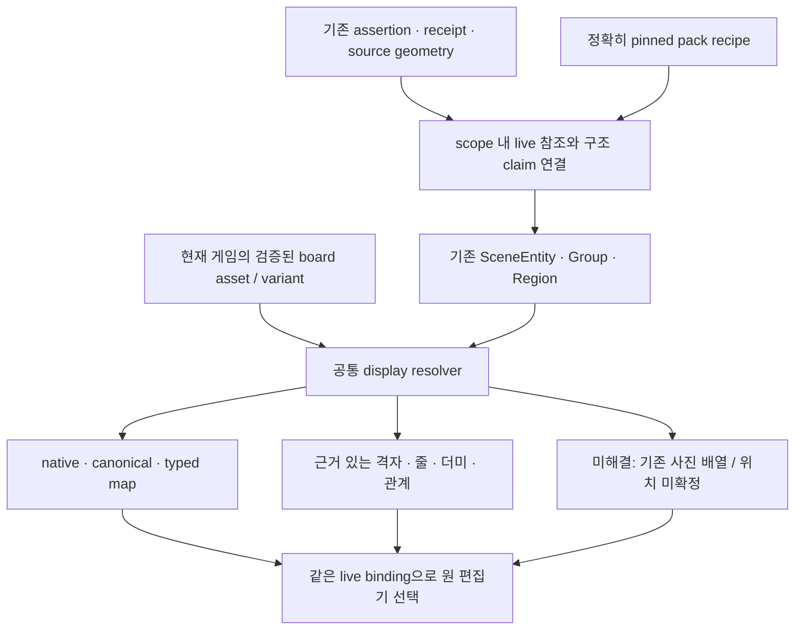

# 구현 설계: 저장 근거를 먼저 소비하고, 부족한 구조만 보완

이 문서 전체는 **RECOMMENDATION**이다. 현재 동작 확인은 [evidence.md](evidence.md)에 분리했다. 새 프로바이더·새 게임 목록·새 평가 체계를 제안하지 않는다. 기존 구조와 표시기를 연결하는 작업이 우선이다.

## 목표와 완료 경계

복원판은 물체를 읽기 쉬운 크기로 보여 주면서, 저장된 칸·지도·관계가 있으면 그 근거를 우선 사용해야 한다. 역할/소속/칸이 없으면 사진 배열과 미확정을 유지한다. 같은 데이터에서 단지 viewport 폭 때문에 물리적 묶음이나 순서가 달라져서는 안 된다.

완료를 두 단계로 나눈다.

1. **기존 데이터만으로 가능한 연결 복구:** canonical/manual/typed 위치를 사용하고, 검증된 관계를 연결하며, 나머지 관측을 기존 사진 배치로 표시한다. 새로운 판독은 0회다.
2. **역할별 구조 표시:** 정확한 팩 의미와 실제 관측 관계가 갖춰진 영역을 격자·가변 줄·더미·지도로 표시한다. 없는 역할/칸/인접을 채우는 일은 후속의 제한된 판독 또는 사용자 정정이다. 1단계의 사진 줄 표시를 의미 복원 완료라고 부르지 않는다.

## 재사용할 경계

| 기존 자산/함수 | 재사용 목적 | 연결할 지점 |
|---|---|---|
| `projectGenericDrawing`, `spatialView/publicSpatialView` | exact frame/slot 검증, manual→canonical→photo 우선순위 | 검증된 board context를 받는 공통 display resolver |
| `loadRealAssets/useRealAssets` | 현재 게임의 board/variant/symbols 로딩, `verifySpatialAsset=true` SHA 산출 | `RestorationSceneView`의 표시 준비. pure shared 함수 안에서 fetch하지 않음 |
| `GameBoardRecord`의 canonical/소유 미정 판 body | 저장된 칸·덮은 칸·회전 표시 | 적합한 위치를 가진 subset에만 adapter로 사용 |
| `carcassonneLayout` + `CarcassonneLayoutPreview` | 기존 typed gridX/Y·부착 지도 | 좌표를 이미 가진 record capability로 선택 |
| `RummikubBoard`, Catan native 진입 | 기존 게임의 native 표현·편집 연결 | 현재 native dispatch 유지 |
| `layoutDrawingItems`, `photoLayoutEvidence`, `PhotoLayoutBoard` | bbox 출처·비율·방향을 이용한 읽기 쉬운 사진 줄 | 상위 위치/관계가 해결하지 못한 같은 source 영역에 적용 |
| `collectVisibleRelations`, `partialStructureOrder` | spatial relation 참조와 부분 순서 처리 | scene-reading과 spatial의 공통 qualified 참조 adapter |
| `EstimatedGroupBody` 및 기존 3종 추정기 | 이미 검증 범위가 있는 창문/원정/도시 표시 | 잔여 그룹의 명시적 estimated adapter로 유지 |
| `SceneEntity/Group/Region/Claim`, `reconcileSceneSelections` | 원 binding, 근거 수준, 수동 정정·보관 연결 보존 | 새 schema를 통째로 만들지 않고 현재 모델에 연결 |
| `board.json`의 areas/tableModel/tableZones/numericTracks, spatial 정의 | 실제 칸·줄 용량·더미 단위·네트워크 의미 | profile 생성 시 source pin을 가진 작은 실행 계약으로 정규화 |

`PhotoLayoutBoard` callback은 현재 bare `pieceId`를 받는다. 서로 다른 assertion의 물체를 함께 그리는 scene adapter에는 `(assertionId,pieceId)` 또는 `entityId→LivePieceRef` mapping이 필요하다. 원 저장 ID를 바꾸어 중복을 피하지 않는다. `photoFallbackReference`의 canonical 제외 집합도 같은 qualified key를 사용하도록 scene 경계를 맞춘다. 기존 단일 assertion native 호출의 동작은 그대로 유지할 수 있다.

## 최소 구조: 의미와 화면 배치를 분리



현재 `SceneGroup.family`는 요청된 표현 유형이지, 이미 확보된 위치의 증거가 아니다. `SceneGroup.presentation`에 없는 정보를 family 이름에서 채우지 않는다. 순수 함수 `resolveSceneDisplay`(가칭)가 각 영역의 **사용 가능한 근거**를 조사하고 실제 adapter를 선택하도록 한다.

아래는 구현 경계를 설명하는 최소 입출력이며 확정 API 이름은 아니다.

```ts
type DisplayInput = {
  scene: ScenePartitionState;
  assertions: readonly Assertion[];
  evidence: readonly Evidence[];
  pack: GamePack;
  // 현재 게임과 필요한 variant만. 네트워크/파일 읽기는 호출자 담당.
  boardContexts: readonly VerifiedBoardContext[];
};

type GroupDisplay = {
  groupId: string;
  members: readonly {entityId: string; ref: LivePieceRef}[];
  parts: readonly DisplayPart[]; // 한 그룹 안에서도 canonical / 잔여 사진 분리 가능
  size: {width: number; height: number};
  unresolved: readonly {entityId: string; reason: string}[];
};

// DisplayPart는 기존 함수의 결과/참조를 담는다.
// native-record | canonical-board | typed-map | relation-layout
// | estimated-structure | photo-rows | unlocated
```

새 `DisplayPart`는 물체를 새로 만들거나 원값/placement를 수정하지 않는다. 외부에 새 게임 상태로 저장할 필요도 없다. 저장된 scene의 `presentation`/`plan`은 파생 힌트로 취급하고, 현재 근거로 만든 render plan이 오래된 힌트를 우선할 수 있게 한다. role·boardMembership·manual frame·명시적 group 편집은 semantic claim으로 보존한다.

### asset을 어디서 전달할지

첫 구현에서는 UI가 이미 사용하는 `loadRealAssets`를 해당 variant와 `verifySpatialAsset=true`로 호출하고, 얻은 board를 pure display resolver에 전달하는 방법을 권한다. 현재 `useRealAssets(gameId)` 기본 호출은 SHA 검증을 켜지 않으므로 그 객체를 그대로 넘기는 것만으로 canonical 연결이 완료되지 않는다.

`projectRestorationScene`에 선택적 `boardContexts`를 받게 하더라도 함수 안에서 fetch/전역 catalog import를 하지 않는다. 서버가 아직 asset context를 제공하지 않는 경우 **근거 대기**를 반환하고, 해당 위치를 “존재하지 않음”이나 새로운 사진 추정 위치로 확정하지 않는다. UI에 필요한 asset이 도착하면 파생 display만 재계산한다. 관측 값, 권한 scope, semanticRevision을 asset 로딩만으로 PATCH하지 않는다. 이후 서버 측 동일 display 결과가 필요할 때 같은 pure resolver에 검증된 context를 공급하면 된다.

`__photo.public`의 resolved field와 관측 board instance는 `publicSpatialView`의 기존 계약을 사용한다. 실제 사람 소유를 만들어 field를 옮기지 않는다. `GameBoardRecord`의 소유 미정 판 표시를 재사용할 때도 선택은 원 `LivePieceRef`로 돌아가야 한다.

### adapter 우선순위

단순히 가장 구체적인 모양을 고르지 않고, 같은 실물에 대해 아래 순서로 근거를 선택한다. 호환되지 않는 두 명시 근거가 경쟁하면 하나를 추정으로 덮지 않는다.

| 순위 | 필요 입력 | 출력/처리 |
|---:|---|---|
| 1 | 기존 native record 또는 사용자가 명시한 위치/좌표/정정 | 기존 native/typed/canonical renderer와 정확한 binding. 기존 coordinate frame 규칙 유지 |
| 2 | 현재 asset SHA·frame·variant·slot·scope 검증을 통과한 canonical spatial | `space:'board'` 위치·covered slots·rotation. 근접 bbox 추정을 건너뜀 |
| 3 | 유효한 region membership, frame, physical relation/partial order | 관계로 정당화된 그룹/순서. 판이 없어도 display-region 가능 |
| 4 | 기존 3종 추정기 등 명시된 추정 adapter가 지원하는 입력 | `estimated` 표기와 기존 정정 경로. 상위 위치는 빼고 잔여만 처리 |
| 5 | 같은 source의 usable bbox/비율, 의미 미확정 | `layoutDrawingItems`의 사진 줄·간격. 실제 칸/소유/합법 묶음으로 저장하지 않음 |
| 6 | 위치 근거가 없음/유효하지 않음 | 고정 크기 미확정 목록. 사라지거나 원점에 겹치지 않음 |

각 adapter가 `consumedEntityIds`와 unresolved 이유를 반환하고, 마지막 단계에서 모든 live binding이 정확히 한 번 표시되는지 조합한다. 단일 관측 group은 quantity가 모른다고 여러 개로 펼치지 않는다. attachments는 기존 forest를 재사용하되 부모 아래 들어간 child를 다른 행에서 다시 표시하지 않는다.

`estimateBoardStructure`의 manual/canonical/group 유지 처리는 게임 지원 목록 확인 **앞**으로 옮겨야 한다. 지원하지 않는 게임이라는 이유로 이미 유효한 위치를 photo fallback으로 보내면 안 된다. 또는 이 분리를 공통 resolver가 담당하고 추정기는 잔여만 받게 해도 된다. 두 곳에 경쟁 우선순위 로직을 복제하지 않는 것이 완료 조건이다.

## 요청 범위·관측 역할·표시 묶음을 구분

`request.areaId`는 사용자가 선택한 판독 범위다. old response의 모든 물체가 실제로 그 역할이라는 보장은 없다. 다음 정책으로 한 번 분리한다.

- `SceneEntity.observedRole`에는 해당 관측의 `sourceAreaId` 또는 검증된 scene region의 역할만 참조한다.
- 기존 요청 영역/저장 field는 recipe 후보를 좁히는 **context**로 쓴다. UI 제목에 범위를 설명할 수 있지만 observation claim으로 승격하지 않는다.
- 명시적 수동 `set-role`은 기존 claim 우선순위로 유지한다.
- roleCandidates가 복수면 후보/미확정을 유지한다. 서로 다른 역할로 분리할 근거가 없으면 사진 표시를 먼저 제공한다.
- 사진 줄이나 bbox 연결 성분은 display subgroup이다. 사용자가 명시적으로 확인하기 전 `boardMembership`, owner, canonical slot, 보관해야 할 물리 더미를 생성하지 않는다.

이 변경은 기존 request/receipt/field를 재작성하는 migration이 아니다. 파생 role을 다시 산출하고 수동 정정만 reconcile한다. 기존 자료의 단일 역할을 해제한다고 새 역할을 자동 채워 넣는 것도 아니다.

## 관계를 scope 전체에서 연결하고 소비

현재 같은 receipt가 여러 assertion에 저장될 수 있다. 처리 단위는 assertion 반복문이 아니라 **현재 scope의 unique receipt + live entity index**다.

1. accepted/live assertions와 이미 검증된 `ObservationRef`에서 `(scopeKey, taskId, observationRef, evidenceId, sourceSHA, captureEpoch, definitionSHA)` index를 만든다. 기존 entity의 다중 binding은 한 entity로 수렴시킨다.
2. 같은 receipt는 한 번 처리한다. 참조가 현재 scope에서 유일한 live entity에 연결될 때만 region member/board/relation으로 사용한다. 삭제된 receipt-only observation은 되살리지 않는다. 여러 후보면 unresolved다.
3. `scene.regions`는 boardRef가 null이어도 유효하다. 하나비/도미니언/지도에 가짜 physical board를 만들지 않는다. observed board는 실제 literal/spatial/native/manual 근거가 있는 entity만 쓴다.
4. `precedes`, spatial `before`, 기존 manual `beforeRefs`를 source가 있는 부분 순서 edge로 정규화한다. [partialStructureOrder](../../shared/structureRelations.ts)는 기존 구현을 재사용한다. scene group의 `physicalOrder` 또는 공통 relation adapter에 한 번만 보관하고 실제 `displayEntityOrder/orderLevels` 생성에 연결한다.
5. 순서 cycle/충돌은 `orderUnresolved` 및 `unsatisfiedRelationIds`로 남긴다. 안정적인 화면 tie-break는 가능하지만 그것을 물리적 앞뒤 순서로 저장하지 않는다. 서로 다른 semantic group 사이의 순서라는 이유만으로 group을 합치지 않는다.
6. `attached-to`는 현재 forest와 binding 검증을 유지한다. `overlaps`는 겹침, `tucked-under`는 보이는 끼움 관계로만 사용한다. 겹침의 전이 연결 성분 전체를 한 실제 더미나 한 소유자의 물체로 확정하지 않는다.

기존 spatial의 `same-visible-stack/adjacent-to`는 `SceneReadingResultV1`의 관계 enum에 없다. 지원되는 spatial 관계를 adapter로 먼저 사용한다. `same-visible-stack`은 근거 있는 membership 후보로 다루고, 무방향 `adjacent-to`만으로 타일의 동/서/남/북 좌표를 만들지 않는다. 새 구조 계약이 필요하다면 아래 후속 조건에서만 확장한다.

## 팩 의미를 작은 실행 계약으로 정규화

보드 SVG의 x/y 배열만으로 규칙 구조를 추론하는 것을 중단해야 한다. 기존 `Family`, `RegionRecipe`, `SourcePointer`, profile pin을 유지하고 topology에 필요한 의미만 추가한다. 예시:

```ts
// topology의 선택적 확장 예시. 현재 v1 전체 교체가 아님.
kind?: 'canonical-grid' | 'ordered-track' | 'variable-lanes'
     | 'pile-collection' | 'tile-network' | 'free-area';
unit?: 'piece' | 'physical-group' | 'observed-pile';
rowCapacities?: number[];
// 기존 slotIds/networkRef/spatialDefinitionSHA/assetStructure/sources 재사용
```

`canonical-grid`는 정확한 spatial address/frame 계약이 있을 때만 해당한다. 렌더러는 `rows/columns`가 있다는 이유로 관측 물체를 채우지 않는다. 표시용 슬롯은 layout template로 사용할 수 있지만 occupancy·실제 칸 주소를 부여하지 않는다. `ordered-track`의 순서는 좌표 정렬이 아니라 기존 slot/track의 명시된 인덱스를 따른다. capacity는 빈 구조 표현과 검증에 쓰고, 안 읽힌 실물을 생성하는 수가 아니다.

먼저 같은 구조를 드러내는 현재 네 게임만 기존 자료에서 정규화한다. 전120종 수작업 source를 새로 만드는 마일스톤은 필요 없다.

| 게임/역할 | 재사용할 팩 의미 | 선택 가능한 표시 | 부족할 때 |
|---|---|---|---|
| 하나비 fireworks/discard | 영역 의미와 관측된 색상·region/겹침·부분 순서. art 5×5는 표시용이라는 구분 | 관측된 각 더미/줄을 upright card로 표시. 보이는 card별 순서만 적용 | 역할/더미 membership 없으면 사진 배열. 값 크기로 순서를 정렬하거나 unseen 카드를 채우지 않음 |
| 아줄 pattern/wall/floor/offer | tableModel/tableZones에서 pattern 용량1..5, wall5×5, floor7, 관측 factory 인스턴스 | 검증된 board frame/주소가 있으면 기존 board renderer. pattern은 가변 줄 adapter | board/role/frame 미확정이면 타일·판을 별도 관측으로 유지. 공장 표시용2×2를 정식 찍힌 칸으로 주장하지 않음 |
| 카르카손 map/track | landscape의 unbounded square edges, 점수트랙의 명시 순서, 기존 typed readout | 기존 typed 좌표가 있으면 map preview. 점수 말은 해당 track 위치 근거로 표시 | 개별 타일/방향 인접이 없으면 사진 지도 위치와 미확정 목록. 모든 tile를 grid에 강제 snap하지 않음 |
| 도미니언 supply/play/discard | tableModel의 slot=더미, basic/kingdom 영역과 tableZones | 검증된 region/stack membership으로 더미별 대표와 펼침. 개별 관측은 원 ID로 선택 | supply 요청만으로 모든 cards를 공급 더미화하지 않음. group은 그대로 한 관측, 숨은 장수 모름 |

source가 충분한 구조는 compiler의 공통 schema adapter로 읽고, 코드가 해석할 수 없는 의미만 기존 `restoration-profiles/source` 형식의 작은 semantic 입력으로 보충한다. 게임별 사진 bbox 임계값·ID 배열·좌표를 source에 넣지 않는다. compiler/profile 버전·SHA를 갱신하고 정확한 pack pin을 유지한다.

## 화면 조합과 가독성

- `EstimatedGroupBody`는 이미 cell/slot이 계산된 경우 계속 사용한다. 새 family 렌더러는 enum 이름만 검사하지 않고 위 capability 결과를 받는다.
- 사진 fallback은 의미/board group과 같은 source 안에서 실행한다. assertion이 다르다는 이유만으로 검증된 동일 region이 끊기지 않도록 `contextKey`를 source-qualified group으로 부여하되, scope·capture·서로 다른 사진은 섞지 않는다.
- 사진 card 크기는 기존 `PhotoLayoutBoard`의 card/tile 옵션과 글자 표시를 재사용한다. 개수를 줄이거나 전체 캔버스를 축소해서 한 화면에 맞추지 않는다. 행 내부 팬·원사진 위치·선택 복귀를 유지한다.
- 각 adapter가 실제 `size`를 반환한다. generic 기본폭 `entityCount×112+40`를 사진 여러 줄에도 그대로 적용하지 않는다. `sceneLayout`은 이 크기와 근거 있는 region 관계를 사용한다.
- 관계가 없는 영역을 보기 좋게 pack하는 것은 display 결정이다. 화면 위/아래가 좌석·사람·차례 관계라는 의미를 갖지 않는다. 순서/neighbor claim은 별도 유지한다.
- 상위 canonical/map 부분과 잔여 photo 부분이 섞인 경우 각 part가 한 번만 표시되어야 한다. 사용자가 팬한 위치/선택을 값 편집·asset 로딩·재열기로 임의 초기화하지 않는다.

## 파생 캐시와 저장·재개

두 종류의 변경을 분리한다.

| 변화 | 포함할 fingerprint/처리 |
|---|---|
| semantic 입력 변경 | 현재 사용한 live values/bindings, observation role/physicalUnit/geometry 참조, 검증된 scene/spatial 구조, source transform/epoch, exact profile pin, projector version |
| display 입력 변경 | 위 semantic revision + 선택된 assetSHA/frame/variant + display adapter version + 표시를 바꾸는 수동 claim |
| viewport·팬·선택·hover | 위 semantic digest에서 제외. 기존 UI 상태 보존 |

큰 native/provider 원문 전체를 digest에 넣을 필요는 없다. **실제로 소비하는 구조와 출처**만 정규화해 fingerprint를 만든다. 현재 `result.scene`만 달라져도 새 groups/relations/plan이 생성되어야 하고, 알고리즘 버전 변경도 이전 파생 plan을 재사용하면 안 된다.

기존 저장 scene이 있어도 source/algorithm이 바뀌면 자동 파생 부분을 재계산하고 `reconcileSceneSelections`를 적용한다. 수동 split/merge·역할·판 소속·frame·보관 연결을 현재 live entity에 재연결한다. 참조가 없거나 여러 후보면 원 정정을 삭제하지 말고 적용 불가 이유를 남긴다. receipt/value/owner/canonical 원값은 migration 대상으로 삼지 않는다. 첫 구현은 기존 snapshots가 보유한 원 assertion과 receipt를 그대로 이용할 수 있다.

## 검토한 대안

| 대안 | 얻는 것 | 한계/선택 |
|---|---|---|
| CSS wrap만 추가 | 긴 한 줄 완화 | 역할/물리 순서/지도/칸을 복원하지 않으며 폭 계산도 남음. 최종 해법으로 선택하지 않음 |
| 전체를 옛 field별 GameBoardRecord로 되돌림 | 기존 위치/사진 표시를 빨리 노출 | 공개 scope를 field별로 다시 분절하고 cross-field 관계를 잃음. 필요한 body만 재사용 |
| 기존 사진 배치기를 모든 관측에 적용 | 무료로 bbox 활용, 줄 가독성 개선 | 사그라다 canonical과 기존 원정/도시 구조를 퇴행시킴. 잔여 fallback으로만 선택 |
| profile family를 곧바로 grid/track으로 렌더 | 구현 분기 단순 | 하나비 표시 격자·아줄 첫 행·도미니언 단위 오류. 의미 계약 정규화 후 선택 |
| 구조/칸 판독을 모든 게임에서 다시 호출 | 일부 누락 관계를 얻을 가능성 | 소비 단절은 그대로이며 칸 없는 구조도 많음. 우선 작업이 아님 |
| 게임마다 새 전용 renderer 제작 | 예시 사진을 빠르게 맞출 수 있음 | 기존 native/map/board/rows와 중복. 공통 topology/adapter 경계로 재사용 |
| 전체 사진을 그대로 배경에 두고 bbox만 표시 | 원사진의 상대 위치 보존 | 작은 물체 가독성과 실제 역할 설명이 부족. 원사진 확인 경로로 유지 |

## 후속 사진·판독이 필요한 조건

현재 task에서는 아래 호출을 수행하지 않는다. 소비 경로를 수정한 뒤 남는 정보만 확인한다. 기본 강도·전체 구조 모드·reader 교체·반복 자동 호출을 전제로 하지 않는다. 기존 요청/응답은 보존하고 새 시도는 별도 근거로 기록한다.

| 남은 질문 | 먼저 필요한 정보 | 가장 작은 후속 조건 | 완료/유보 기준 |
|---|---|---|---|
| 하나비의 fireworks/버림/보이는 손패 경계 | source area, board 없는 region membership, 보이는 overlap/order | 기존 사진 한 장에서 필요한 공개 범위의 structure를 명시적으로 1회 요청. private/owner 범위는 기존 권한 유지 | 멤버·역할·관계가 live IDs로 연결돼 실제 UI에 반영되는지. 불명확한 역할·사람 소유는 유보 |
| 아줄 벽/패턴/바닥 및 놓인 타일 | 올바른 area, 판 frame/방향, printed cell 주소와 인쇄칸/물체 구분 | 기존 사진의 해당 판 영역으로 요청 범위를 맞춘 1회. 해상도/가림 때문에 구분 불가한 경우에만 같은 판 근접사진 한 장 | 실제 frame/slot 검증을 통과한 것만 canonical. 빈 칸을 타일로 만들거나 추정으로 주소 채우지 않음 |
| 카르카손 지도 연결 | 개별 보이는 tile 단위, 방향 있는 edge 접촉 또는 tile-local 좌표, rotation, follower 부착 | 먼저 기존 typed 좌표/합성 relation으로 소비 경로 검증. 그 뒤 필요한 지도 부분 한 장/한 요청. 현 scene schema에 없는 방향 인접은 최소 versioned 계약부터 명시 | pair별 direction/rotation이 맞아야 lattice 후보. 무방향 adjacency나 bbox만 있으면 estimated picture 유지. 가린 타일 생성 금지 |
| 도미니언 더미 구분 | 보이는 pile 경계·region 역할·같은 visible stack, 대표 face | 기존 사진의 중앙 공개 더미 영역 1회 structure 요청. 숨은 장수는 요청 성공 기준에 넣지 않음 | 기존 single/group 관측과 pile membership을 구별. unknown face/quantity 유지, 실제 표시 소비 확인 |

한 번에 모든8종을 재판독할 필요는 없다. 먼저 구현한 구조 종류에 해당하는 한 사례만 확인하고, 서로 다른 미해결 원인이 있을 때 다음 사례로 간다. 새 모델 응답이 잘못되면 단순히 더 강한 호출을 반복하지 말고 요청 정보·가림·정의·소비 중 어디가 부족한지 같은 경계로 분류한다.

예상 효과는 **기존 데이터 가독성과 근거 보존**이다. 원자료가 제공하지 않는 실제 게임 구조의 완전성, 새 사진 일반화, 실기기 속도/정확도 향상을 이번 연구 결과만으로 보장하지 않는다.
