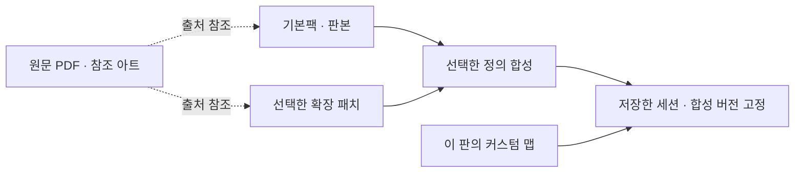

# 1천·5천·1만 종 비교와 확장·커스텀 맵

2026-10-21. 추가 요청을 기존 120종 선정 조사에 합친 설계다. **인기 기반 준비 카탈로그는 기본 게임 1,000종 규모를 권고한다. 실제 시험은 이미 고른 60종(24+36)부터 진행한다.** 현재 확보한 실목록은 120종이며, 1,000종을 확보하거나 지원 완료했다고 주장하지 않는다. 확장은 지원 방향에 포함하되 기본 게임 수에 더하지 않는다.

## 규모 판단

| 비교 | 기본 1,000종 — 권고 | 기본 5,000종 | 기본 10,000종 |
|---|---|---|---|
| 목적 | 주요 인기·국내 접근·긴 중단 가치의 폭넓은 준비 목록 | 다수 취향·구판까지 포함하는 장기 검색 목록 | 범용 보드게임 백과에 가까운 탐색 범위 |
| 실제 수요 근거 | 현재는 120종 조사, 그중 26종에 별도 인기 신호. 1,000종 전체 수요는 미검증 | 추가 4,000종의 수요·출처 가용성 미검증 | 추가 9,000종의 수요·출처 가용성 미검증 |
| 게임당 확장 2개를 준비한다고 가정 | 기본+패치 정의 3,000개 | 15,000개 | 30,000개 |
| 같은 확인 단위의 상대 작업량 | 1배 | 5배 | 10배 |
| 운영 제안 | 공통 템플릿으로 점진적으로 채움. 실제 요청은 순위 밖도 수용 | 검색용 이름/별칭부터 필요할 때 확대 | 전체 명세 선제 제작은 보류. 요청한 게임만 같은 경로로 추가 |

이 표의 배율은 개수 산술이고 인시 측정이 아니다. “BGG 1~1,000위”를 그대로 채우는 뜻도 아니다. 국내 가족/카페 선택, 온라인 이용, 장시간 전략·협력, 공식 자료 존재를 함께 본다. BGG 현재 수치를 얻지 못했으므로 상위 1,000종의 시장 커버율이나 5,000위 이후의 실제 인기 하락률은 **미확인**이다. 구판·테마·언어·확장 중복을 없애고 확인한 신호와 시점을 남긴다. 공식 카탈로그에 있는 것과 인기 증거가 있는 것은 별개다. 사용한 인기 출처는 [선정 보고서](README.md#인기-근거와-확인-수준)에 있다.

용량 때문에 1,000종으로 제한하는 것은 아니다. 아래 기본 가정이면 확장까지 포함한 구조화 명세는 1만 종도 약 800MB다. 더 큰 비용은 판본 식별, 공개 자료 확인, 사진 시험, 패치 조합 차이의 유지다. **1,000종을 준비 목표로 삼고, 선택된 60종부터 시험 상태를 올리며, 요청이 확인된 게임부터 나머지를 채우는 순서**가 현재 목표에 맞는다. 5,000·10,000종으로 늘리는 조건은 저장 공간 확보가 아니라 실제 미등록 요청과 재사용 가능한 명세가 쌓이는 것이다. 이를 위한 별도 지표 시스템을 만들 필요는 없다.

## 기본팩·확장패치·세션 맵의 경계



| 단위 | 담는 것 | 담지 않는 것 |
|---|---|---|
| `BaseGameSpec` | 기본 게임 ID, 판본/버전, `rules`, `components`, `features`, 출처 참조 | 확장마다 복사한 전체 기본 규칙, 개인 세션 사진 |
| `ExpansionPatch` | 부모 ID·대상 판본·선행 확장, 바뀌는 항목만 add/replace/disable, 선택 시나리오 참조 | 기본팩 전체 복제, 모든 확장 조합별 별도 게임 |
| `SessionMap` | 실제 칸의 좌표·ID, 지도 방향, 관측된 지형·부품의 연결, 사용자가 고친 지도 | 새 게임 등록, 숨은 지형 자동 확정, 규칙서의 표준판 강제 |
| `SessionState` | 공용판, 소유자별 보유, 차례/짧은 메모, 선택 팩/패치 버전과 해당 맵 | 원문 PDF/아트의 반복 사본, 미래 판본으로의 자동 변경 |
| `SourceAssetRef` | 원문/이미지 URL, 판본, 해당 쪽, 사용 조건, 선택적 파일 해시/캐시 경로 | JSON 안 base64 원문, 재배포 권리가 확인되지 않은 공용 이미지 묶음 |

`rules`는 읽은 규칙의 짧은 의미·출처·기록상 주의점을 담는다. `components`는 부품 종류·위치 형태·앞뒤·회전·소유·부착·필요 속성, `features`는 이 게임에서 켤 편집 기능·개인 영역·선택 수량을 담는다. 전체 행동 엔진을 만드는 계약이 아니다. 원문 문단이나 모든 카드 효과를 그대로 구조화 명세에 복사하지 않는다.

최소 필드는 다음이면 된다. 아직 제품 타입이 아닌 **제안 계약**이다.

```text
BaseGameSpec
  gameId, editionId, version
  rules[id]      = {summary, sourceRef, section, handling: reference|optional_hint}
  components[id] = {label, primitive, slotTypes, occupancyGroup?, attributes?, sourceRef?}
  features       = {mapType, enabledEditors[], privateAreas[], optionalFields[]}
  references[id] = {url, mediaKind, edition, usageNote, cachedAssetRef?}

ExpansionPatch
  patchId, version, baseGameId, compatibleEditionIds[], requiresPatchIds[]
  components/rules/features: {addById, replaceById, disableIds}
  replacesPatchIds?, scenarioRefs[], references

Session
  baseRef, selectedPatchRefs[], resolvedDefinitionHash
  map = {mapId, revision, orientation, cells:[{id,q,r}], legacyAliases?}
  publicScene, ownerScenes, optionalValues, note
```

위 합성 규칙의 핵심은 **배열 순서가 아닌 안정 ID**다. 기본→판본→의존 순서의 선택 패치→필요한 조합 차이만 적용한다. 같은 ID의 충돌은 작성 단계에서 해결하며, 일반 사용자에게 규칙 승인 질문을 늘리지 않는다. 비활성화된 부품 정의 때문에 기존 저장 구성물을 삭제하지 않는다. 저장한 세션과 스냅샷에는 사용 버전을 고정하고, 내용이 같은 기본팩·패치·미디어는 한 번만 보관한다. 확장 10개의 모든 부분집합에 대해 1,024개 복제 명세를 만드는 방식은 피한다.

원문 PDF는 참고 자료, 참조 아트는 표시/식별 보조 자산이다. 원문 링크만 있으면 앱이 매번 전체 PDF를 모델에 넣을 필요가 없다. 인식에는 현재 선택한 기본팩+패치의 관측용 부품/필드만 전달한다. 클라이언트도 선택한 게임 정의만 읽고, 1천·1만 종 전체를 프롬프트나 번들에 넣지 않는다.

## 카탄: 현재 고정 19칸에서 실제로 바뀌는 점

**직접 확인:** 현행 `catanPack`은 2.0.0, 57필드다. 지형은 19칸, 꼭짓점 54개, 변 72개다. 합성 입력에서 `r6c1`의 지형은 `location.id=null`, `kind=ship`는 `unknown`으로 정규화됐다. 해상 지형 `variant=sea` 문자열은 남았지만 새 부품 종류와 바깥 칸은 현재 계약에서 손실된다. [실측/합성 확인 JSON](measurements.json)

| 경우 | 기본판과 다른 관측 상태 | 필요한 확장 방향 |
|---|---|---|
| 기본판의 임의 타일 교환 | 같은 19칸, 지형/숫자/항구 위치만 변경 | 기본팩 유지, 세션의 부품 위치만 정정 |
| 5–6인, 2025판 | 기본 19+추가 11=30지형, 두 플레이어 추가, 28개 숫자 디스크로 기본 디스크 교체, paired-player 진행 | 30칸 맵 프로필·플레이어 목록·공급 정의 replace·선택 진행 메모. 구판의 Special Building Phase와 구분 |
| 항해사 Seafarers | 가변 크기 프레임·섬/바다, 배, 금 지형, 해적, 선택 시나리오 | 가변 육각/물·육지 구분, 새 부품 ID와 변 위 배, 해상 도둑류, 선택 시나리오/메모 |
| 도시와 기사 Cities & Knights | 기사 힘/활성 면, 도시 위 대도시, 상품 카드, 도시 발전, 야만인 진행 등 | 지도 확장과 별도로 부품 속성·부착·공용 트랙·개인 수량/진행 필드 추가 |
| 사용자 커스텀 섬/확장 조합 | 칸 수·외곽·바다·항구·부품 수가 표준과 다를 수 있음 | 선택 패치와 세션 맵을 함께 보존. 표준 수량/규칙으로 원본을 자동 수리하지 않음 |

5–6인의 변경은 [2025 공식 CN3082 규칙 p.1–4](https://www.catan.com/sites/default/files/2025-03/CN3082%20CATAN%20%E2%80%93%205-6%20Rulebook%202025%20reduced.pdf)에서 확인했다. 특히 p.1은 기본 숫자 디스크를 돌려놓고 확장 디스크를 쓰도록 하며, p.3은 paired-player 규칙이 구판 특수 건설 단계를 대체한다고 설명한다. **확장은 단순 append만으로 처리되지 않는다.**

[항해사 공식 소개](https://www.catan.com/seafarers)는 가변 프레임·사용자 배치, 배·금 지형·해적을 명시한다. 5–6인 항해사는 기본 게임, 항해사, 각각의 5–6인 상자가 필요하므로 패치 의존성도 있어야 한다. [도시와 기사 공식 소개](https://www.catan.com/cities-knights)는 기사 활성/힘, 상품, 도시 발전·대도시를 설명하고, [현행 유통사 제품](https://store.asmodee.com/products/catan%C2%AE-cities-knights-expansion)은 도시 발전판/큐브와 야만인 트랙 등의 구성물을 확인해 준다. 도시와 기사 PDF는 웹 도구의 크기 제한으로 본문을 열지 못했으므로 이번에 카드별 전체 규칙이나 확장 조합 전체 호환을 검증한 것은 아니다. 상품 상세의 시간 값도 서로 달라 확장 시간 평균으로 사용하지 않았다.

### 적용 위치 — 제품 수정은 하지 않음

| 현재 코드 | 확인한 고정점 | 최소 변경 명세 |
|---|---|---|
| [shared/scene.ts](../../../shared/scene.ts) | `BoardTopology.id`가 `catan-base-19` 리터럴. `buildTopology()`가 r=-2..2 생성. `resolveSlotId`, `slotPoint`, snap, normalization이 전역 topology 사용 | 세션/팩에서 `TopologyContext`를 전달. 기본 19칸 preset을 보존하고 명시적 `cells:[{id,q,r}]`를 받는 생성기로 확장 |
| 같은 파일의 `SCENE_KINDS`·`BOARD_SLOTS`·schema | 부품 enum/위치 적합성이 고정 | 기존 kind를 유지하면서 `componentTypeId`, 정의된 속성/배치층을 추가. 패치의 ship/knight 같은 ID와 데이터가 정규화에서 사라지지 않게 함 |
| 같은 파일 `coastalEdge`·`harborPoint` | 인접 hex 1개인 외곽 변만 해안으로 판단 | 명시적 바다칸을 넣으면 육지–바다 사이 변에는 hex 2개가 있음. 지형 분류와 바다를 향한 면을 사용. 모르는 지형은 해안 여부도 모름 |
| [shared/sceneBridge.ts](../../../shared/sceneBridge.ts), [server/ai/index.ts](../../../server/ai/index.ts), [server/ai/scenePrompt.ts](../../../server/ai/scenePrompt.ts) | 완전판 기준이 19, 프롬프트에 기본 지형/자원/개발 카드 고정 | 선택 정의/세션 맵의 실제 기대 칸 집합으로 판단. 맵도 미확인일 때 관측된 칸 수만으로 full 확정 금지 |
| [src/SceneEditor.tsx](../../../src/SceneEditor.tsx) | 슬롯·viewBox·6각 해상 프레임·배치 팔레트가 고정 | topology bounds로 화면 구성, 형상이 다른 섬에 기본 6각 프레임 강제 금지. 새 종류의 공통 아이콘·속성 편집 재사용 |
| [shared/catanPlacement.ts](../../../shared/catanPlacement.ts) | 도둑 1개·항구 9개 등 기본판 검사와 도로/건물 종류 고정 | 기본판 전용 힌트로 격리. 확장/커스텀 정정에 기본판 수량을 강제하지 않음. 이동·교환·undo는 동작 유지 |
| [gamepacks/catanProfile.ts](../../../gamepacks/catanProfile.ts), [src/Fields.tsx](../../../src/Fields.tsx), [shared/catanSummary.ts](../../../shared/catanSummary.ts), [src/CatanOverview.tsx](../../../src/CatanOverview.tsx) | 기본 자원/개발/남은 말 종류, 요약·교역 항구가 카탄 기본판에 결합 | 선택 패치의 개인 수량/공개 트랙만 추가. 보이지 않는 카드·지난 턴 이력은 요구하지 않음. 단순 보유 편집부터 지원하고 상품 교역의 자동 계산은 별도 범위로 표시 |
| [shared/types.ts](../../../shared/types.ts) `GamePack`, `Session`, `Snapshot` | 단일 팩/팩 버전은 있으나 패치 목록·세션 맵 계약 없음 | base/patch 버전 참조, 해시, 맵 revision을 세션과 스냅샷에 보존. 이전 저장본에는 기본 19칸을 암묵적으로 연결 |

**기하 ID 설계:** 육각은 axial `(q,r)` 목록을 저장하고, 꼭짓점은 정수 격자 좌표, 변은 정렬된 두 꼭짓점 ID로 생성하면 칸 추가로 기존 ID가 바뀌지 않는다. 현재 방식의 “읽기 순서에서 먼저 만나는 육각 이름”을 새 커스텀 맵 ID로 재사용하면 바깥 칸 추가 때 이름이 바뀔 수 있다. 기존 `r3c2.N` 등은 별칭 매핑으로 유지한다. 반경만 2→3으로 늘리면 37칸이므로, 공식 30칸과 동일하다고 할 수 없다. 실제 5–6인/시나리오 도형의 좌표 목록은 해당 판본 도식을 확인해 작성해야 한다. 이번에는 그 좌표 전체를 추출하지 않았다.

지형 종류·숫자·도로 같은 실제 관측 상태는 맵 좌표 정의와 분리한다. 항구는 변과 맞닿는 두 꼭짓점, 바다 쪽 방향을 연결한다. 도로/배는 같은 경로 점유 그룹, 항구는 별도 층, 대도시/성벽은 도시 부착으로 표현할 수 있다. 이는 **제안**이며 현재 구현이 아니다. 칸 삭제 시 놓인 부품도 지우지 말고 이전 위치를 보존한 미배치 상태로 두며 한 번에 undo한다.

## 용량: 실측과 가정 분리

아래는 **현재 로컬 정의만 직접 측정**했다. 파일 내용이나 개인 데이터를 외부로 보내지 않았고 PDF/아트를 새로 내려받아 평균을 만들지 않았다. JSON은 UTF-8, compact는 공백 제거, gzip은 레벨 9 비교값이다. gzip 크기가 현재 실제 전송 크기라는 의미는 아니다.

| 실측 대상 | 원 파일 bytes | compact JSON bytes | gzip9 bytes | 의미 |
|---|---:|---:|---:|---|
| 카탄 2.0.0 export | 소스 파일과 다른 개념; pretty JSON 82,597 | 52,828 | 9,381 | 57필드·25요구·17파생 규칙을 포함한 기존 전체팩 |
| 카탄 경량 profile | 667 | 535 | 301 | 입력 초안 |
| 카탄 경량 compiled-profile | 3,787 | 2,722 | 947 | 5필드 관측 팩; 전체 카탄과 기능 동등하지 않음 |
| 재사용 빈 template | 136 | 110 | 119 | 빈 양식이며 완성 게임 평균이 아님 |
| TI4 / 아컴 연구 profile | 986 / 999 | 870 / 884 | 602 / 606 | 작은 연구 초안; 실제 지원 완료 팩이 아님 |

재현: `node --import tsx docs/research/initial-supported-games/measure-capacity.mts`. 해시·시각·원본 파일 byte·합성 정규화 결과는 [measurements.json](measurements.json)에 있다. 한 게임의 52.8KB나 빈 110byte 템플릿을 1,000종의 실제 평균으로 주장할 수 없다.

### 기본 계획 가정

단위는 십진수 **KB=1,000bytes, MB=1,000,000bytes, GB=1,000,000,000bytes**다. 다음 수치는 실측 평균이 아닌 용량 예산이다.

| 종류 | 기본 게임당 가정 | 확장 패치당 가정 | 설명 |
|---|---:|---:|---|
| `rules` 구조화 요약 | 25KB | 7KB | 짧은 의미·참조·기록상 주의점; 원문 전체 아님 |
| `components` | 15KB | 5KB | 종류/속성/배치 정의; 이미지 파일 없음 |
| `features` | 5KB | 2KB | 공통 편집 기능과 필요한 필드 |
| 메타데이터·출처 참조 | 5KB | 1KB | 이름/판본/연결/버전 등 |
| **구조화 합계** | **B=50KB** | **P=15KB** | 현재 전체 카탄 compact와 같은 규모를 기본 예산으로 삼되 전체 평균으로 단정하지 않음 |
| 원문 PDF 사본 — 선택 | D=8MB | d=3MB | 링크만 보관하면 이 파일 용량은 0. 실제 분포 미측정 |
| 참조 아트 — 선택 | A=2MB | a=0.5MB | 제한된 예시/아이콘 등. 전체 카드 그림 사전 가정 아님 |

기본 게임 수를 `N`, 게임당 준비할 확장 평균을 `E`라 하면:

```text
구조화 명세 = N × (B + E × P)
PDF 사본    = N × (D + E × d)
참조 아트   = N × (A + E × a)
세션 저장   = 세션 수 × (커스텀 맵 + 관측 상태 + 사진)
```

E=2는 **계획 가정**이지 인기 게임의 실제 확장 수 조사 결과가 아니다. 버전 1개·사본 1개·비압축, 세션/DB 인덱스/임베딩/백업 제외 기준이다.

| 기본 게임 N | 가정한 패치 수 | 구조화 명세 | PDF 사본 | 참조 아트 | 합계 — 세션 제외 |
|---:|---:|---:|---:|---:|---:|
| 1 | 2 | 80KB | 14MB | 3MB | 17.08MB |
| 1,000 | 2,000 | 80MB | 14GB | 3GB | 17.08GB |
| 5,000 | 10,000 | 400MB | 70GB | 15GB | 85.4GB |
| 10,000 | 20,000 | 800MB | 140GB | 30GB | 170.8GB |

**명세만 준비하면 수십~수백 MB, 원문/아트까지 복제하면 수십~수백 GB가 되는 서로 다른 문제**다. 링크 우선, 필요한 자산만 확보, 기본팩/패치의 같은 파일은 해시로 재사용하면 중복을 피할 수 있다. 공개 다운로드 제공은 공용 재배포 허락을 자동으로 뜻하지 않는다. PDF/이미지를 준비하는 정도는 실제 사용 조건과 필요에 따라 결정하며 모든 게임에 사본이 필요하지 않다.

기본 50KB·패치 15KB를 유지하고 E만 0/1/2/4로 바꾸면, 1,000종 구조화 명세는 **50/65/80/110MB**, 5,000종은 **250/325/400/550MB**, 10,000종은 **500/650/800/1,100MB**다. 더 작은 가정 `10KB+1×3KB`는 1천/5천/1만 종에 **13/65/130MB**, 큰 가정 `200KB+4×60KB`는 **440MB/2.2GB/4.4GB**다. 실제 완성 팩 표본이 쌓이면 가정을 갱신한다.

커스텀 맵은 게임별 정의 복제 대신 세션에 저장한다. 예산상 맵 1개를 10KB로 놓으면 1만 세션은 100MB이지만, 이는 **미측정 가정**이고 말/카드 상태·사진은 별도다. 전체 게임 수에 사용자 세션 사진 용량을 무조건 곱하지 않는다. 판본을 보존할 때도 실제 남긴 고유 버전의 합을 사용하며 가능한 확장 조합 수를 곱하지 않는다. 모든 산식/민감도 값은 [capacity-plan.json](capacity-plan.json), 재현은 `python3 docs/research/initial-supported-games/calculate-capacity.py`다.

## 후속 구현에 넘길 최소 확인 사례

1. 기존 19칸 저장본 재열기 시 칸/변/꼭짓점 ID·항구·개인 보유가 그대로이며 선택 이동/교환/undo가 유지된다.
2. 명시적 30칸 또는 불규칙 커스텀 맵의 바깥 칸에 부품을 놓고 저장/재열기해도 위치가 null로 바뀌지 않는다. 사진 일부만 보이면 전체 지도를 자동 확정하지 않는다.
3. 항해사 패치를 켠 뒤 배/해적/해상 지형이 유지되고, 육지–바다 사이의 내부 변에도 항구 연결을 기록할 수 있다. 기본 도로와 배를 서로 다른 수량으로 보되 같은 물리 경로 슬롯을 공유한다.
4. 도시와 기사 패치의 기사 활성/힘, 도시 부착물, 개인 상품/발전 값이 남는다. 기본 자원 5종 화면에 맞추느라 누락되지 않고 모름을 0으로 바꾸지 않는다.
5. 기본+확장 버전을 고정한 저장본은 이후 팩 업데이트로 다시 해석되지 않는다. 확장 선택을 바꿔도 기존 구성물 원본을 삭제하지 않는다.

이번에 실행한 것은 현재 팩/템플릿 byte 측정과 가짜 구성물 정규화 확인뿐이다. 가변 지도·패치 합성·확장 편집은 **설계 제안**이며 제품 구현·실제 게임 인식·확장 전체 조합 시험은 수행하지 않았다.
