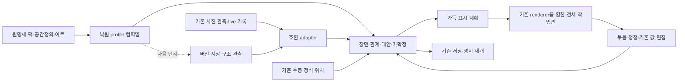

# 전체 장면 복원 기술 설계

상태: **RECOMMENDATION — 구현 전 설계**. 현재 사실은 [근거 E01–E10](evidence.md), 자료 부족은 [문제 지도](problem-map.md)를 따른다. 아래 새 타입·함수·화면은 아직 제품에 없다. 효과와 성능은 미측정이다.

## 1. 선택할 구조와 대안

**권고: 현재 판독·게임팩·renderer 사이에 장면 해석과 표시 계획을 추가한다.** 입력의 틀린 값까지 보존한 채 표시용 관계를 만들고, 실제로 새 관측이 필요한 부분만 다음 판독에서 보완한다.

| 대안 | 이득 | 남는 문제/비용 | 판단 |
|---|---|---|---|
| A. 프롬프트에 규칙 추가 + 현재 임계값 조정 | 변경이 작고 일부 역할 오분류를 줄일 가능성 | 필드별 출력, 판이 없는 영역, 여러 판의 상대 위치, 일괄 수정/저장 문제는 그대로. 과거 응답에는 소급 효과 없음 | 역할 입력 개선은 채택하되 전체 해법으로 삼지 않음 |
| B. 새 검출·분할 모델과 end-to-end 사진→완성판 교체 | 물체 경계와 구조를 함께 최적화할 여지 | 데이터·운영·검증 비용, 기존 모델 비교 외 추가 미지수. 생성된 판과 원관측/수정의 대응을 다시 만들어야 함 | 현재 선행 작업으로 권하지 않음. 후속 증거가 필요 |
| C. 게임팩 복원 profile + 장면 관계 + 가독 배치, 필요한 판독만 보강 | 현재 연결/아트/편집/저장 재사용, 기존 응답부터 개선 가능, 추정과 관측 분리 | 새 scene 계약과 저장 plumbing 필요. 원사진의 검출 누락·숫자 오독 자체는 별도 해결 | **추천** |

첫 묶음 T1–T4는 C의 장면·편집·저장 경로다. 이후 지식 입력과 구조 관측을 붙인다. 전체 120종을 유지하며 구조군별 깊이를 개선한다. 3종만 제품 목표로 줄이거나 120종의 전체 규칙 재조사를 요구하지 않는다.

## 2. 현재와 목표 데이터 흐름

**VERIFIED — 현재.** 원명세→`adaptSpecification`→팩/읽기 정책, 일부 공간 정의→`compileObservationTask`/`attachSpatialReading`→literal/공간 관측→assembly/fusion→assertions→필드별 `projectGenericDrawing`/`estimateBoardStructure`→renderer→기존 편집·commit·resume. 판 자산의 table model과 전체 scene 관계는 이 흐름에 명시적으로 이어지지 않는다. [E01–E08](evidence.md)

세 층의 책임을 고정한다.

1. **관측/기록:** 원값, 원 ID, 원 bbox, receipt, evidence, owner, native 위치, 수동 이력. 장면 표시 때문에 덮어쓰지 않는다. 원관측은 모델이 본 결과이며 정답 인증이 아니다.
2. **장면 해석:** 실제 관측 판, 판 없이도 존재하는 표시 구역, 물체/묶음/관계, 경쟁 가설, 값과 무관한 배치 근거. 관계마다 provenance와 미확정 이유가 있다.
3. **표시 계획:** 화면상 패널 위치·읽기 방향·간격·표시 순서. 원근과 실제 거리의 복사가 아니다. 표시 순서가 물리 순서를 확정하지 않는다.

## 3. 지식에서 실행으로

### 3.1 복원 profile의 출처와 위치

제안 `shared/restorationProfile.ts`의 `compileRestorationProfile`은 **현재 세션에 고정된** pack/version/sourceSHA와 연결 자료만 입력받는다. current catalog로 옛 팩을 대체하지 않는다. 출력은 [contracts.md](contracts.md)의 `RestorationProfileV1`이며, 기본 컴파일과 의미 보강을 나눈다.

| 기존 입력 | 그대로 재사용 | 추가 정형화/주의 |
|---|---|---|
| pack fields/runtime.fieldBindings/components | 필드 scope·visibility, 종류·변형, 입력/보존 경로 | `record-note.*`를 몰래 물리 좌표/턴 상태로 재해석하지 않음 |
| 원명세 layout/anchor_contract/relations | 영역 역할과 기준판·반복 구조의 근거 | 문자열을 매번 런타임 LLM에 해석시키지 않고 작은 typed recipe로 검토·생성 |
| spatial definitions | board instance/frame, 정식 address, cell/edge 의미 | 정의 hash/판본 일치 필수. 정의가 없으면 정식 주소를 생성하지 않음 |
| real-board areas/slots/network/variants | 격자·트랙·노선·시장·구역 렌더링 | 도해의 기본 말/카드는 관측으로 만들지 않음. 빈 판/배경과 예시 점유를 구분 |
| Sagrada/7W tableModel/tableZones | 창문/트랙/도구, 도시/단계/좌석/공용 구역 | 현재 미소비 의미를 profile로 옮김. 7명 자산이 사진의 7명 출석 증거가 아님 |
| requirements/resume/preservationTemplates | 기존 질문·중단 메모·실물 보존·복원 순서 | scene 미확정과 미완료 행동을 기존 actions에 연결. 질문0을 장면완료로 표시하지 않음 |

기본 profile은 120팩 모두에 대해 기존 메타데이터에서 만들 수 있는 수준만 생성한다. 정보가 얇은 팩은 `free-area`/기존 필드 renderer를 재사용한다. 이는 현재 지원 경로 유지이며 자동 구조 품질 인증은 아니다. 기존 원천은 `docs/research/game-specs-120/games/*.json`, `public/game-art/real-boards/*/board.json`, `game-photo-definitions/spatial/`다. 추가 typed 의미는 제안 경로 `gamepacks/restoration-profiles/source/<game-id>.json`에 출처 pointer와 함께 둔다. 제안 생성기 `tools/game-runtime/generate-restoration-profiles.ts`가 기본 컴파일+이 보강을 합쳐 `gamepacks/generated/restoration-profiles.json`을 만들고, `catalog.ts`가 기존 정책처럼 정확한 pack/version/source tuple로 연결한다. 기존 `generateRuntime`의 출력·retired pack 보존을 유지하며 단순 profile 추가 때문에 원명세나 모든 팩 버전을 재생성하지 않는다. profile 과거 버전도 hash로 남기고 snapshot에는 사용한 작은 실행 계약을 pin한다.

### 3.2 규칙을 쓰는 범위

복원 제약은 `allowedKinds`, 반복 구조, 역할 후보, 관계 보존 필요, 판본/변형 적용 조건이다. 예: 원정과 버림을 구별하고 원정의 부분 순서를 보존한다. 완전 합법성 심판·전략 조언·보이지 않는 장수 추정은 이 profile의 책임이 아니다.

규칙 검사는 `pass/fail/unknown/not-applicable`와 근거를 낸다. 규칙 위반처럼 보이면 잘못 읽었거나 실제 배치가 불법일 수 있으므로 값을 자동 교정하지 않는다. 인벤토리는 부분 사진의 검출 개수 정답으로 사용하지 않는다. 판본 미확정이면 공통 시각 구조만 적용하고 판본별 효과·정식 단계 주소는 유보한다. 7W 사진의 판본 의심은 이 경계를 실제로 요구한다. [E09–E10](evidence.md)

### 3.3 모델에 전달할 크기

reader에는 선택 scope에 해당하는 역할 사전, 구별 단서, 관계 종류, 관측할 구조, 숨김/유보 기준만 보낸다. 전체 규칙 본문·전체120팩·SVG 좌표·모든 판의 예시 물체는 보내지 않는다. 코드에는 완전 profile을 두어 응답을 검증하고, 모델에는 동일 profile hash의 작은 `readingHints`를 보낸다. 컴파일된 contract와 모델의 임의 해석이 서로 다른 영역 이름을 만들지 않도록 region/role ID를 고정한다.

## 4. 기존 응답을 전체 장면으로 바꾸는 알고리즘

제안 `projectRestorationScene(input)`은 **하나의 허용된 기록 범위 전체**를 입력받는다. 현재 active field만 넘기는 경계를 여기서 없앤다. 방/개인 접근 범위는 기존 서버 판정을 따른다.

1. **live entity 수집.** 현재 유효한 accepted 기록의 구성물과 실제 board 관측을 qualified ref로 수집한다. 현재 `engine.currentFacts`의 field+owner별 최신 accepted/turn 유효성 규칙만 공용 selector로 추출해 재사용하되, 규칙판정용 complete-board 조건을 그림 수집에 복사하지 않는다. 부분 native 판도 기존 방식으로 표시할 수 있어야 한다. 물리 entity 목록은 rule-derived 값을 검출물로 추가하지 않는다. 후보/충돌 기록은 별도 후보층이다. receipt는 근거이며 삭제된 물체를 되살리는 목록이 아니다. 기존 native/수동 투영을 먼저 호출하고, photo reference/alias 검사와 source transform을 재사용한다.
2. **identity 연결.** 새 scene entity ID는 현재 assertion ID와 분리한다. 기존 receipt origin/linkOrigin 및 검증된 갱신 대응으로만 이어 붙인다. 값·색·배열 index·가까운 중심이 같다는 이유로 동일 실물로 합치지 않는다. 기존 렌더 경로에서 같은 live piece가 두 번 들어오면 같은 entity로 dedupe한다.
3. **기하 근거 분류.** 원 bbox를 변경하지 않고 파생 geometry에 `usable/weak/inconsistent/absent`와 이유를 붙인다. 범위·crop 변환 검증은 필수다. 폭/높이/겹침만으로 오답을 증명할 수 없으므로 과도한 모양 검사로 가려진 물체를 삭제하지 않는다. 다수 물체를 덮는 이상 bbox는 소속 결정 근거에서 제외하고 값과 카드 존재는 남긴다.
4. **실제 판과 frame.** `collectStructureBoards`/명시 spatial frame을 재사용한다. 관측 판 identity, 로컬 축, 축 부호/방향, native address를 각각 구분한다. 투시변환은 지지 평면이 확인된 곳에만 쓰며 카드 겹침의 높이까지 동일 평면이라고 가정하지 않는다.
5. **묶음/관계 후보.** 명시 공간 관계 → 신뢰할 수 있는 판 내부 포함/끼움 → 방향을 공유하는 노출띠/겹침/색·역할 호환 → 상대 구역 후보 순으로 근거를 모은다. 기존 LC/7W/Sagrada 추정기의 성공한 부분을 adapter로 가져온다. 모든 관계를 단일 거리 임계값으로 판정하지 않는다.
6. **경쟁과 전파.** 연결 그래프를 구하되 전파된 관계는 원래 근거보다 강해지지 않는다. 두 판으로 이어지는 무리는 자동 한 판 확정을 중지한다. 그룹 전체가 하나의 판에 유일하게 지지될 때만 그룹 연결을 선택한다. 두 후보가 남으면 표시 구역은 유지하고 실제 판 연결을 유보한다. 순환한 순서는 해당 부분만 미확정으로 둔다.
7. **판 없는 표시 구역.** 서로 일관된 카드줄/주사위 격자가 있지만 판 관측이 없으면 `display-region`을 만든다. `boardEntityId`는 비워 둔다. 구역 이름은 ‘왼쪽 위 카드 무리’, ‘전경 격자’처럼 위치/형태 중심이다. 사람 이름, 실제 플레이어 수, 정식 window/wonder identity를 생성하지 않는다.
8. **전체 구역 관계.** 사진별 원좌표에서 분리된 구역의 상대 위/아래/좌/우를 추출하되 경계가 겹치거나 중심 기준이 불안정하면 축별로 유보한다. 원근 거리·각도를 layout 크기로 복사하지 않는다. 원형 게임의 이웃 관계는 일부 사진의 x순서와 다르다. 관측/수동 좌석 순환이 있어야 neighbor 관계를 확정한다.
9. **결과와 진단.** scene entities/groups/claims, 미확정 원인, 의존 관계, provenance를 출력한다. 기존 field별 renderer 결과와의 source map을 유지한다. 렌더되지 않은 live entity는 마지막 ‘위치 미확정’ 구역에 남겨 사라지지 않게 한다.

**실제 구현 선택:** 첫 묶음은 기존 estimator를 assertion별로 호출하고 결과를 source ref로 병합하는 compatibility adapter를 쓴다. 추가 context는 한 번 인덱싱한다. 이어 상세 3종 분기를 공통 `grid/lane/stack/player-area` recipe로 옮긴다. 검증 없이 모든 heuristic을 한 번에 일반화하지 않는다. 반환값의 `handled`는 다른 필드에 있다는 의미이므로 전체 수집기에서 최종 누락으로 처리하면 안 된다.

### 4.1 geometry와 값의 역할 분리

값 수정은 `face/number/color/quantity` 같은 원래 편집 계약을 따른다. 소속/끼움/순서/frame 수정은 scene 관계다. 한쪽이 틀려도 다른 쪽을 폐기하지 않는다. literal decoder가 현재 null로 만드는 회전은 새로운 구조 관측 단계에서 별도 typed output으로 받는다. 사진 속 인쇄 방향, 판 로컬 방향, 카드가 놓인 물리 회전, 사용자 화면에서 읽기 좋게 돌리는 회전은 별도 값이다.

새 geometry는 가능하면 **보이는 면/노출띠**와 추정 전체 외곽을 나눈다. 가려진 카드의 완전 bbox를 만들어 넣도록 강요하지 않는다. 기존 bbox는 `legacy-unspecified` 의미로 받아 현재 값을 재작성하지 않는다. 오답으로 의심되는 좌표를 1000으로 나누는 식의 자동 구제는 계약이 그 좌표 단위를 명시했을 때만 허용한다.

## 5. 가로 중심 전체 평면

제안 `layoutRestorationScene(scene, profile, viewClass)`는 게임 의미와 표시 결정을 구분한다.

**거시 배치:** 패널 그래프의 상대 관계를 보존한 bands/rows로 배치한다. 강한 공용 중심 관계가 있으면 공용 구역을 가운데 두고 개인/양편 구역을 둘레에 둔다. 관계 DAG의 위상 단계와 side 조건을 사용하며 순환/충돌 edge는 표시 근거에서 제외하고 진단에 남긴다. 동일 제약 안의 tie-break는 저장된 region ID/기존 표시 순서로 안정화한다. 문서의 예시 위치나 사진별 정답 좌표를 상수로 쓰지 않는다.

구체 v1 layout은 `above`의 위상 단계로 band, `left-of`/공용중앙 제약으로 lane을 정한다. 패널의 읽기 크기를 먼저 산정하고 각 lane의 최대 폭·각 band의 최대 높이에 gap을 더해 원점을 누적한다. 관계 없는 패널은 기존 저장 순서로 빈 자리에 놓되 이를 관측 관계로 저장하지 않는다. 제약 충돌 시 관계를 유보하고 해당 패널을 별도 미확정 band에 남긴다. 이 과정은 겹침 없는 배치를 만들며 viewport가 좁다고 패널 의미 순서를 재정렬하거나 전체 축소하지 않는다.

**미시 배치:** 각 패널은 기존 빈 판 아트·그리드·선로·카드/말 renderer를 사용한다. 카드 색줄/원정/시장/단계를 다른 행/칸으로 구별하고, 겹침은 판독된 값의 노출을 해치지 않는 표시 간격으로 펼친다. 노출되지 않은 값은 빈 값으로 남는다. native slot은 그대로, estimated slot은 표시상 구별한다. 물리 순서가 부분 순서이면 비교 가능한 것만 연결하고 화면 정렬용 순서에는 ‘복원 순서 미확정’을 표시한다.

**읽기 크기:** 현재 글자/카드/주사위 렌더 크기를 출발점으로 써 실제 가로폰에서 확인한다. 전체 장면이 안 맞으면 작업면이 넓어지고 pan/scroll한다. 전체를 강제 축소해 맞추지 않는다. 작은 overview는 현재 보는 패널로 이동하는 보조 수단이며 읽는 본판을 대체하지 않는다. 기본 진입은 공용+주요 전경 패널이 읽히는 위치, 각 구역 jump, 원상복귀 버튼이다. 다중 가로/세로 nested scroll을 피하고 전체 workbench가 pan을 맡는다.

**재사용 UI:** `GameEssentials`의 주 보기로 `RestorationSceneView`를 추가하고 기존 필드 선택은 상세 편집으로 유지한다. `GameBoardRecord`의 판 내용/편집을 재사용 가능한 body와 wrapper로 분리해 패널 안에서 중복 toolbar/scroll 없이 쓴다. `EstimatedBoardView`의 카드·주사위·그룹 controls와 `PhotoLayoutBoard`의 사진 연결을 재사용한다. 물체 탭→원래 `{assertionId,pieceId}`→기존 편집기. 별도 값 편집기를 새로 만들지 않는다.

7W의 관측4판+판 미검출 구역은 각자의 판/구역 패널로 놓되 사진의 위/아래·양옆 관계를 반영한다. 이것이 기존 ‘anchor별 세로 목록’과 다른 핵심이다. 넓은 사진의 실제 cm/원근/사람 위치는 복사하지 않는다. 모호한 detached coin은 임의 도시로 넣지 않고 인접 미확정 구역으로 보존한다.

## 6. 한 번의 묶음 정정과 소수 확인

초기 화면은 자동 장면을 제공한다. 판마다 owner를 골라야 화면이 완성되는 절차를 만들지 않는다. 표시 구역의 identity, 실물 판 identity, 사람 owner는 서로 독립이다.

| 사용자 행동 | 변경 | 자동 전파/보존 |
|---|---|---|
| 구역 선택→‘이 판에 속함’ | 그룹의 membership claim | 명시적으로 선택한 범위와 그 종속 자동 관계만 갱신. 기존 명시 수동 예외는 유지 |
| 원정/도시/단계/버림 역할 수정 | 역할 claim | 허용 recipe와 배치만 다시 계산. 원래 카드값/원관측 area는 보존 |
| 줄 합치기/나누기 | group membership + split provenance | 해당 줄의 부분 순서/부착을 유효한 범위로 이관. 모순은 유보 |
| 판 방향 확인/필요시 frame 수정 | frame claim | 미확정/자동 로컬 배치 재계산. native 주소나 수동 위치를 회전시켜 재작성하지 않음 |
| 숫자/면/색 수정 | 기존 field answer | 관측 이력 보존, 현재값 변경. 그 속성에 의존하는 자동 관계만 재평가 |
| 사람 이름 연결 | 기존 component-links 흐름 | 명시 선택 때만 owner/필드 이동. 표시 구역 확인만으로 수행하지 않음 |

묶음 수정은 기존 PATCH 안에 `sceneCommands[]`를 추가하고 한 transaction으로 처리한다. 여러 field answer가 동반되면 clone에서 검증→새 assertion IDs 일괄 할당→최종 ID map으로 rebasing→scene bindings 갱신→저장한다. 관계는 안정적인 entity ID를 참조하고, 기존 estimated override의 volatile assertion refs도 같은 map으로 갱신한다. 실패하면 아무것도 반영하지 않는다. 기존 단건 answer API 동작은 유지한다. 저장 scope를 넘는 원소는 자동 소유권 변경 없이 읽기 합성만 허용한다. 새 scene 수동선택은 sidecar에 두고 whole-scene과 상세 field 보기가 같은 resolved claim을 읽게 한다. 같은 차원의 명시적 최신 선택은 과거 override보다 우선할 수 있지만 자동 group 전파로 과거 수동 예외를 지우지는 않는다. 원래 override는 이력/호환 근거로 남긴다.

그룹별로 ‘판 연결 불확실’, ‘원정 순서 일부 불명’ 정도를 요약하고 세부 provenance는 선택 시 펼친다. 모든 물체에 경고 배지를 붙이지 않는다. 자동 후보 선택을 calibrated 확률처럼 표시하지 않는다.

질문은 **기존 actions/편집 경로**에서, 하나의 답이 여러 오류를 줄이는 것부터 제안한다. 우선순위는 영향받는 실물/보존 관계, 경쟁 정도, 답할 수 있는지로 비교한다. 숨은 손패·완료 중인 거래·드래프트 전달 단계는 사진으로 확정하지 않는다. 이미 입력된 pending/turn/round 메모를 우선 사용하고 필요한 때 짧은 확인을 제안한다. 사용자가 건너뛰어도 미확정 포함 저장을 허용하며 동일 입력 digest에서 같은 질문을 반복하지 않는다. 새로운 필수 질문 수/정확도 목표는 만들지 않는다.

## 7. 저장·재개와 호환

선택: 기존 assertion의 값 구조를 장면 데이터로 덮지 않고 `Session.restoration`/`Snapshot.restoration`에 **선택적, scope별 sidecar**를 둔다. [구체 계약](contracts.md)을 따른다. 저장 내용은 profile pin/작은 실행 계약, entity bindings/aliases, 장면 claims·수동 edits, 안정적인 구역 ID/표시 계획, 질문 처리 상태다. 사진·receipt 본문을 복제하지 않는다.

| 경계 | 필요한 변경 |
|---|---|
| `answerField`, `rebaseEstimatedReferences` | 기존 proof 조건 유지, scene binding과 단건 refs 갱신 |
| `PATCH`, `change`, 새 `applySceneCommands` | 기존 mutation queue와 revision 검사 안에서 staged batch, scope 검증, idempotency/undo |
| `linkComponents` | 기존 linkOrigin identity를 entity alias에 이어 줌. scope 이동의 참조 정리는 같은 허용 transaction에서 수행 |
| `commit` 일반 snapshot / `snapshotForIntent` | 명시 snapshot 객체에 해당 scope sidecar 포함. 읽기 자동완료 저장에서도 동일 |
| `analysisTask` scope stamp | 기존 readingScopeVersion은 유지하고 별도 scene input stamp로 늦은 구조 적용만 판정. sidecar만 바뀌면 유효 literal을 기존 fusion으로 보존하고 최신 수동 claim 위에서 재투영. pan/zoom은 제외 |
| `resumeSnapshot` 및 legacy resume branch | 선택 snapshot의 동일 scope sidecar만 교체. 새 captureEpoch가 과거 원관측 ref를 무효화하지 않음 |
| `privacy.redactSession`, `rooms.authorizeRoom` | 기존 allowed field/evidence로 sidecar를 투영하고 write scope를 검사. 알 수 없는 sidecar를 무조건 spread 반환하지 않음 |
| `sessionCodec`/저장 로딩 | 선택적 version 파싱. intern 최적화는 데이터량 근거가 있을 때 기존 codec 확장 |

**구판 저장본:** sidecar 없음→현재 기록에서 read-only compatibility scene 생성. 열기만으로 팩/스냅샷/원값을 마이그레이션하지 않는다. 다음 명시 저장·정정 때 sidecar를 추가한다. 구 native/override가 우선이고 기존 renderer fallback이 가능하다.

**같은 저장본 재열기:** profile hash/algorithm version/구역 순서와 선택 관계를 pin한다. 화면 폭에 따라 배치 간격은 바뀔 수 있지만 판 소속·부분 순서·수동 수정·미확정은 같다. 새 알고리즘으로 재계산은 현재 작업 복사본에서 명시적으로 할 수 있으며 예전 snapshot은 변경하지 않는다. 저장한 계획의 source digest가 달라졌으면 영향받은 부분만 재계산하고 stale refs는 표시에서 유보한다.

**미래 version:** 해석 못 하는 sidecar는 opaque 보존하고 기존 기록으로 fallback한다. 자동 덮어쓰기나 그 sidecar를 포함한 편집은 거부한다. 단순 읽기 fallback은 가능하다. 오래된 바이너리에서 미래 sidecar를 편집해도 유지된다고 보장할 수 없으므로 API version 검증과 round-trip 검사가 필요하다.

**공개/개인:** sidecar partition key는 기존 save/write scope를 따른다. 공개 구역의 모든 실물에 owner를 강제로 부여하지 않는다. 화면은 허용된 여러 partition을 합성할 수 있지만 group command는 사용자가 쓸 수 있는 scope만 대상으로 한다. 다른 scope의 private entity를 anchor/가설명/질문/thumbnail로 남기지 않는다. 이는 새 보안 사업이 아니라 새 필드를 기존 저장·표시 범위에 맞추는 필수 plumbing이다.

## 8. 새 판독에서 보강할 것

첫 묶음과 분리한다. 기존 응답 재생으로 검출/값이 좋아졌다고 주장하지 않는다.

1. **구조 co-output.** 기존 한 번의 hosted reading에 optional scene protocol을 추가한다. 판/표시 구역 존재, board frame·방향, 보이는 겹침/끼움, 묶음 관계를 literal 값과 함께 반환한다. region observation은 실제 보드 검출과 다르다. `readMode`의 기존 의미는 유지하고 새 버전에서 구조 요청 포함 여부를 명시한다.
2. **버전 경계.** strict compact v3의 허용 key를 전역 완화하지 않는다. 새 protocol의 스키마/decoder를 별도로 선택하고 실패한 구조 확장만 유보한다. 유효한 literal 행은 유지한다. 기존 request/receipt 재생은 동일하게 동작한다.
3. **역할 단서.** 현재 ‘owner/role을 추측하지 말라’는 일반 금지에서 사람 owner와 관측 가능한 게임 영역 역할을 분리한다. ‘모르면 물체 존재와 속성을 반환하고 역할 후보를 남김’이 기본이다. 미확정 role 때문에 물체를 생략하지 않게 한다.
4. **선택적 추가 읽기.** 값이 실제 복원에 필요하고 원사진에 보이는 경우 기존 ROI/crop 변환을 사용해 작은 영역을 재판독할 수 있다. 자동 무제한 반복·항상 두 번째 호출·3종별 새 모델은 만들지 않는다. 실패 이유/영역/원본SHA/기존 후보를 고정하고 새 결과를 비교·충돌로 보관한다.
5. **사진 추가가 필요한 경우.** 실제 가림·프레임 밖·반사면은 prompt로 복구하지 못한다. 가능하면 한 영역의 가까운 사진 또는 그대로 포장 보존을 제안한다. 사진과 무관한 진행단계는 짧은 질문이 낫다.

새 유료 호출/외부 사진 전송은 이번 설계에서 하지 않았다. 기본 모델/강도는 이 제안으로 변경하지 않는다. 실제 새 protocol의 효과·응답 크기·비용은 후속 승인된 판독 비교로 확인한다.

## 9. 여러 사진·시간

기존 동일 source crop fusion을 유지한다. ‘같은 상태를 찍음’, ‘같은 판 frame으로 정합됨’, ‘동일 실물임’은 서로 다른 claim이다.

- 다른 시점 정합 전에는 사진별 scene view를 두고 잠재 중복을 표시한다. 두 사진의 동전/카드를 합산해 상태값으로 만들지 않는다.
- 후속 registration은 board-local landmark/frame과 transform, 적용 범위·잔차·가림을 기록한다. 한 평면의 homography를 테이블 전체나 다른 개인판에 전파하지 않는다.
- 정합 후에도 반복 색/뒷면 카드의 일대일 매칭은 별도 문제다. 위치·kind·속성·인접관계가 유일하게 지지하거나 사용자가 같은 물체라고 확인할 때 alias를 연결한다. 경쟁이면 양 관측을 보존한다.
- captureEpoch만 같다고 정지 상태를 보장하지 않는다. 카드 이동/턴 변화가 있으면 다른 state group으로 남긴다. 사진 추가가 이미 저장된 상태를 몰래 변경하지 않는다.

최초 전체 장면 묶음은 이 미해결 registration을 선행조건으로 삼지 않는다. 동일원본 crop와 단일사진에서 완결된 저장/재개가 먼저다.

## 10. 성능·비용과 실패 처리

전체 scene은 scope별 한 번 계산하고 입력 digest(현재 accepted IDs/값, profile, semantic edit revision, source geometry)로 재사용한다. field 렌더마다 전체 context를 재탐색하지 않는다. 기존6단위 판독 병렬, 유용한 값 preview, save intent dedup, codec을 재사용한다. 관계 후보는 board/region별 인덱스로 좁힌다. 필요 없는 전조합 비교와 동일 사진 재호출을 먼저 없앤다.

측정은 입력 준비→모델 응답→유효 값→구조 assembly→첫 읽을 수 있는 scene paint→저장→재열기로 나눈다. streaming 글자 도착을 복원 완료 시간으로 쓰지 않는다. 30초를 이번 선행 게이트로 두지 않고 실제 bottleneck 이후 조정한다.

| 실패 | 제품 동작 |
|---|---|
| profile/edition 불일치 | 공통 시각 구조/기존 renderer, 판본별 정식 주소 유보 |
| 판 검출 누락 | 관측 실물의 표시 구역 유지, actual board는 없음 |
| bad bbox/geometry | 원값/존재 유지, 해당 기하 연결만 약화/유보 |
| 여러 판 경쟁/순서 cycle | 대안과 부분 순서 유지, 위치 미확정 구역 사용 |
| 새 구조 decoder 실패/일부 누락 | valid literal 유지, legacy scene adapter로 표시 |
| 사용자가 고친 뒤 늦은 응답 | 값/원본 수정은 기존 stale 처리. scene만 수정됐으면 옛 구조 선택은 적용하지 않고 유효 literal을 최신 manual 위에서 재투영 |
| group edit 중 stale ref/scope 충돌 | 전체 command 실패·초안 유지, 최신 상태에서 다시 선택 |
| 삭제된 판/실물 | live binding 제거, receipt로 부활시키지 않음, 의존 관계 유보 |
| restore의 출처 누락 | 해당 참조만 유보, 원사진/기록 보존 및 재연결 경로 |

구현별 소유 파일·입출력·완료 행동은 [implementation-plan.md](implementation-plan.md), 실제3사진과 다른 구조군 적용은 [walkthroughs.md](walkthroughs.md), 검증 분모는 [validation-plan.md](validation-plan.md)를 따른다.
