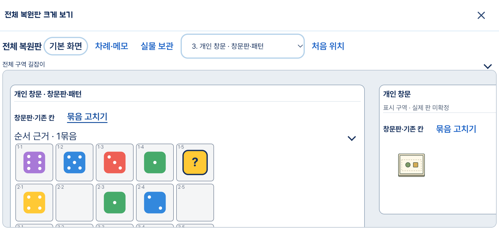
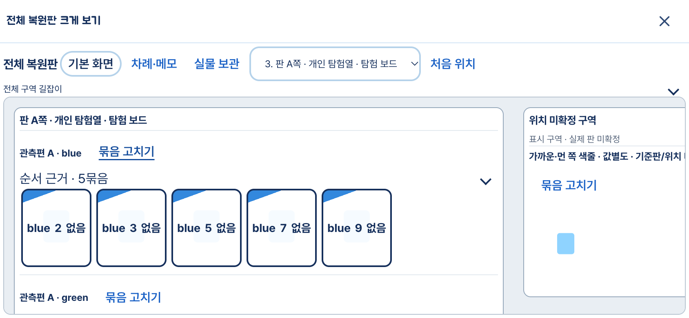
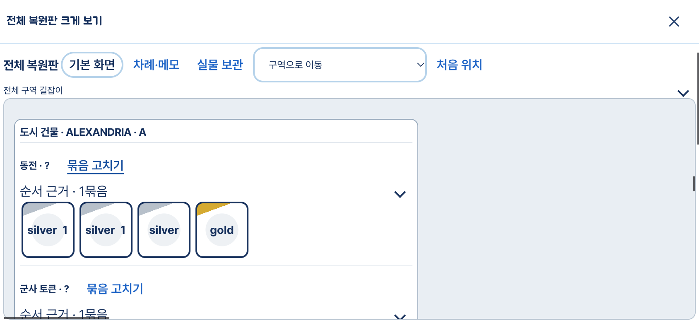

# 종합 복원 설계 구현·통합 결과

**VERIFIED — T1–T9의 제품 연결과 기존 자료 회귀를 구현했다. 전체 1,468/1,468, 타입 검사와 Vercel용 빌드를 통과했다.** T10 중 실제 앱의 기존 응답 재생·정정·저장·재열기·공개 재개를 확인했다. 새 사진 판독, 새로운 두 시점 정합 품질, 실제 iPhone Safari는 미검증이다. 긴 저장 이력의 성능 회귀도 남아 있다. 따라서 모든 자동 배치 문제나 실사진 품질이 해결됐다는 뜻은 아니다.

[채택 설계](../restoration-system-design-20261113/README.md) · [실제 공유 계약](contract.md) · [감독 검증](supervisor/verification.json) · [UI 인계](sol1/README.md) · [shared/backend 인계](sol2/README.md)

## 실제 사용에서 달라진 점

- **전체 복원판:** 필드 하나씩 열던 화면에서, 접근 가능한 같은 저장 범위의 구성물을 하나의 가로 작업면에 표시한다. 기존 그림·주사위·카드·칸 표시와 값 편집기를 재사용한다. 구역 선택, 밀어 보기, 집중 보기로 이동하고 원래 실물 ID의 편집기로 연결한다.
- **게임 문맥:** 기존 120팩의 정확한 판본에 맞는 복원 profile을 연결한다. 사그라다 창문·트랙·도구, 로스트 시티 중앙판·버림·A/B 원정, 세븐 원더스의 관측 도시와 미연결 표시 구역을 구분한다. 판이 없다는 이유로 구성물을 숨기지 않으며, 표시 구역을 실제 판·사람 소유로 바꾸지 않는다. 나머지 팩은 기존 metadata/아트와 계열 fallback을 이용한다. 120종 실사진 품질을 새로 인증한 것은 아니다.
- **묶음 정정:** 판 소속·역할·분리·합치기·네 모서리 정정을 기존 PATCH에 연결한다. 대기 중인 값 편집도 같은 요청에 보낼 수 있다. 오래된 요청은 전건 거절하고 같은 요청의 재전달은 중복 적용하지 않는다. 저장·재개 때 관계와 표시 근거를 함께 보존한다.
- **판독·질문·보관:** 선택형 ‘구조 함께 읽기’, 기존 원사진/영역 읽기, 필요한 내용의 건너뛰기, 기존 실물 보관 항목 연결을 소비한다. 건너뛰기를 복원 완료로 바꾸거나 보관 체크를 자동으로 켜지 않는다.
- **다른 사진 연결:** 실제 관측판의 대응점과 동일 상태 확인을 받아 사진을 등록하고, 유일한 후보의 실물 동일성도 명시 확인한다. 원래 관측 ID와 값은 합쳐 없애지 않는다. 새 사진 쌍에서 이 정합이 정확한지는 아직 확인하지 않았다.

기본 reader 모델·추론 강도는 바꾸지 않았다. 새 유료 판독·운영 데이터 접근·운영 배포는 0회다.

## 통합 과정에서 고친 결함

1. transaction용 복사본이 BlobStore의 ETag를 잃어 정상 저장까지 409가 됐다. 로드한 정확한 CAS token을 기존 Store 훅으로 승계하며 실제 stale 거절은 유지했다.
2. 로스트 시티의 같은 실제 판에 속한 중앙·버림·A/B 구역이 한 패널로 다시 합쳐졌다. 동일한 판 ID 아래 별도 표시 구역을 유지하며 명령 후에도 재합치지 않는다.
3. 작업면 원점에 판이 없으면 첫 화면과 집중 보기가 비었다. 실제 첫 패널에서 시작하고 사용자 이동은 측정·재렌더·집중 보기 전환에도 유지한다. 이동 선택지는 전체 구역 이름과 번호로 구별한다.
4. 반복 profile을 기존 저장 codec으로 공유 저장하고, 이미 복사된 개인정보 응답에서 중복 복제를 줄였다. 범위가 줄었을 때 command·질문·undo 정리 조건은 원래대로 유지했다.

최종 후속 근거: [UI 초기 위치](sol1/integration/initial-viewport/README.md), [LC 라벨](sol1/integration/lc-labels/README.md), [backend 통합](sol2/integration/README.md). 감독의 마지막 제품 변경은 이동 선택지의 이름·번호뿐이다. [최종 소스 SHA 대조](supervisor/final-source-verification.json).

## 실제 앱 화면과 저장 확인

운영 데이터 대신 별도 임시 Store와 저장된 9응답을 실제 App/createApp에 연결했다. 공급자 호출은 차단했고 호출 시도 0회였다. 정적 뷰어만 검사한 결과가 아니다.

| 확인 | 결과와 범위 |
|---|---|
| Sagrada 실물 선택→기존 편집→저장→reload→공개 재개 | r1c4의 기존 초록 주사위 값을 검수자가 2→1로 정정했다. 같은 실물 ID·칸·bbox·판독 원문·다른 실물 값 유지. [기록](supervisor/browser-value-save.json) |
| LC 묶음 역할→저장→reload→공개 재개 | 5개 카드 묶음에 검수용 역할 변경을 한 번 적용해 집계/표시와 저장 유지 확인. 원값·원문·실제 판 ID 불변. 시험 뒤 원래 원정 역할로 되돌려 저장. [기록](supervisor/browser-group-save.json) |
| 전체 작업면 | SG 4×5의 20셀/18주사위, LC 중앙·버림·양편 별도 패널, 7W 첫 진입에서 실제 패널 노출과 GIZAH 이동 후 집중 재진입 위치 유지 |
| 화면 크기 | Chrome 844×390 및 실제 emulation 390×844. 세로 모드 document 폭 390px 유지. Safari 실기기·실제 터치 인증은 아님 |

### 사그라다

검수자가 고친 초록 1은 사용자 정정이며 새 모델 판독 성공에 더하지 않는다. 패턴을 모르면 중립 칸을 유지한다.

[세로 화면 캡처](supervisor/sagrada-portrait.png)

### 로스트 시티

사진의 사람 소유 대신 관측편 A/B를 구분한다. 넓은 작업면의 일부 캡처이며 중앙·버림·반대편은 이동 선택지로 찾는다.

### 세븐 원더스

관측된 판과 미연결 표시 구역을 구분한다. 카드 이름 부족·가려진 판·일부 미연결은 새 판독 없이 해결됐다고 주장하지 않는다.

## 검사와 남은 한계

- 최종 `npm test`: **1,468/1,468**, 실패·취소·skip 0. [로그](supervisor/full-tests.log)
- 최종 `npm run build:vercel`: 타입 검사·Vite·Nitro 성공. [로그](supervisor/build-vercel.log)
- 최초 통합에서 발견한 8건은 교정 후 최종 전체 검사에서 통과했다. [최초 실패 기록](supervisor/integration-first-pass.json)은 보존했다.
- 기존 입력 21파일 SHA 불변. 같은 응답 재생은 입력/저장 보존 근거이며 새로운 사진의 위치 정확도가 아니다.
- 개발 검수 서버는 HMR을 끈 상태라 websocket 오류가 발생했다. GameEssentials scalar fragment의 기존 key 경고도 남는다. 해당 fragment는 작업 전 HEAD에도 같았으며 기능 실패나 새 오류 0으로 포장하지 않았다.

**미해결 성능:** 기존 큰 보드 검사에서 251개 snapshot·826요청이 누적됐다. 과거 약64.0초 대비 이번 수정 전349.5초, 중복 복제 수정 뒤 계측본253.9초로 회귀가 남는다. 최종 전체 실행의 같은 원본 검사는267.7초로 통과했다. 응답 최대12.61MB, 계측 요청 p95 약709ms였다. 하드웨어를 통제한 A/B나 모델 지연 수치는 아니다. 저장 기록을 삭제하거나 snapshot 관계 pin을 생략해 수치를 줄이지 않았다. [측정·한계](sol2/integration/performance-summary.json)

다음 판단이 필요한 것은 새 구조 출력의 실사진 효과, 새 두 시점 정합 품질, 실폰 조작, 긴 이력 저장의 추가 비용 감소다. 이 검증을 통과한 것으로 보고하지 않는다. 기존 공유 Site는 갱신하지 않았고 운영 앱도 배포하지 않았다.

## 코드 읽기 진입점

1. [sceneProjection.ts](../../shared/sceneProjection.ts) `projectRestorationScene`: 원관측/기존 native/수동 관계 → 같은 scope의 장면. 실제 판과 표시 구역을 분리하는 이유를 읽는다.
2. [restorationState.ts](../../server/restorationState.ts) `applySceneCommands`: 명령 + 기대 revision → 전체 검증/원자 저장/중복 방지. 값 편집과 관계 편집이 함께 올 때의 경계를 읽는다.
3. [GameEssentials.tsx](../../src/GameEssentials.tsx) `wholeScene`, `selectScenePiece`, `dispatchScene`: 전체 판 → 원 ID 편집 → 기존 저장 queue. 새 편집 앱을 따로 만든 구조가 아니다.

짧은 흐름: **저장된 관측과 게임팩 → 관계·가설 → 전체 복원판 → 묶음/값 정정 → 기존 저장·재개**.

개발 영어: *scene* 장면, *claim* 근거가 있는 주장, *binding* 원기록 연결, *snapshot* 저장 시점. “The scene keeps the original values.” “One change updates the group.” “Save and reopen keep the links.” 코드를 읽을 때 ‘표시 구역이 생기면 실제 판도 생기는가?’를 설명할 수 있으면 핵심 경계를 이해한 것이다.
