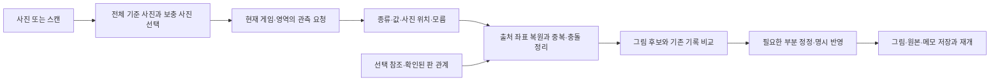

# KeepBoard 사진·스캔 판독 최소 설계

> **감독 검토 정정 — 사용자 흐름:** 기본은 판독 결과를 기존 그림판에 자동 반영하고, 사용자가 필요할 때만 수정한 뒤 저장하는 흐름이다. 아래의 ‘후보·명시 반영·사용자 확인’ 표현을 모든 판독에 추가 확인 버튼이나 필수 정정 절차를 넣는 요구로 해석하지 않는다. 연결이 확실한 결과는 자동 반영하고, 불확실한 연결·값은 원사진 근거와 함께 미배치/충돌/?로 남겨 수정 없이도 저장할 수 있게 한다. 기존 사용자 정정값을 늦게 온 판독으로 덮지 않는다. 대상 지정·근접 재판독은 선택 기능이다. 내부 후보/출처 검증 계약과 사용자에게 강제하는 확인 단계는 구별한다.

확인일 2026-10-28. **설계 제안이며 제품 적용·추가 판독 실험은 0회다.** 현재 공유 소스를 읽었으며 배포본과의 일치는 확인하지 않았다. VERIFIED는 코드·공식 자료를 확인했다는 뜻이고, 기존 실험 결과는 REPORTED, 적용 판단은 RECOMMENDATION, 미측정 효과는 UNKNOWN이다.

## 권고

**기존 이미지 API에 게임별 읽을 종류·속성을 주고, 전체 사진을 기준으로 필요한 근접 관측만 보충한다. 물체의 속성 읽기와 사진 간 연결·게임판 배치를 분리한다.** 원본에서 자른 사진은 기록된 변환으로 연결하고, 다른 시점 사진은 확인된 기준점이나 사용자가 지정한 실물로 연결한다. 연결되지 않는 관측도 버리지 않되 새 실물로 자동 합산하지 않는다.

구성물 참조 이미지와 고정 관계는 유용한 선택 자료다. **고정 관계는 지금 재사용하고, 실물 참조 이미지는 반복되는 종류 혼동에 작은 집합부터 적용**하는 것이 적합하다. 모든 게임의 카드 사전을 먼저 만들거나 전용 검출기를 필수 단계로 추가할 근거는 부족하다. 이 선택은 최저가보다 **촬영부터 정정·저장까지 걸리는 전체 시간과 잘못 확정한 상태**를 줄이는 데 목적이 있다.

## 현재 확인한 출발점

| 확인 | 설계에 미치는 영향 |
|---|---|
| `src/scanQuality.ts`·`scanBatch.ts`는 최대 6장 품질·중복 선별과 같은 owner/epoch를 보존한다. | 재사용한다. 현재 선별은 의미상 촬영 범위나 사진 간 위치 정합을 보장하지 않는다. |
| `SessionWorkspace.tsx`의 `readStoredPhotos`·`finishCaptureRun`은 scoped reader에 마지막 1장만 전달한다. `prepareHostedObservation`·`compileObservationTask`도 한 장만 허용한다. | 스캔 여러 장을 실제로 활용하려면 UI 선택뿐 아니라 job 계획·관측 출처·합치기를 함께 연결해야 한다. |
| `GeminiGameReader.read`는 literal 관측, 카탄 공용판은 `readCatanScene`으로 canonical 슬롯까지 한 번에 요청한다. | 카탄의 현재 그림 생성은 보존한다. 새 분할 경로에서 숫자·종류와 슬롯 추론을 섞어 비교하지 않는다. 모델이 제시한 슬롯은 관측 좌표와 별도 후보다. |
| `PhotoTransform`·`ConfirmedPhotoFrame`·`mapObservationRegion`이 있다. 현재 frame은 카탄 한 사진↔기본판 대응이다. | 일반 crop 변환은 확장 가능하지만 다른 두 사진의 정합은 아직 없다. 기존 atlas는 19칸 내부이며 도로·건물·해안 전체를 덮지 않는다. |
| 현재 `referenceSetId`와 `referenceCandidates`는 실물 참조 사용을 거부한다. | 이름만 있는 필드를 활성화했다고 참조 기능이 완성되지 않는다. 별도 선택 기능으로 검증한다. |
| 현재 촬영 정의는 120 ID. 10월 24일 preflight는 검증된 완전한 인쇄물 참조 사전 0개를 보고한다. | 120 정의는 읽을 항목·공개 범위의 출발점이다. 현재 참조 자산 완전성 재감사는 하지 않았고, 화면 SVG를 실물 정답 이미지로 사용할 수 없다. |

파일·심볼·검토 시 SHA는 [evidence.json](evidence.json)에 있다. 사전 정의를 추가하기 위해 기존 정본·packVersion·과거 촬영 정의를 일괄 재생성하지 않는다.

**최근 실험의 의미:** [전체 4크롭 기록](../catan-full-crop-20261028/README.md)은 병렬 25.796초/13,034 tokens, 90행을 사후 눈대조하여 55개 물리 후보 그룹으로 정리했다. 이 55는 정답 개수가 아니다. 종류 충돌·6/9 오독·항구 누락이 남았고, 자동 병합기는 없었다. 기존 전체 요청과 과제·출력계약이 달라 crop만의 효과는 미분리다. 이 결과는 작은 물체를 더 읽을 가능성과 **경계 중복·종류 충돌을 처리해야 한다는 필요성**을 함께 보여준다. 이번에 사진·GT를 재채점하지 않았다.

## 다른 방향과 비교한 근거

| 방향·1차 출처 | 실제 확인한 방법 | KeepBoard 선택과 한계 |
|---|---|---|
| 한 요청에 여러 사진: [Gemini 공식 문서](https://ai.google.dev/gemini-api/docs/generate-content/image-understanding#prompting-with-multiple-images) | 현재 사용하는 GenerateContent 계열도 여러 image Part를 받는다. | 가장 작은 API 대안이다. 다만 현재 앱의 imageIndex=0·한 장 validator를 바꿔야 하며, 모델이 사진별 출처와 동일 실물을 정확히 구분한다는 증거는 없다. 공동 문맥이 필요한 비교 후보로 남긴다. |
| 분할 후 합치기: [SAHI 논문](https://arxiv.org/abs/2202.06934), [공식 구현](https://obss.github.io/sahi/guides/sliced-inference/) | 겹친 패치의 검출을 원본 공간으로 옮겨 중복 처리한다. | 좌표 변환·경계 처리 원칙을 채택한다. 검출 AP를 VLM 숫자 판독이나 복원 정확도로 바꾸지 않는다. 겹친 지형/숫자/도둑을 일반 NMS로 한 물체로 없애면 안 된다. |
| 모델 내부 타일+전체 문맥: [UReader](https://aclanthology.org/2023.findings-emnlp.187/) | 형상 적응 crop과 학습된 문서 이해 구조를 사용한다. | 전체 문맥과 세부 해상도를 함께 고려할 근거다. 별도 API 요청을 4개 보내는 것과 다른 방법이며, 기존 모델에 논문의 효율을 그대로 얻을 수 없다. |
| 종류 이름으로 검출: [Grounding DINO 공식 구현](https://github.com/IDEA-Research/GroundingDINO#-explanations-tips-for-grounding-dino-inputs-and-outputs) | image+text로 box와 단어 유사도를 출력한다. | 게임팩의 종류 목록을 검출 질의로 활용할 수 있다. 숫자·비용·도시/마을 세부형태는 별도 검증이 필요하다. 검출 누락이 후속 판독까지 막고 호출·운영 단계가 늘어 현재 기본 경로로 채택하지 않는다. |
| 예시 이미지로 찾기: [OWL-ViT 공식 구현](https://github.com/google-research/scenic/tree/main/scenic/projects/owl_vit) | 텍스트 조건과 한 장의 예시 이미지 조건 검출을 제공한다. | 사용자 제안의 기술적 근거다. 학습 없이 시도할 수 있으나 예시와 비슷한 종류 검출이지 판본·카드 ID·동일 개체 확인의 보증은 아니다. 현재 사용 중인 API에 이 기능이 연결됐다는 뜻도 아니다. |
| 필요한 세부만 재탐색: [V* 논문](https://arxiv.org/abs/2312.14135), [저자 구현](https://github.com/penghao-wu/vstar) | 고해상도 장면의 질문 대상에 시각 탐색을 사용한다. | ‘이 부분 다시 읽기’에 참고한다. 전체 구성물 재고 조사와 다른 과제다. 여러 번의 자동 에이전트 탐색 대신 한 번의 선택적 근접 판독으로 제한한다. |
| 사진↔판 좌표: [OpenCV 공식 homography 설명](https://docs.opencv.org/4.10.0/d9/dab/tutorial_homography.html) | 평면 간 대응점으로 투영 변환한다. | 카탄 판·평평한 카드의 정합에 맞는다. 높이 있는 말의 꼭대기, 손에 든 카드, 바뀐 상태를 하나의 평면으로 정확히 연결하지 않는다. |
| 참조 사전 실사례: [MTG Scanner 원작성자 저장소](https://github.com/ehshi1992/mtg-scanner) | README는 카드 사각형 검출·원근 보정·그림 pHash/ORB 참조 비교·사용자 확인을 설명한다. | 제한된 카드 집합과 표준화된 카드 사진을 활용하는 패턴이다. README 확인 수준이며 소스 파일 조회는 cache miss로 실패했고 실행·정확도는 미검증이다. 혼잡한 게임판·동일 카드 여러 장·말의 위치에는 그대로 적용되지 않는다. |

문헌은 각 방법의 존재와 작동 원리를 뒷받침한다. 이 설계의 게임 정확도·지연 개선 수치는 모두 UNKNOWN이다. 기존 [분할 연구](../catan-crop-research-20261028/README.md)의 세부 논문 검토를 재사용하되 새 모델 도입·학습의 근거로 확대하지 않았다.

첫 구현에서 독립 관측 묶음을 택하는 이유는 현재 단일 이미지 reader·출처 검증을 재사용하고, 한 사진의 실패와 다른 사진의 결과를 구분하기 쉽기 때문이다. 공동 다중 이미지 요청보다 정확하거나 빠르다는 결론은 아니다. 관계 판단 실패가 주된 병목으로 남으면 같은 입력·출력 과제로 공동 요청을 차선 비교한다.

## 사전 정보는 어디까지 사용할까

| 정보 | 사용할 연결 | 확정하면 안 되는 것 |
|---|---|---|
| 현재 게임/판본·종류·visible 속성 목록 | 허용 출력, 용어, 숫자와 수량의 구분. 사용자 선택 범위만 prompt에 포함 | 해당 종류가 사진에 반드시 존재한다는 가정, 재고에 맞춘 누락 생성 |
| 고정 보드의 칸·변·꼭짓점 및 겹침 층 | 사진과 판의 대응을 확인한 뒤 위치 후보 생성. 숫자와 지형의 공존 등 구조 검사 | 사진 대응 없이 기본 보드 배치를 사실로 대입, 도시 업그레이드·턴·소유 추정 |
| 판본이 확인된 실물 예시 | `class-exemplar`로 마을/도시 등 종류 비교 | 색·시점 차이를 무시한 확정, 같은 색 말을 같은 개체로 합치기 |
| 정확한 카드 앞면 참조와 정적 인쇄 정보 | `printed-identity`가 확인되면 해당 인쇄값을 참조 출처로 제안 | 비슷한 그림만으로 정체 확정, 현재 보유 수·활성 효과·뒤집힌 면·손패 내용 대입 |
| 사용자가 지정한 플레이어 색·대상 실물 | 명시된 색 대응이나 ‘이 부품의 근접 사진’ 연결 | 카드 그림색을 소유색으로 해석, 주변 자리만으로 소유 추정 |

실물 참조의 최소 등록값은 `referenceId, gameId, editionId, componentId, purpose, assetSHA, face/view, source/usageTerms`다. 정적 인쇄값은 출처를 붙이고 사진에서 읽은 값과 분리한다. 회전 예시나 여러 시점은 필요할 때 추가하며 처음부터 수백 장을 요구하지 않는다. 판본/권리/실물 종류가 확인되지 않은 참조는 비활성이다. **초기 구현은 새 참조 사전 없이 작동해야 한다.** 참조 확률·유사도는 정답 인증이 아니다.

## 최소 처리 흐름

1. **촬영:** 사진 한 장도 그대로 가능하다. 스캔은 전체가 보이는 한 장을 기준으로 삼고 작거나 가린 부분만 가까이 찍는다. 기본 안내는 ‘전체 → 필요한 곳 가까이 → 끝내기’. 항상 6장을 요구하지 않는다. 기존 품질 선별을 유지하고 기준 사진은 바꿀 수 있게 한다. 촬영 후 움직인 판은 같은 상태 묶음으로 합치지 않는다.
2. **작업 계획:** 기존 analysis job 하나 안에 제한된 읽기 단위를 고정한다. 원본 한 장, 같은 원본의 겹친 구역들, 실제 근접 사진은 서로 다른 입력 종류다. **6장 각각을 다시 4분할하는 기본 정책은 두지 않는다.** 초기에는 사용자가 선택한 원본·보충 사진을 장당 한 번 읽고, 밀집한 단일 사진 분할은 별도 선택 경로로 둔다. 읽지 않은 보관 사진을 ‘분석 완료’로 표시하지 않는다.
3. **API:** 현재 모델·endpoint를 우선 재사용한다. 종류/visible 필드와 `kind, box, face, quantity, attributes`의 짧은 출력만 요구한다. 게임 규칙 설명·모든 게임 정의·턴 추론을 붙이지 않는다. 한 물체의 개수와 인쇄 숫자를 분리하며, 안 보이는 값은 null이다. 유효한 독립 단위 결과는 한 단위 실패 때문에 잃지 않는다.
4. **출처와 배치:** crop/resize/rotation을 기록하여 box를 원본으로 역변환한다. 이는 좌표계 변환이지 잘못된 모델 box의 교정이 아니다. 현재 Catan 슬롯 출력은 `model-proposal`; 확인된 frame에서 얻은 위치는 `confirmed-frame`의 후보로 구분한다. 도로/건물은 기준 면·연결점이 확인되지 않으면 가장 가까운 칸에 자동 삽입하지 않는다.
5. **같은 실물 처리:** 동일 원본 중첩은 원본 공간의 위치·물리 층·종류 일관성을 이용해 후보를 묶는다. 경계에서 잘린 관측은 보조 출처로 남긴다. 같은 위치의 서로 다른 종류는 충돌로 보존한다. 숫자 두 개가 같다는 이유로 합치거나 인접 말이 붙었다고 하나로 만들지 않는다. 다른 사진은 동일 판/영역이라는 말만으로 개체 대응을 확정하지 않는다.
6. **보충 사진의 작은 첫 구현:** 사용자가 선택한 기존 실물에 읽은 속성만 보충하는 경로부터 연결한다. 여러 실물이 보이면 대응 대상을 고르게 하거나 미연결로 남긴다. 확인된 카탄 frame/같은 원본 crop이 있으면 위치를 연결 후보로 제시한다. 자동 사진 간 feature matching·추적·3D 복원은 이 첫 단계에 필요하지 않다.
7. **정정·저장:** 읽기 결과는 candidate, 사용자 수정과 accepted 값은 별도다. 보충의 null로 기존 값을 지우지 않고 충돌값을 조용히 덮지 않는다. 새 부품 추가와 기존 부품 보충을 구분하고 취소/undo를 유지한다. 기존 그림·목록 편집기와 원본 보기를 재사용하며 ‘모름/그대로 저장’을 허용한다. 턴·개인 정보·덱 순서처럼 사진만으로 안 되는 상태는 기존 질문/메모/실물 보존 경로를 유지한다.

공개 개인 보유는 공개 관측과 실제 owner 연결을 분리하고, 본인 비공개패는 해당 owner 작업으로만 읽는다. 공개·비공개 사진을 한 API 요청에 섞고 prompt로만 숨기지 않는다. 사진 원본과 관측이 없는 영역을 복원했다고 표시하지 않는다.

## 정확도·대기·토큰·촬영 부담의 선택

| 선택 | 기대와 대가 — 아직 효과 미측정 |
|---|---|
| 원본 한 번 | 촬영·호출 부담 최소. 작은 인쇄와 밀집 영역은 누락될 수 있다. 현재 기준선으로 보존. |
| 같은 원본 분할 | 원본에 남아 있는 세부를 크게 입력. 겹침·반복 prompt·출력이 늘고 문맥 손실/경계 중복이 생긴다. 초점이 나간 원본은 복구하지 못한다. |
| 실제 근접/다른 각도 | 새 픽셀·다른 가림 상태를 확보할 수 있다. 촬영·연결 시간이 추가된다. 같은 판 상태와 부품 대응 확인이 필요하다. |
| 작은 참조 집합 | 종류/인쇄 정체 구분을 도울 가능성. 판본 자료·권리 확인과 참조 입력/검색 비용이 든다. 물체를 찾지 못하는 오류를 자동 해결하지 않는다. |
| 별도 검출기→속성 API | 위치와 속성 과제를 나눌 수 있다. 검출 누락·추가 endpoint·모델/운영 비용이 생겨 현재는 조건부 대안. |

병렬 처리는 허용 동시성 내에서 요청 시간을 겹칠 뿐 총 토큰을 줄이지 않는다. 전체 시간은 **촬영+업로드+계획/대기+판독+합치기+사용자 확인/정정+저장**이다. [공식 rate limits](https://ai.google.dev/gemini-api/docs/rate-limits)는 프로젝트별 요청·토큰 제한을 설명하며, 현재 계정 한도는 조회하지 않았다. 모든 child 요청의 input/output/thought usage와 실패 비용을 합산한다. 비용식은 모델별 단가×실사용량이며 사진당 고정 비용을 새로 주장하지 않는다.

## 단계와 검증

**첫 구현 묶음:** 한 장 경로를 보존하면서 `ScanPlan → 단일 이미지 reader 재사용 → 출처를 유지한 묶음 후보 → 기존 부품 보충/새 부품 추가 → 저장`만 연결한다. 카탄으로 시작하되 Splendor의 카드·칩과 공개/개인 구분을 회귀 사례로 사용한다. 120 정의는 읽을 필드 범위로 재사용하며 120게임 정확도 완료를 주장하지 않는다. 구체 계약·파일·작은 검증안은 [implementation-plan.md](implementation-plan.md)에 있다.

**다음 순서:** 같은 원본 분할의 자동 중복 처리를 기존 4크롭 raw로 오프라인 확인 → 다른 실제 시점 보충을 작은 비교로 확인 → 종류 혼동이 반복될 때만 해당 실물 참조를 비교한다. 기존 crop/짧은 prompt/atlas 실험이 일관된 개선을 입증한 것으로 전제하지 않는다.

현재 UNKNOWN은 동일 정지 상태의 실제 다중 시점 자료 유무, 다른 사진의 자동 정합 성공률, 참조 이미지가 줄일 오독, 적절한 overlap/동시성, 전체 정정·복원 시간이다. 이것들은 설계를 막는 전제 조건이 아니라 단계별 확인 항목이다. 새 학습·전용 GPU·범용 추적 엔진·120개 별도 비전 파이프라인은 이번 최소안에 포함하지 않는다.
