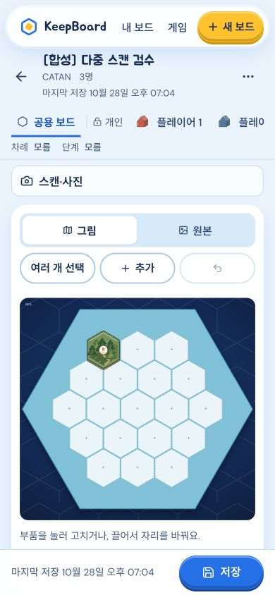

# 스캔 관측 연결 구현 인계

**VERIFIED — 소스 구현·집중 검증 완료, 배포/유료 모델 호출 0.** 현재 dirty 소스를 작업 시작점으로 보관했고 다른 변경을 되돌리지 않았다. 정확한 20개 제품/테스트 변경과 pre/post SHA는 `handoff.json`, 시작점은 `baseline.json`, 재현 가능한 차이는 `implementation.patch`에 있다.

## 구현한 동작

- 화면의 마지막 한 장 절단을 제거했다. 선택한 최대 6장과 요청 순서를 그대로 job에 고정하고 장당 한 단위로 읽는다. 한 장 카탄은 기존 native 그림 판독, 보충/crop은 기존 literal reader를 사용한다. 새 참조 사전·모델·기본 crop 정책은 없다.
- job마다 단위 1개씩 실행하여 기존 2-job scheduler의 상한을 재사용한다. 각 단위 retry0. 한 단위 실패는 다른 성공 단위와 원문을 버리지 않는다. Cloud batch claim/완료 영수증과 기존 requestId 중복 억제를 재사용한다.
- 같은 원본 crop은 저장된 `sourceEvidenceId/sourceRegion`와 실제 source/input SHA·크기로 원본 좌표에 복원한다. `PhotoTransform.kind='crop'`은 축 정렬 사각형이며 atlas와 구별한다. 중첩 crop은 지원하지 않는다.
- 원본 공간 IoU≥0.75인 같은 종류의 유일 대응만 연결한다. 같은 단위의 두 관측이 한 실물에 엮이면 충돌로 남긴다. 숫자값·색·모델 슬롯만으로 실물을 합치지 않는다. 지형/숫자/도둑은 다른 층이고, 도시/마을 종류 충돌은 보존한다. 이 임계값은 정답 인증값이 아니다.
- 확실히 연결된 새 기준 사진은 기존 그림/typed 목록으로 자동 반영한다. 기존 기록은 통째로 교체하지 않는다. 기존 non-null 사실과 수동값은 유지하고, 확실한 동일 실물의 빈 속성만 보충한다. 상충값은 raw와 충돌 메타데이터에 남는다. scope/epoch/revision 변경 뒤 늦게 온 결과는 적용하지 않고 job 영수증에 남긴다.
- 다른 시점의 미연결 관측을 새 실물 재고에 합산하지 않는다. `ScanObservationResults`에서 단위 성공/실패·원사진·모름/미배치를 열어 볼 수 있고 정정 없이 저장한다. 해당 원문은 receipt/snapshot에 보존된다.
- 선택된 카탄 실물에 **선택 기능**인 ‘이 실물 근접 사진으로 보충’을 붙였다. 새 확인 단계는 없다. 기존 한 장 그림/일반 typed 판독과 자율 편집·저장을 재사용한다.

## 계약과 보존

기존 job API의 `reader`에 optional `target:{assertionId,pieceId}`만 추가했다. 대상은 같은 owner/선택 영역의 현재 accepted 실물이어야 한다. target revision은 기존 scope CAS가 고정한다. 단일 보충 관측이 대상을 가리킬 때만 반영하며 다중 대응은 보류한다.

성공 receipt의 `scanUnitId/scanBundle`에 계획, 단위별 실제 상태, `(unitId,observationRef)` 연결·충돌을 보존한다. `result`와 `hostedWire/nativeWire`는 원문 관측이고 수정된 그림과 별개다. `componentRefs`는 실제 연결된 그림 ID만 가리킨다. 미연결 ref는 bundle의 원문 멤버로 남고 존재하지 않는 그림 ID를 만들지 않는다. 저장 엔진은 미연결-only 결과도 기존 receipt와 함께 보존한다. 공용/본인 scope 필터와 PIN/room 권한은 기존 경계를 재사용했다.

## 직접 검증

- `focused.log`: 관련 **67/67**, exit0. 기존 Catan native·Gemini literal·Splendor·Rummikub rack·UI/dirty·scan 회귀 포함.
- 최종 입력순서/대상 보충 성공/crop 원본·입력 SHA 분리까지 `integration-final.log`: **22/22**, exit0. 합성 HTTP 저장·재열기, Cloud 단위 중복 재전달, 부분 실패, null/0, 늦은 수동 정정, 다른 scope/epoch와 crop 좌표를 검사했다.
- `typecheck.log`: exit0. `build.log`: `npm run build` exit0 (타입 검사 포함). 기존 큰 client chunk 경고는 남아 있다. 전체 suite는 실행하지 않았다.
- 실제 CUA 390×844: ‘사진 읽기’ 한 번 → 2/2장 → 숲/숫자 그림 자동 표시 → 보충 숫자 미상/미연결 보관 → 수정 없이 저장 → reload 후 그림/두 receipt 유지. clientWidth/scrollWidth **390/390**, viewport 원복. 업로드는 합성 API seed이며 read/save/reload는 실제 UI 클릭이다. 1px 사진/PreviewReader이므로 인식 품질·지연 근거가 아니다.
- `ui-verification.json`: job/현재 기록/snapshot의 원 `ObservationResult` SHA 일치, 미상 보충 보존. 자기 preview PID65079 종료 확인. 최종 선택순서/derived-ref 정리는 최종 API 회귀로 확인했으며 완전한 브라우저 여정을 다시 반복하지 않았다.
- `replay.json`: 기존 4-crop 90행을 무과금으로 좌표·연결 재생. 보수적 기계 그룹 78개(연결11/충돌1/미연결66). 이전 사람 눈대조 55개에 맞추지 않았고 정확도/recall로 해석하지 않는다.

## 남은 범위

실제 여러 시점의 자동 정합·새 모델 성능/비용은 미검증이다. 원본 대응/확인 frame/선택 대상이 없는 다른 시점은 미연결로 보관한다. 일반 게임의 target API 계약은 있으나 선택 실물 UI 버튼은 현재 Catan SceneEditor에 노출했다. 새 crop은 hosted 축 정렬 경로이며 nested/local crop은 명확히 거절하고 원본을 유지한다. 읽지 못한 항목의 수정은 강요하지 않는다.

