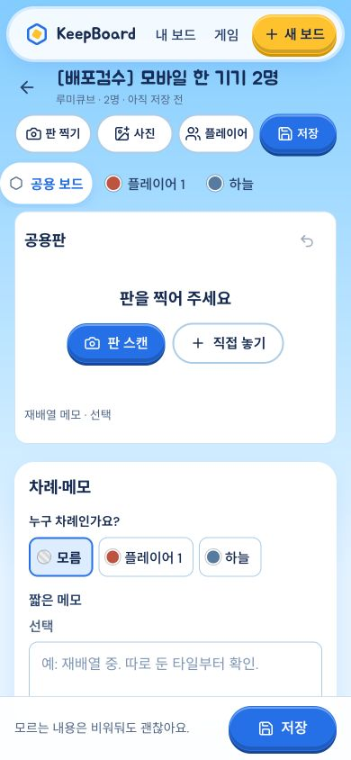

# 선택 이름·단일기기 production 반영

**VERIFIED · https://keepboard-kappa.vercel.app · READY**

- 배포 ID `dpl_AYwndjkTyeJcTGRTkReKT4wtvvyf`, **2026-10-22 12:25:02 KST**.
- 고정 URL https://keepboard-6q18nzgal-renggyus-projects.vercel.app
- Backend4319 **PID49131 / output session86172**, 같은 `/tmp/keepboard-preview/data`.
- 기존 proxy64200/tunnel64203/gateway18287와 preview들을 유지했다. 모델·라우팅 변경/AI 호출0.

로컬263/263·type/build0 동결 결과를 사용했다. source156파일 manifest와 dist SHA가 같아 전체검사/빌드는 반복하지 않았다. 기존 프로젝트·인증·터널 라우팅을 재사용한 clean prebuilt static **674파일**, zip/docs/source/env/Store/키 제외, CLI deploy/inspect exit0. [stage](stage.json) · [배포 로그](deploy.log) · [inspect](inspect.log)

## 직접 검수

공개 HTTPS 독립 cookie로 **25검사 PASS** ([api-verification.json](api-verification.json)):

- host 이름 생략→플레이어1, 새 member 공백→플레이어2, 다른 member ‘나래’ 보존. 실제 참가 전에는 host1명만 존재.
- 같은 cookie 재입장 시 기존 이름/색/좌석 유지. member 공용 수정403, host 타인 개인 수정403, outsider 조회403, 타인 개인 메모 비노출 유지.
- legacy 단일기기3명은 빈 값/‘별’/공백→플레이어1/별/플레이어3. named red/blue 색 유지, room metadata 없음.
- 같은 단일기기에서 public+서로 다른 두 owner 메모를 저장·snapshot·reopen해 동일값 확인.

**공개 실제 Chrome390×844 클릭:** 새 생성 기본 ‘한 기기에서 모두 기록’ → 루미큐브 → 이름 첫째 빈 값/둘째 ‘하늘’ → 생성. ‘공용 보드 / 플레이어1 / 하늘’ 탭, 두 명 상태와 개인 사진/선택 PIN 진입을 확인했다. page overflow0, viewport reset. 캡처는 아래 생성 완료 화면이다. 실제 공개 브라우저 save/reopen까지 클릭한 것은 아니며 위 독립 API 검사와 로컬 실제 브라우저 저장/reload 증거를 구분한다.

공개 HTML·신규 JS/CSS·manifest **4개200/정확SHA 일치**, local/public health200/catalog120. [public-assets.json](public-assets.json)

| 산출물 | SHA256 |
|---|---|
| `index-Bq6MHVSs.js` | `1c31fe3d9df33e4bae72ac9216ae434c4044d22fbc5b4fc9888fbd4855ff335c` |
| `index-OaHCSuLT.css` | `dd4e27e13c42afaba2b25669a17b33f4522891a229e49482a70c6283e65847a9` |
| `index.html` | `9d4dad645dd6f48017b22498c36297ecba860a8b5f8cd90554c051a51da56bb0` |

AI 상태 전후 동일: configured=true, provider=gateway, model=deepseek-flash, upstreamProvider=deepseek, reasoningEffort=high. 실AI·사진 전송/카메라 활성화는 하지 않았다.

## 데이터와 복구

교체 대상PID43978의 command/cwd/data-root/PORT4319/NODE_ENVproduction을 대조하고 **그 listener만 종료**, 같은 Store로 최신 source를 기동했다. opaque full backup **`/private/tmp/keepboard-integrated-backup-0twn7jns`**(0700, 해시 파일명·로컬 restore index0600)은 배포 산출물에 포함하지 않았다.

교체 전·후/최종 **기존52파일 전부 바이트 동일**, 기존 PIN/settings/routing 변경0, 누락0. 추가3파일은 아래 명시 합성 session뿐이며 path hash로 대조했다([operations-final.json](operations-final.json), [verification.json](verification.json)). 새 PIN/사진 파일은 만들지 않았다. 기존 사용자 기록은 수정하지 않았다.

- `2874065d-3ec5-400c-ab29-bb5848c9be1d` — `[배포검수] 선택 이름 초대방`
- `4806f2d7-a17b-4e3d-9109-8293b7a480ea` — `[배포검수] 한 기기 3명 선택 이름`
- `7acab9dc-e2fe-4465-a4c2-45d142c15ccd` — `[배포검수] 모바일 한 기기 2명`

문제 시 신규 쓰기를 멈추고 같은 Store의 검증 source로4319만 재기동한다. 이전 static 배포 `dpl_5tvBrcy2UigCpmMU4obnEUvk8Nqs`/clean stage는 보존돼 있다. 이후 사용자 쓰기를 덮는 일괄 데이터 복원은 하지 않는다.

Mac backend/proxy/tunnel·AI 사용 시 gateway 상시 실행과 `/tmp` Store 보존 조건은 기존대로다. 계정/좌석이전/방 권한확장·기존 기록변환은 추가하지 않았다. source/art/spec/freeze 미변경 범위와 전체 로컬 결과는 [상위 인계](../README.md). 소유권 반환.
