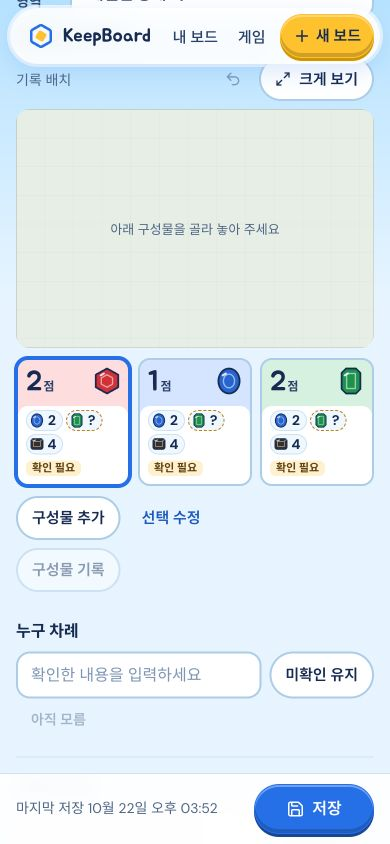

# 스플렌더·Claude UI production 반영

**VERIFIED · https://keepboard-kappa.vercel.app · READY**

- 배포 `dpl_2QwWa85maeijaCWR67KFx6ELEMX8`, 고정 https://keepboard-mkfk7y1or-renggyus-projects.vercel.app
- Backend4319 **PID85677 / output session41418**, 같은 Store `/tmp/keepboard-preview/data`.
- proxy64200 / tunnel64203 / gateway18287 유지. configured=true / gateway / deepseek-flash / deepseek / high 그대로. 실AI0.

동결 source784+주요 dist3 **787개 해시 불일치0**, source digest35dbb0e299fdfc69182cf5b09b8397fc81f9db99824b9e23ac16d10935b40b18. clean prebuilt static674파일만 배포, docs/source/PDF/zip/env/Store/사진/raw 제외. 기존 full293 및 마지막SSR1/type포함build0 증거를 재사용했고 반복하지 않았다. deploy/inspect exit0.

공개 HTML·JS·CSS/art manifest/board mapping/web manifest6개200·정확SHA 일치, health200/catalog120 assisted118/native2. [해시/API](public-assets.json) · [배포검증](verification.json)

| 산출물 | SHA256 |
|---|---|
| index.html | 415a8c0644f86544d3a6ed1775bdda6d2ba86f1dcac82fe62fd7eb184c126c18 |
| index-DvCBl2yE.js | 41c2f5b121bc894b846b18d58db1fa77bc3b903036d56f6ce69fa52a1cb09478 |
| index-ChqLjnDm.css | e2945e192d74265880d9f1cc017a4cb609c3516d7d6f254200e435c633139fe9 |

## 공개 동작·보존

새 `[배포검수] 스플렌더 구조화 수동 카드` **91376997-fd8a-4310-b2d7-fa299692818f**만 생성했다. typed 음수점수 PATCH400으로 새 backend 검증을 확인했다. CUA390에서 카드 표시→점수0을2로수정→상단저장→reload→점수2 확인. 같은 합성기록 API에서 3카드/snapshot1/모름green=null·white=0/스냅샷값일치를 확인했다. 실제사진/AI출력 검수가 아니며 인식 정확도 개선 완료를 주장하지 않는다. page overflow0/broken0, viewport reset. [합성값](synthetic.json)

교체전 full opaque backup `/private/tmp/keepboard-integrated-backup-7xyi2kil`(0700, 해시파일명/restore index0600). PID70743의command/cwd/PORT/data-root를확인한뒤4319만SIGTERM/같은Store로기동. 기존 **63파일 전부 바이트동일**, 변경/누락0. 추가1파일은 위 합성session뿐이다. PIN/settings/routing을바꾸거나사용자기록을열지않았다. [보존/PID](preservation.json)

Mac backend/proxy/tunnel/gateway 실행과 `/tmp` Store 보존이 필요하다. 문제시 현재데이터를유지하며이전검증backend/static배포로복귀하고신규사용자쓰기를덮는전체Store복원을하지않는다. 새소스작업/AI호출/재빌드없이소유권반환.
