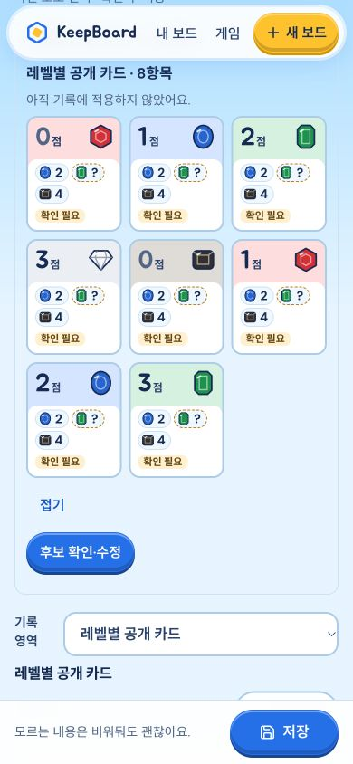

# 스플렌더·Claude UI 최종 통합

**VERIFIED · 소스 동결/소유권 반환 · 운영 미반영.**

- 전체 `npm test` **293/293 exit0**. 이후 감독 확인한 마지막 연결결함만 수정했다: `SplendorEditor.current()`에서 readout.kind=null이지만 componentId가 알려진 귀족/토큰은 편집 시작값만 해당 empty kind로 연다. 표시값·원래 객체는 그대로 unknown이다.
- 해당 SSR 회귀 **RED→GREEN 1/1 exit0**, `editor-kind-{red,green}.log`; 마지막 수정 뒤 full suite는 지시대로 반복하지 않았다. `src/SplendorEditor.tsx` 조건1줄 + `tests/splendor-record-ui.test.ts` 회귀1개만 추가 변경했다.
- 최종 `npm run build` **exit0**(tsc 포함), `build.log`. 중복 typecheck 없음. 최초 빌드 뒤 위 소스수정이 있어 필요한 최종빌드만1회 갱신했다. Vite >500KB chunk 경고는 남는다.

최종 JS **index-DvCBl2yE.js**, CSS **index-ChqLjnDm.css**. SHA/exit/캡처범위는 `verification.json`, 전체 제품소스·정적원본784파일 digest **35dbb0e299fdfc69182cf5b09b8397fc81f9db99824b9e23ac16d10935b40b18** (`source-manifest.json`). 사용자 첨부3개와 동일한 SHA의 dist 파일0. 원본사진/raw/개인설정은 정적산출물에 넣지 않았다.

## 실제 화면

새 AI차단 tempStore의 built 앱 **http://127.0.0.1:4406** (`preview.json`, output session44695). 운영자료/기존프리뷰/유료AI 호출0.

- CUA Chrome5에서 **390px 3열 카드·모두보기8** → 후보확인 → 점수blank/0 및 비용null/0 입력 → 명시적용 → 상단저장 → reload → 공개저장복원 실제 클릭.
- 같은 합성 기록의 API 재조회로 points0/blue비용null/green비용0/snapshot1을 확인했다(`roundtrip.json`).
- 390/320/1440에서 page overflow0, broken image0. 카르카손390 기본 화면도 확인. viewport reset.
- 화면은 최종1줄 편집시작값 수정 **직전** 빌드의 실제 캡처다. 그1줄은 새 SSR로 검증했고 추가 실제클릭을 했다고 주장하지 않는다. 실폰 키보드·손가락·카메라 검수는 아니다.

다른 변경목록은 `../handoff.json`, `docs/splendor-readout-ui/README.md`, `docs/ui-polish-claude/README.md`. 실제 사진의 숫자 오독은 앞선 `comparison.json`에 남아 있으며 이번 합성 UI 검증으로 정확도가 개선됐다고 주장하지 않는다. 공개배포/backend전환은 별도 A3 카드까지 대기한다.
