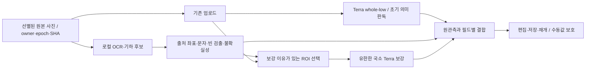

# KeepBoard의 빠른 1차 시각 판독과 Terra 보강 설계

## 1. 결정

**선택: 전용 OCR·기하로 관측 근거를 먼저 얻고, Terra의 의미 판독과 필요한 국소 보강을 결합한다.** 처음에는 OCR이 못 보는 말·문양·가려진 경계의 회수를 위해 현재 whole-low를 병행한다. 검출기가 충분히 회수하는 장면군에서만 나중에 이 whole 호출을 생략한다. 처음부터 모든 게임에 `detector → OCR → high`를 강제하거나, 작은 범용 VLM으로 모든 판독을 대체하지 않는다.

핵심 변화는 “low를 끝까지 기다렸다가 high”가 아니다. 사진의 픽셀에서 얻을 수 있는 문자 영역·경계·기하를 먼저 처리해 **보강할 이유가 이미 있는 영역은 whole-low와 겹쳐 읽을 수 있게 하고**, 의미가 모호한 나머지는 low 결과 후 한 번만 보충한다. 동시에 위치·반복 키·동일한 속성을 대량 생성하는 일을 줄인다. 어떤 ROI를 고르는지, 얼마나 놓치는지 확인되지 않았으므로 자동 보강은 먼저 명시된 실험 모드에서 검증한다.

이 선택은 INFERRED이다. 현재 자료만으로 “PaddleOCR+Terra가 더 빠르고 정확하다”를 확정할 수 없다. 보드게임에서의 전용 OCR·검출기 성능은 아직 측정하지 않았다. 아래의 구현·비교가 선택을 지지하거나 기각해야 한다.

## 2. 현재 증거가 말하는 것과 말하지 않는 것

### 현행 제품의 실제 경계 — VERIFIED

| 경로 | 직접 확인한 사실 | 설계에 주는 제약 |
|---|---|---|
| `src/Capture.tsx:91–109`, `src/scanQuality.ts` | 작은 로컬 품질 샘플로 선별하되 원 카메라 해상도 JPEG를 보관한다. 최대 6장. 흐림·노출·움직임·중복은 보지만 물체 회수는 확인하지 않는다. | 작은 샘플을 OCR 원본으로 쓰지 않는다. 모든 영상 프레임에 OCR을 추가하지 않는다. |
| `server/scanExecution.ts::runHostedScan` | 이미지 읽기 캐시, 단위별 durable claim, `Promise.allSettled`로 준비된 단위를 병렬 실행한다. 최대 단위 수는 기존 6장 계약에서 제한된다. | “2개를 6개로”는 이미 있는 개선이다. 새 ROI도 호출 예산에 포함해야 한다. |
| `workflows/analyze.ts::analyzeWorkflow` | hosted 경로는 `runScan`을 이용한다. 기존 legacy job-slot 반복과 다르다. | 오래된 2-job 설명을 현재 hosted 호출의 전역 상한으로 쓰지 않는다. |
| `src/ScanObservationResults.tsx::ScanProgressPreview` | 먼저 완료된 단위의 사진 overlay를 보여준다. | 첫 overlay는 편집 가능한 전체 판이나 복원 완료가 아니다. |
| `server/analysisTask.ts::commitAnalysisTask` | 현행 결과는 별도 승인 대기열이 아니라 현재 편집 기록으로 반영된다. scan 단위 결과가 모인 뒤 한 번 commit한다. 같은 job 재반영 차단, epoch·scope·수동 변경 검사가 있다. | 오래된 “반드시 후보 승인” 전제를 재도입하지 않는다. 부분 편집을 일찍 열려면 새 commit 계약이 필요하다. |
| `server/ai/terraGameReader.ts` | 현재 제품은 low/high-image/32768 출력 상한, 단일 이미지, 완료 JSON 파싱이다. 실험 high와 구분된다. | high 선택은 task/reader identity에 명시해야 한다. 전역 기본값을 몰래 바꾸지 않는다. |
| `shared/lightweightRecognition.ts::compileObservationTask` | `images.length === 1`; referenceSetId는 현재 거절한다. | 다중 이미지와 실제 참조 매칭은 아직 구현된 계약이 아니다. 공용 SVG는 실물 참조 데이터가 아니다. |
| `shared/photoGeometry.ts` | 같은 원본 crop 역변환은 정확한 생성 정보에 근거한다. 확인된 Catan frame의 일부 종류만 hex 후보로 연결한다. | 다른 각도 사진의 정합이나 모든 게임의 슬롯 검출이 이미 된 것은 아니다. |
| `server/observationFusion.ts::focused`, `projectGenericFusion` | 작은 ROI·픽셀 밀도 우세가 알려진 값 충돌에도 `focused-provisional` 선택 근거가 될 수 있다. 수동 값·삭제·퇴역 group 보존 경계는 별도로 있다. | 국소 사진을 항상 더 정확하다고 취급하면 빠른 재판독이 오히려 값을 망칠 수 있다. |

코드 해시는 [입력 목록](input-inventory.json), 마지막 변경 여부는 [검사 결과](validation.json)에 있다. 현재 공유 파일 검토이며 운영 배포 확인은 하지 않았다.

### 기존 실험과 이번 무과금 점검

A=whole-low, B=같은 whole-high, C=사전 고정된 한 ROI-low, D=같은 ROI-high이다. **C/D는 모든 누락 영역을 자동 탐색한 결과가 아니다.** 세 사진은 이미 본 개발 자료이며 AI 부분 기준을 사용했다.

| 게임 | A / B / D API 시간(초) | 선택 물체 A→B | 중요한 품질 차이 |
|---|---:|---:|---|
| 카르카손 | 24.0 / 174.4 / 96.9 | 10/16→16/16 | D 단독 12/16. B+D는 B보다 선택 물체를 추가 회수하지 않았다. |
| 사그라다 | 32.9 / 79.1 / 43.2 | 20/21→21/21 | 숫자 A 19정/1오, B·D 각각 17정/1오/2모름. B+D 19정/1오. A와 같은 숫자 정답 수이며 같은 오독이 남았다. |
| 티켓 투 라이드 | 70.7 / 82.2 / 50.1 | 25/25→25/25 | B/D 추가 호출의 선택 표본 회수 이득이 없었다. 군집 기준 0/8은 개별 표현과 중복되는 별도 분모다. |

근거: [high 독립 검토](../terra-quality-iteration-20261030/independent-high-review.md), [crop-high 독립 검토](../terra-quality-iteration-20261030/independent-crop-high-review.md). 62개 선택 표본, 20개 숫자, 높은 확신의 숫자 18개는 서로 다른 분모이다. 7개의 기하 중복 후보를 7개 실물 중복이라고 세지 않았다.

이번 [오프라인 점검](offline-audit.json)은 A/B/C 원응답 9개의 SHA를 확인하고 속성 상태·출력량을 다시 집계했다. **새 시각 정답 판정은 하지 않았다.** 사그라다 A에는 전체 출력상 unknown도 있지만, 선택 기준의 오독 1개는 observed 값이다. 따라서 unknown-trigger가 다른 ROI에서 우연히 이를 고칠 수는 있어도 해당 오류를 직접 지목하지 못한다. 카르카손 A의 타일 출력은 2행뿐이고 일부는 묶음 표현인 반면 B는 53행이다. 이 차이를 바로 전체 타일 정확도로 계산할 수는 없지만, 없는 개체에는 검사할 속성 행도 없다는 문제는 분명하다.

출력량도 중요하다. 카르카손 A/B의 output은 1,760/15,555 tokens, 그중 reasoning은 102/6,572다. reasoning을 제외한 출력도 1,658/8,983으로 늘었다. **high가 오래 걸리는 이유를 추론 토큰 하나로 환원할 수 없다.** 더 많이 검출한 결과를 전부 잘라 내서 빨라지는 것은 목표 달성이 아니다. 모델이 생성하지 않아도 되는 위치·식별자·반복 구조를 코드로 담당하는 방향을 시험해야 한다.

10게임 whole/ROI 연구에서도 숫자·개별 회수·더미의 표면 정보가 서로 달랐다. 원문이 스키마를 충족해도 숫자가 맞는 것은 아니었다. 작고 흐린 인쇄값은 같은 픽셀을 확대해도 원정보가 생기지 않는다. [10게임 보고](../terra-ten-game-evaluation-20261030/README.md)

이미 빠르지만 쓸모없었던 반례도 있다. 고정 Tesseract 5.5.0 `psm11` whole Catan 시험은 약0.309초에 끝났지만 지정 숫자18개를 하나도 회수하지 못했다. 다른 고정 crop 처리의 결과를 모든 OCR의 한계로 일반화할 수도 없다. Qwen 숫자 전용 경로는 같은 한 사진/atlas에서 각각16/18·약58초였고 독립 표본이 아니었다. 따라서 새 OCR은 실제 game-font/위치 시험을 통과하기 전에는 이름만 바꾼 해결책이다. [OCR 진단](../lightweight-recognition/ocr-diagnostic.json), [숫자 인계](../lightweight-recognition/number-final-handoff.json)

## 3. 관련 연구·실제 구현에서 채택할 것

상세한 방법/표/고정 코드/라이선스는 [1차 근거표](primary-sources.md)에 있다. 아래는 그 근거에서 도출한 KeepBoard 적용 판단이며, 논문 수치를 서비스 성능으로 옮긴 것이 아니다.

1. **전용 OCR의 검출과 문자 판독 분리.** PP-OCRv6는 비생성형 검출과 CTC 판독 경로를 갖고, 공식 JS 구현은 실제 polygon에서 crop한다. 작은 문자·숫자의 위치를 VLM이 JSON 좌표로 다시 생성하는 일을 줄일 후보다. 그러나 텍스트 polygon과 카드/주사위/타일 경계는 다르다. SDK가 인식에 실패한 polygon을 버리는 부분은 보완해야 한다. [논문 §2–3](https://arxiv.org/html/2606.13108), [구현 core.ts](https://github.com/PaddlePaddle/PaddleOCR/blob/dab3fe35379033fdcb2d0e9572fac0b36c9a9ebf/paddleocr-js/packages/core/src/pipelines/ocr/core.ts)
2. **판 기하와 외형 분류를 분리.** chesscog의 격자·점유·기물 분리는 고정 판에서 현실적인 사례다. 같은 격자라도 기물 외형이 바뀌면 별도 적응이 필요했다. KeepBoard는 알려진 칸 수로 기물을 채우는 대신, 등록이 검증된 경우에만 관측 위치를 칸으로 옮긴다. [논문](https://pmc.ncbi.nlm.nih.gov/articles/PMC8321354/), [공식 recognizer](https://github.com/georg-wolflein/chesscog/blob/4e9c22d76c75615d4e9a4cd567679f4caa00dec7/chesscog/recognition/recognition.py)
3. **crop은 작은 물체의 모델 입력 스케일을 보완한다.** SAHI는 이미 있는 detector에 slicing과 source 좌표 복원을 붙인다. 큰 물체가 쪼개지거나 overlap 중복이 생겨 whole 문맥과 merge가 필요하다. 이것은 detector 자체도 아니고 VLM 정확도 보장도 아니다. [논문 §3–4](https://arxiv.org/html/2202.06934), [공식 slice 추론](https://github.com/obss/sahi/blob/b5a153ee7bcb1fd84a7b868575ff14131e7423ce/sahi/predict.py)
4. **찾을 대상이 있는 선택적 visual search와 전체 인벤토리는 다르다.** V*는 목표 물체를 국소 탐색하고 visual working memory에 넣는다. 코드의 crop 검색은 첫 물체에서 종료하는 경로도 있어 같은 모양 여러 말을 전부 세는 문제와 다르다. 우선순위 탐색 원리만 쓰고 재귀 VLM agent를 이식하지 않는다. [논문 §3.3·5](https://arxiv.org/html/2312.14135v2), [검색 코드](https://github.com/penghao-wu/vstar/blob/4ede6647959cfb59eeabd09286adf6a5f9478da0/visual_search.py)
5. **내부 시각 토큰 압축은 API crop과 다르다.** LLaVA-UHD의 variable tiling·학습된 resampler는 자체 모델 구조다. Terra API 바깥에서 mosaic을 만들었다고 그 압축률·비용을 얻지 못한다. overview와 source 위치 보존 원리는 재사용한다. [논문 §3](https://arxiv.org/html/2403.11703v1)
6. **라우터의 confidence는 복원 정답 확률이 아니다.** RouteLLM은 언어 선호 비교 데이터로 strong/weak를 선택하며 도메인 밖 성능 저하를 보였다. 코드의 threshold 보정은 strong 호출 비율을 맞추는 방식이다. KeepBoard의 관측 정확도 데이터 없이 이 수치를 신뢰도로 사용하지 않는다. [논문 §4](https://arxiv.org/html/2406.18665v2), [threshold 코드](https://github.com/lm-sys/RouteLLM/blob/0b64fdafe049e596a3f5657c219329f24af24198/routellm/calibrate_threshold.py)

## 4. 네 가지 현실적 구조 비교

| 안 | 장점 | 품질·대기·운영 비용 | 판정 |
|---|---|---|---|
| 전체 Terra high 1회 | 현재 저장 계약과 가장 가깝다. 개발 표본에서 타일 개별화가 개선됐다. | 79–174초 실측. known 오독도 잔존. 모든 사진에 high 비용. | 비교 기준·어려운 장면의 명시적 fallback. 기본안으로 고정하지 않음. |
| whole-low 완료→unknown/누락 crop-high | high를 적게 호출할 가능성. | 직렬 대기. 처음부터 없는 물체·known 오독을 unknown으로 검출하지 못함. ‘누락 ROI’를 아는 것이 선결 과제. | 사후 보강 일부에만 사용. 항상 강제하지 않음. |
| **전용 OCR/기하 후보 + whole-low 병행 + 필요한 국소 Terra** | 사진 픽셀 위치를 코드로 연결, 생성 출력 축소, 선행 ROI를 low와 겹침. 무설치 브라우저 배포 후보. | OCR의 물체 범위 제한·cold download·폰 자원·selector 누락. high 호출 감소/속도는 미측정. | **추천 개발 방향.** 기능별 증거를 분리해 작은 slice부터 비교. |
| 일반 detector/segmenter+참조 매칭이 대부분 처리, Terra 예외만 | 충분한 데이터·정합이 있으면 VLM 의존을 크게 줄일 수 있다. | 현재 검증된 실물 참조셋 0. YOLO-World의 일반명 검출은 게임 정체성을 보장하지 않는다. 학습/모델관리·GPU 또는 hosted 의존이 추가된다. | 이후 detector 회수 검증 후. 지금 120게임 전용 학습/참조 수집을 선행하지 않음. |

YOLO-World의 offline vocabulary는 gamepack에 있는 “주사위·카드·말” 후보 이름을 연결할 수 있다. 그러나 색 소유권·인쇄 숫자·카드 정체성까지 주지 않는다. 논문의 V100 FPS를 CPU/mobile에 적용할 수 없다. 공식 코드/가중치 계열의 GPL-3.0 조건과 배포 방식 검토도 필요하다. 이번 고정 main의 detector 파일은 정적 AST 파싱에서 문법 오류가 있었으므로 그 revision을 실행 준비 완료로 분류하지 않았다. 공개 release/별도 검증된 runtime을 고르는 일이 추가로 필요하며, 모델 전체가 불가능하다는 뜻은 아니다. [공식 저장소](https://github.com/AILab-CVC/YOLO-World), [무실행 파싱 증거](offline-audit.json)

## 5. 권고 데이터·처리 흐름

### 5.1 로컬 1차 결과는 정답이 아니라 출처가 있는 증거

새 `PerceptionEvidence`는 최소한 다음을 갖는다. 현재 `LiteralObservation`을 거짓 reader identity로 재사용하지 않는다.

- `sourceEvidenceId/sourceImageSHA/inputImageSHA/dimensions/transformId`, `owner/partition/epoch`, `definitionSHA/definitionSourceSHA`, 실제 `engine/model/assetSHA/backend`. 현 `ObservationRequest.sourceSHA`는 명세 해시이므로 이미지 해시와 혼용하지 않는다.
- `proposalId`와 **원본 픽셀 polygon**. `text-region`, `closed-surface`, `registered-cell` 등 검출 방식. 이것은 아직 게임의 동일 물체 ID가 아니다.
- 문자 raw, 해석 후보, det/rec score의 원값. score는 정답 확률로 표시하지 않는다. 빈 문자도 polygon과 `unreadable/unsupported`로 보존한다.
- `clipped/occluded/orientationAmbiguous/registrationResidual` 등 실제 계산한 상태. 품질 수치가 없으면 unknown. OCR box로 기물 전체 bbox를 대체하지 않는다.
- 함수로 측정한 `load/detect/recognize/map` 시간, cold/warm, 실제 전송/다운로드 바이트. 관측되지 않은 속성은 null이며 0·없음과 다르다.

PaddleOCR.js는 공개 ONNX와 Worker 경로가 있어 우선 구현 후보로 적합하다. 약 31.1 MB의 small det+rec 가중치 외에도 ORT/WASM/OpenCV 비용이 있다. 최초 다운로드·메모리·모바일 throttling은 UNKNOWN이다. 공식 저장소 package version은0.4.2지만 npm 게시본 열람은403이어서 release artifact 동일성은 미확인이다. 화면 진입 후 비차단으로 준비하고, 선택된 원본만 처리한다. WebGPU가 안 되면 공식 WASM 경로를 시험하되 너무 늦거나 실패하면 **현재 Terra 경로를 그대로 진행**한다. macOS에서 빠른 것만으로 Vercel/모바일 성능을 승인하지 않는다. 첫 시험은 small을 기준으로 하며 tiny는 정확도-속도 비교 후보이지 비용 때문에 자동 채택하지 않는다.

OCR이 글자를 읽었다고 공용 필드에 넣을 권한이 생기는 것은 아니다. 선택된 area의 허용 속성과 owner/partition 경계를 그대로 적용한다. 공용판 사진에서 보인 손패 글자를 다른 사람의 비공개 상태로 자동 연결하지 않는다.

### 5.2 코드가 대신할 수 있는 것의 경계

| 작업 | 코드가 담당할 수 있는 조건 | Terra/사용자/추가 사진이 필요한 부분 |
|---|---|---|
| 위치 | crop 생성 transform, 검출된 polygon, 검증된 평면 homography | 가림·기물 받침점·다른 시점의 반복 무늬 대응. 제시된 box가 맞는지 자체로 증명하지 못함 |
| 개수 | 실제로 분리 검출된 single을 동일성 중복 제거 후 집계 | 더미 속 수량, 검출되지 않은 물체. 게임 재고 총수로 채우지 않음 |
| 색 | 물체 내부 mask에서 측정·조명 영향 확인 후 후보색 | 색=소유자 추정, 반사·투명체·조명 착색. 색 이름이 맞아도 owner 미정 가능 |
| 숫자·텍스트 | polygon crop OCR, 허용 문자 parsing, 방향 증거 | 6/9, 주사위 윗면과 옆면, 가려진 글자. 허용 값 목록은 두 합법값 중 정답을 고르지 못함 |
| 주사위 눈 | 윗면 경계가 분리되고 pip blob이 온전히 보이는 경우의 후보 계수 | 투명 주사위의 뒷면 점·반사·옆면 혼입. OCR 성공으로 계산하지 않음 |
| 배치 관계 | 해당 판본의 고정 연결 + 관측 위치가 충분히 등록된 경우 | 현재 점유·회전·쌓임·그림에 없는 관계를 룰로 발명하지 않음 |
| 종류·문양·카드 정체 | 법적으로 확보된 판본별 실물 참조와 충분한 매칭 근거가 있는 경우 | 현재 참조셋 없음. Terra 의미 판독/사용자 정정이 주 경로 |

gamepack의 고정 사실은 상태 정답이 아니라 **타입/허용값/표현 관계**에 사용한다. 예를 들어 격자가 20칸이라고 20개의 주사위를 만들지 않는다. 등록된 빈 칸은 `검출 없음`과 `비어 있음이 확인됨`을 구별한다. 자동 homography는 충분한 대응점과 outlier 검사·재투영 잔차가 있을 때만 쓰며, 현재 Catan 확인 frame을 먼저 재사용한다. 일반적인 움직이는 시점 추적·3D 복원은 첫 단계에서 제외한다. [OpenCV 공식 예제](https://docs.opencv.org/4.13.0/d7/dff/tutorial_feature_homography.html)

### 5.3 ROI 선택: unknown 검사보다 넓되 호출은 제한

ROI 생성에 정답·예상 개수·사진별 좌표를 사용하지 않는다. 다음 reason code를 먼저 기록한다.

1. **TEXT_WITHOUT_VALUE**: 텍스트 검출 polygon은 있으나 OCR이 빈 값·미지원 문자·방향 불명이다. 필수 복원 속성과 관련 있는 영역만 대상. 가려져 원정보가 없으면 high 대신 원사진/미확인 보존이다.
2. **VISIBLE_REGION_UNACCOUNTED**: 독립적으로 얻은 단일 surface/cell 후보가 semantic observation과 연결되지 않았다. 후보가 잘못됐을 수도 있으므로 존재를 확정하지 않고 존재/종류부터 묻는다. 처음에는 검증된 surface 방법이 있는 영역에 한정한다.
3. **GROUP_HAS_VISIBLE_DETAIL**: group이 읽혔고 내부에 분리된 표면 후보가 보인다. 더미 수량을 강제하지 않으며, 한 개 표면이 여러 카드라는 가정도 하지 않는다.
4. **VALUE_DISAGREEMENT**: 동일 실물의 OCR/whole/다른 관측이 다르다. low 자신이 unknown이라고 했는지와 무관하다. 알려진 값끼리 다른 이유를 보존한다.
5. **BOUNDARY_OR_SCALE**: 물체 경계가 ROI에서 잘렸거나, 원본에는 글자 획이 있으나 전체 입력 축소로 소실될 가능성이 있다. 광학적 흐림과 분리한다.

작업 우선순위는 **새 개체/복원에 중요한 속성 → 연결된 값 충돌 → 선택적 명칭** 순서의 설명 가능한 규칙으로 시작한다. “printedName unknown”을 모두 high로 보내지 않는다. OCR과 Terra가 모두 같은 물체를 놓치면 이 selector도 놓친다. 따라서 첫 버전은 whole semantic scan을 유지하고 완전성 인증을 하지 않는다.

ROI는 검출 polygon의 부모 표면과 주변 식별 문맥을 함께 포함한다. 인접 후보의 crop이 겹치면 같은 physical region 요청으로 묶고 원본 transform을 보존한다. 화면 전체에 고정 네 칸을 매번 적용하지 않는다. 고정 margin·overlap을 정확도 기준처럼 선언하지 않고 개발 자료에서 고정 후 새 사진에 적용한다. 첫 비교의 자동 보강 한도는 **논리 스캔당 0–2개 ROI, 한 차례 사후 보충까지**, 총 호출 수는 기존 max6보다 늘리지 않는다. 이는 검증을 위한 자원 경계이며 최적값 주장이나 사용자 수동 확인 요구가 아니다.

low를 기다릴 필요가 없는 reason은 업로드/로컬 처리가 끝나는 즉시 dispatch할 수 있다. 미관측 또는 충돌이 low 이후에만 드러나면 직렬 추가 시간이 생긴다. 모든 경우를 사전 판별할 수 있다고 약속하지 않는다.

### 5.4 Terra에 넘길 국소 작업과 출력

첫 비교는 현재 모델·이미지 detail·계약을 유지한 ROI 기준군과 비교한다. 이후 `region-refinement-v1`은 **이미지와 검출 proposal ID/원본변환, 허용 종류·속성, 필요한 질문만** 받는다. 검출기의 값은 정답으로 지시하지 않는다.

- 로컬 경계가 검증된 경우 `proposalId → exists yes/no/unknown, componentId, requested literal properties`를 반환하면 좌표와 모든 반복 속성 키를 재생성할 필요가 줄어든다.
- `reject`, `split`, `new object with box`, `group/unknown`을 허용한다. 후보 목록 밖 물체를 못 쓰게 막으면 검출기의 누락이 영구 고정된다.
- detector의 text-region ID와 물리적 카드 ID는 다르다. 숫자 여러 개가 한 카드의 비용·점수일 수 있으므로 관계는 실제 관측 또는 의미 판독 근거로만 연결한다.
- 원응답·값·거절·좌표는 그대로 저장하고 기존 editable 값은 adapter가 조립한다. serialization만 압축한 효과와 읽는 속성을 줄인 효과를 분리해 측정한다.
- 고정 max output을 작게 잘라 빠르게 만든 것으로 취급하지 않는다. `incomplete`는 완료 복원 결과가 아니다. 국소 작업의 적절한 출력 상한은 실측 후 정한다.

### 5.5 결합과 일찍 편집 가능한 결과

동일성은 `sourceSHA + transform + owner/epoch + definition/area + 물리 단위 + 실제 겹침`으로 판단한다. ROI가 같다는 이유만으로 같은 실물은 아니다. 같은 unit의 이웃, 카드 위 말, 보드 위 주사위, 서로 다른 종류를 무조건 합치지 않는다. 미등록 다른 각도 사진은 별도 관측으로 보존한다.

값 결합은 **수동값/수동삭제 보호 → 동일값 근거 결합 → null 보완 → 알려진 값 충돌 보존** 순서다. 충돌에서 crop이 작다는 이유만으로 값을 승격하지 않는다. 기존 값은 임시 표시로 유지하되 대안·충돌을 노출한다. anchor가 틀릴 수 있으므로 영구 잠그는 것도 아니다. 검증된 새 시각 근거 또는 사용자의 자연스러운 정정으로 바꿀 수 있다. 같은 VLM의 두 답이 일치해도 독립 검증으로 계산하지 않는다.

현재의 단위 overlay는 재사용한다. **부분 편집의 실제 구현은 별도 작은 단계**다. 초기 whole-low/로컬 결과를 기록한 뒤 보강 결과가 수동 수정한 값을 덮어쓰지 않도록 기존 `projectionDigests`와 field-level 보호를 활용해야 한다. `commitAnalysisTask`의 “같은 job 이미 존재” 검사만 제거해서는 안 된다. 제안은 한 논리 scan generation 안에 `initial projection`과 `refinement receipts`를 구분하고, 새 receipt별 1회 비파괴 patch를 적용하는 것이다. scope/owner/epoch/출처가 바뀌면 재배치하지 않고 원관측만 남긴다. 수동 편집 때문에 raw 전체를 잃거나 다시 유료 호출하지 않는다. 저장은 언제나 허용하며 남은 결과는 나중에 읽을 수 있게 한다. 별도 필수 승인 단계를 추가하지 않는다.

이 부분이 구현되기 전에는 **first overlay 시간만 개선되었다고 표기**하고 첫 편집/저장 시간이 빨라졌다고 주장하지 않는다.

## 6. 한 요청의 다중 이미지, 여러 crop, progressive 전략

| 방식 | 기술 사실 / 장점 | KeepBoard 판단 |
|---|---|---|
| whole+crop을 1개 Terra 요청에 | 공식 API는 복수 이미지 가능. 공통 문맥과 요청 overhead 공유 가능. | 각 이미지가 토큰에 반영된다. 현 제품은 단일 이미지 계약이며 imageIndex·좌표계 확장이 필요하다. 한 응답의 생성/실패/긴 꼬리 공유. 동일 품질·속도 미측정이므로 비교 후보로만 둔다. |
| 필요한 ROI별 요청 | 원본 transform·독립 claim·먼저 온 결과·국소 실패 분리. | 문맥/입력 중복·호출 수 증가, rate-limit·비용. 현재 unit 모델과 가장 가까워 첫 구현에 적합. |
| atlas/mosaic | 다수 crop의 HTTP 수 감소 가능. | 개별 물체 유효 픽셀 축소·panel mapping·문맥 소실. 학습된 internal tiling 압축과 다르다. 기본안 아님. |
| SSE/progressive token | 텍스트 일부를 빨리 전달할 수 있다. | high의 첫 추론 지연과 최종 JSON 검증은 별개. token prefix를 저장 가능한 물체라고 해석하지 않는다. unit completion/draft가 더 직접적인 첫 개선이다. |
| early exit/적응 추론 | 자체 학습 모델에서 중간 layer/토큰 선택 가능. | Terra의 내부 layer early-exit는 현재 API 계약이 아니다. 여기서 가능한 적응성은 **요청 전에 작업을 선택하고 미발행 요청을 생략하는 것**이다. |

근거: [OpenAI 이미지 가이드](https://developers.openai.com/api/docs/guides/images-vision), [streaming](https://developers.openai.com/api/docs/guides/streaming-responses), [latency](https://developers.openai.com/api/docs/guides/latency-optimization). 현재 모델 페이지는 Terra 이미지 입력·streaming·structured output과 reasoning 설정을 확인해 주지만, 이미지 가이드의 다른 모델 해상도/토큰 표를 6.1 Terra에 그대로 적용하지 않았다. [Terra 모델](https://developers.openai.com/api/docs/models/gpt-6.1-terra)

## 7. 시간·비용을 어떻게 판단할 것인가

`T_local = cold_load + detect + recognize + geometry`다. warm 실행에서는 cold_load가 작아질 수 있으나 캐시/메모리 회수에 달린다. 업로드와 local을 겹친 경우 최초 초기 의미 결과는 대략 `max(T_upload,T_local_dependency)+T_base+T_initial_commit`이다. local을 base의 필수 선행조건으로 만들면 cold start가 오히려 지연을 늘린다. 첫 버전은 base를 막지 않는 sidecar로 시작한다.

사전 ROI의 high 시작은 `max(T_upload,T_local_selection)` 이후 가능하다. 최종 완료는 base와 선택된 high 중 가장 늦은 응답에 좌우된다. 사후 ROI는 `T_base+T_selection+T_high`가 되어 직렬 지연이 남는다. 논문의 OCR 1초를 넣어 전체 완료 30초라고 계산할 수 없다.

기존 A/D 시간을 단순히 더하거나 겹친 산술은 다음과 같다. **실제 동시 실행이나 새 국소 task 실측이 아니다.**

| 게임 | A 후 D 산술 | 동시에 시작했을 때의 max 산술 | 해석 |
|---|---:|---:|---|
| 카르카손 | 120.9초 | 96.9초 | 기다리는 A 시간은 줄일 수 있어도 D 자체가 여전히 길다. |
| 사그라다 | 76.1초 | 43.2초 | 기존 ROI high도 30초보다 길다. |
| 티켓 투 라이드 | 120.8초 | 70.7초 | high crop보다 whole-low가 더 길다. |

근거와 산술은 [offline-audit.json](offline-audit.json). upload/로컬/큐/UI/정정 시간과 동시 부하 영향은 제외했다. API 기록의 headers 시간이 거의 전체 소요와 같아도 이를 순수 GPU 추론 시간으로 해석하지 않는다. 공급자 큐·네트워크·전송이 포함된다.

현재 공식 short-context standard Terra 가격은 input $1/M, output $5/M, cache read $0.05/M이고 cache write는 별도 조건이다. historical 연구 비용은 원 usage에 당시 계산 규칙을 적용한 금액이며 청구서가 아니다. API 추정은 `입력 + 출력(reasoning 포함) + 적용된 cache write/read`로 계산하고, 브라우저 가중치/CDN 전송·기기 전력·개발 유지보수·사람 정정 시간을 따로 보고한다. [공식 가격](https://developers.openai.com/api/docs/pricing)

평균 비용은 대략 `base + p_pre·고정ROI비용 + p_post·추가ROI비용`이며 p들은 아직 UNKNOWN이다. 검출기의 오경보가 high를 늘리면 비용과 final wait가 모두 나빠진다. 이미 발행한 HTTP를 abort하면 무료라고 가정하지 않는다. **취소로 절약을 보장할 수 있는 것은 미발행 예약 작업뿐**이다. 원본/epoch 변경 시 진행 중 응답은 원관측으로만 보관하고 자동 재호출하지 않는다. 429·timeout은 실패로 남기며 자동 paid retry/cascade 루프를 만들지 않는다.

## 8. 지금 채택·보류할 것

- **지금 구현 후보:** 실제 OCR polygon 보존, gamepack 허용 속성 연결, 설명 가능한 ROI reason, 같은 원본 transform, known-conflict 보존, profile/receipt별 명확한 reader identity. 작은 검증 모드에 넣고 기존 default를 유지한다.
- **다음 단계:** 출력 후보 ID 기반 국소 판독, field-safe 초기 편집/후속 patch, 품질이 검증된 surface detector를 통한 미검출 감시. 실패를 원문에서 분리해 측정하면서 단계적으로 활성화한다.
- **보류:** whole semantic reader 전면 제거, 120게임 전용 detector 학습, 거대 실물 카드 사전, V* 전체 agent, 자체 UHD 학습/inner early-exit, 범용 3D·카메라 추적, 매번 모든 crop-high, 최저 confidence만 보는 자동 라우터.

마지막 판단을 바꿀 증거는 명확하다. **새 사진에서 local 후보 회수가 충분치 않거나 cold 비용이 크면 browser-first를 기본화하지 않는다.** 국소 Terra가 같은 사진의 whole-low 오류를 지속적으로 고치지 못하거나 누락을 놓치면 보강 selector를 늘리는 대신 광학 근접 촬영·검출 데이터·다른 역할 분리를 다시 판단한다. 첫 작은 end-to-end 비교는 [evaluation-plan.md](evaluation-plan.md), 실행 가능한 소유권·파일 계약은 [implementation-cards.md](implementation-cards.md)에 있다.
