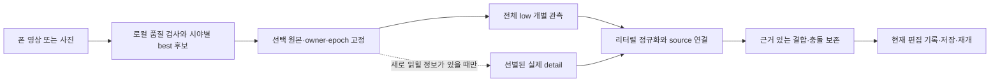

# 전체 장면 회수와 촬영 정보량을 함께 개선하는 설계

2026-11-01 · 연구 범위: 현재 소스와 기존 응답 읽기, 공개 1차 자료, 무과금 재생. 제품·설정·원본·평가기준 변경 없음.

## 1. 판단과 증거 수준

**추천:** 우선 전체 low 한 번에서 개별 실물을 더 충실히 기록하는 방식을 시험한다. 동시에 촬영에서는 ‘처음 통과한 프레임’ 대신 ‘그 시야에서 읽기 좋은 프레임’을 확보한다. 숫자·카드 정체를 코드가 만들어 내는 구조나, 모든 스캔에 OCR/검출기/추가 high를 강제하는 구조는 채택하지 않는다. 실제 다중 시점 정합은 이 두 개선의 선행 조건이 아니다.

- **VERIFIED:** 이번에 직접 읽은 코드, 해시가 맞는 원응답의 형식·행 수, 실행한 무과금 선별 재생, 직접 열람한 공식 문서/구현.
- **REPORTED:** 이전 실험의 모델 시간·usage·부분 기준 점수. 이번에 파일과 산술은 대조했지만 새 실사진 실험 또는 사람의 전체 정답 검증은 아니다.
- **INFERRED / RECOMMENDATION:** 관측 근거로 제안한 원인·설계. 새 조건으로 성능을 측정하지 않았다.
- **UNKNOWN:** 전체 장면의 정답 수, 숨은 물체, 계정 실청구/크레딧, 독립 다중 시점의 복원 효과, 폰 실측 성능.

이전 보고의 OCR/ROI 중심 제안은 하나의 후보로 재평가했다. **이번 자료는 전체 low를 버릴 근거도, 충분하다고 확정할 근거도 아니다.** 사람 기준을 전체 사진으로 넓히고, 판독 지시·출력 부담·입력 시야를 따로 바꾸는 것이 먼저다.

## 2. 실제 병목을 분리한 결과

### 2.1 현재 요청은 이미 어느 정도 ‘열거 우선’이다

[`buildGeminiGameBody`](../../server/ai/geminiGameReader.ts#L17)는 선택 영역의 허용 종류와 가시 속성을 넣는다. 20–23행은 각 종류의 작은/겹친/가장자리 물체, 읽히지 않는 속성 때문에 물체를 빼지 말 것, 인쇄판과 실물의 구분, 개별/불가분 묶음의 구분을 이미 요청한다. Terra는 이를 재사용하고 [`TERRA_FILL_SENTENCE`](../../server/ai/terraGameReader.ts#L10)로 모든 속성의 모름 행과 같은 의미의 중복 속성도 출력하도록 한다.

따라서 사용자 가설을 두 개로 나눈다.

| 가설 | 지금 판단 | 반증/지지에 필요한 비교 |
|---|---|---|
| 전체 low의 물체 발견 능력은 충분하지만 열거 방식이 누락을 유발한다 | 가능하지만 미확정. 현재도 열거 지시가 있음 | 같은 사진·schema·low에서 지시만 변경 |
| 모든 속성·분류를 동시에 완성하려는 부담 때문에 묶음 또는 누락이 증가한다 | 가능한 가설. 원출력의 묶음/속성 행 수 차이는 확인 | 같은 열거 지시에서 모름 속성 행 보고 정책만 변경 |
| 코드가 나중에 분류하면 처음에 못 읽은 물체도 복구된다 | 일반적으로 성립하지 않음 | 원출력에 물체 근거 자체가 있었는지 먼저 확인 |
| crop/추론 high이면 더 정확하다 | 기존 사례에서 일관되게 성립하지 않음 | 물체·속성·오연결·시간을 별도 평가 |

일반 출력은 `kind`가 허용 enum 중 하나여야 한다. **분류 불명인 물체를 현재 wire가 완전히 표현할 수 있는 것은 아니다.** 그러나 이것이 실제 누락 원인이라는 증거도 아직 없다. 첫 시험에서 `kind:null`까지 동시에 넣지 않는다. 그러면 열거 지시/속성 출력 변경 효과를 구분하지 못한다. 미분류 proposal sidecar는 분류 강제가 원인으로 드러날 때의 작은 후속 확장이다.

카탄에는 별도 경로가 있다. [`readCatanScene`](../../server/ai/terraGameReader.ts#L84)과 [`catanScenePrompt`](../../server/ai/catanSceneReading.ts#L15)는 canonical 칸/변/꼭짓점이 있는 장면을 출력한다. 일반 `items` 실험을 카탄의 기존 경로 개선이라고 주장하면 안 된다. 이번 후속 계획에서 카탄은 **native schema 그대로 지시 비교만** 한다.

### 2.2 원출력 손실, 개별화, 값 오류는 다른 문제다

동결된 결과 SHA를 확인하고 `hostedWire.items`와 정규화 결과를 다시 집계했다. [스크립트](audit-responses.py), [결과](raw-audit.json).

| 개발 사진 | whole-low A | whole-high B | 사전 지정 crop-low C | 이 결과가 말하는 범위 |
|---|---|---|---|---|
| Carcassonne | 원출력 19행; 선택 개별 10/16; 24.00초 | 71행; 16/16; 174.38초 | 13행; 10/16; 17.26초 | low의 tile 묶음과 high의 개별화 차이. 추가 6참조는 medium 신뢰 |
| Sagrada | 24행; 선택 개별 20/21; 숫자 19정·1오; 32.91초 | 45행; 21/21; 17정·1오·2모름; 79.07초 | 21행; 21/21; 16정·4오; 27.79초 | 물체 추가 발견과 숫자 정확도는 별개 |
| Ticket to Ride | 64행; 선택 개별 25/25; 70.66초 | 67행; 25/25; 82.24초 | 29행; 25/25; 35.22초 | 선택된 열차 영역만 채점. 전체 열차/손패/덱 정확도 아님 |

9응답은 모두 `completed`, incomplete 없음, **353원행 모두 정규화 행으로 남았다.** 이 묶음에는 parser에서 행이 사라진 증거가 없다. 일반 decoder의 512행 한도에도 도달하지 않았다. 다만 정상 종료는 물체 완전성의 증거가 아니다. 속성 오류를 모름으로 변환하는 경우도 별도로 존재한다. [decode](../../server/ai/geminiGameReader.ts#L39), [Terra 완료 검사](../../server/ai/terraGameReader.ts#L39)

더 넓은 기존 10게임 연구에서도 구분이 중요했다. 당시 whole 99/147, crop 95/147, fusion 103/147은 같은 부분 표본이었다. Dominion의 개별 0/10은 더미 표면의 이름/종류가 읽혔는데도 개별 기준으로는 잡히지 않은 사례인 반면, Ticket의 노선 묶음은 개별 차량 위치 복원에 부족했다. Quacks의 작은 칩 숫자는 사진/모델 기여가 분리되지 않았다. 이 수치는 **당시 코드 결과**이며 이후 퇴역 parent 수정이 반영된 현재 품질로 다시 표기하지 않는다. [10게임 원보고](../terra-ten-game-evaluation-20261030/README.md)

위 55/62, 62/62 같은 합계는 **부분 참조의 회수량**일 뿐 전체 사진 정확도가 아니다. Carcassonne의 기하 중복 후보 7개에는 정상 tile–meeple 겹침과 거친 참조 경계가 섞였고, Ticket의 group 참조 0/8은 25개 개별 표현과 중복되는 대체 표현이다. 이를 오검출 7개·누락 8개로 확정하지 않았다. [기존 독립 검토](../terra-quality-iteration-20261030/independent-high-review.md)

출력 부담도 균일하지 않다. 저장 답에서 **모름 속성 행만 지우는 직렬화 실험**은 Carcassonne high 32,606→16,819 UTF-8 bytes, Sagrada low 7,847→7,463, Ticket low 17,964→17,740이었다. 이미 읽힌 값은 그대로다. 이는 bytes 절약 가능성만 보여준다. 모델 token·시간·추론 부담·새 물체 발견률의 실측은 아니다. 특히 Ticket low에는 모름 행이 적어 큰 이득을 기대할 근거가 없다.

### 2.3 원인별로 다른 조치를 해야 한다

| 실패 유형 | 구별할 관측 | 최소 조치 / 하지 않을 일 |
|---|---|---|
| 사진에 없음·가림·초점/반사로 정보 소실 | 원본을 사람이 확대해도 독립 판독 불가 | 다른 실제 시야/더 가까운 촬영이 필요. 업스케일/warp로 회복했다고 하지 않음 |
| provider 축소로 작은 세부가 손실될 가능성 | 원본 가독 vs 실제 전송 크기·detail·native 결과 | 원본 crop 입력과 전체 입력의 공통 영역 비교. optical 증거 증가와 구분 |
| 눈에 보이는 개별 물체를 한 묶음으로 보고 | group 원행과 사람이 확인한 개별 경계 | instance 지시 시험. 코드가 묶음 수만큼 가짜 물체를 생성하지 않음 |
| 허용 종류 분류/많은 속성 부담 | 물체 근거는 있으나 kind/속성 보고가 빈약 | 종류 불명 proposal은 근거 sidecar 후보. 좌표만으로 카드 정체 추정 금지 |
| 명백한 숫자·색 오독 | 가독 기준 값과 raw 값의 차이 | 서로 독립적인 더 좋은 관측 또는 정정. 룰/재고/다수결로 진실 보정 금지 |
| 값이 읽혔는데 결합 뒤 바뀜/사라짐 | raw→normalized→editable field trace | fusion의 필드별 선택 규칙 수정. 모델 재호출부터 하지 않음 |
| 참조 단위·범위 자체가 모호 | group/individual 대체, 부분 GT, coarse box | 평가에서 별도 표시. 제품 누락으로 확정하지 않음 |

## 3. 1차 자료에서 채택한 원칙과 부적합한 부분

정확한 링크·열람 위치·commit·license는 [근거표](evidence.json)에 있다. 아래 수치는 해당 문헌의 실험 조건이며 KeepBoard 결과가 아니다.

| 자료 / 직접 읽은 구현 | 쓸 수 있는 원칙 | 이 프로젝트에 그대로 쓰지 않는 이유 |
|---|---|---|
| [CountGD 논문](https://arxiv.org/html/2407.04619v2), §§3.1–3.4·4·부록 D/F; [공식 구현](https://github.com/niki-amini-naieni/CountGD) `single_image_inference.py` | 텍스트/시각 예시로 ‘무엇을 한 개로 셀지’를 명시하고 개별 점 후보를 찾는 방식 | GroundingDINO 계열 검출/계수 연구. 출력 점·개수는 종류/숫자/정체/복원 상태가 아님. 확인한 실행 예는 CUDA·800/max1333 resize·logit threshold 사용; 폰 실행 성능 미확인. MIT 코드와 모델 의존 조건은 별도 |
| [VideoTree](https://arxiv.org/html/2405.19209v3), §3·실험 설정; [코드](https://github.com/Ziyang412/VideoTree) `adaptive_breath_expansion.py`, `extract_features.py` | 획일 샘플링보다 질문 관련 정보가 많은 군집을 세분화하는 접근 | 실제 구현은 EVA-CLIP-8B/GPU 특징·caption·LLM relevance를 사용. 영상 QA 선택지 정답률은 전 실물 회수율이 아님. 매 프레임 의미 판독은 지금의 저비용 선별 목표와 맞지 않음. 코드 MIT |
| [ORB-SLAM3 공식 구현](https://github.com/UZ-SLAMLab/ORB_SLAM3/blob/4452a3c4ab75b1cde34e5505a36ec3f9edcdc4c4/src/Tracking.cc#L3064) `NeedNewKeyFrame` | 시간 외에 추적점·새 근거리 정보·처리 여력을 함께 봄 | 랜드마크 추적 품질은 숫자 가독성/불변 상태 증명이 아님. 전체 3D SLAM·보정·GPL-3.0 엔진을 앱 선행 조건으로 넣지 않음 |
| [OpenCV LK](https://docs.opencv.org/4.13.0/d4/dee/tutorial_optical_flow.html), [특징점/homography](https://docs.opencv.org/4.13.0/d7/dff/tutorial_feature_homography.html) | 카메라 공통 움직임을 맞춘 뒤 남은 변화를 분석할 수 있음 | 평면과 밝기/국소 운동 가정. 솟은 기물·반사·반복 무늬에는 실패. 매칭 성공이 같은 게임 상태의 증거는 아님 |
| [ML Kit 입력·실시간 지침](https://developers.google.com/ml-kit/vision/text-recognition/v2/android) | 분석이 밀릴 때 새 프레임을 쌓지 않는 backpressure, 원본 초점/문자 크기 고려 | Android/iOS SDK를 React 웹에 그대로 붙일 수 없음. 문서의 문자 16×16px 지침을 Terra·주사위 눈의 보편 임계값으로 사용하지 않음 |
| [SAHI sliced inference](https://obss.github.io/sahi/guides/sliced-inference/), [combine](https://obss.github.io/sahi/postprocess/combine/) | 큰 물체의 전체 문맥과 작은 물체의 slice 관측을 분리하고 원좌표로 환산 | 검출 benchmark 근거이지 board-state VLM 성능 근거가 아님. class/box 기반 NMS를 tile 위 말·인접 동일 기물에 그대로 적용하면 손실 |
| [OpenAI vision](https://developers.openai.com/api/docs/guides/images-vision), [Terra](https://developers.openai.com/api/docs/models/gpt-6.1-terra) | reasoning effort와 image detail은 별개; 작은 글자·회전·계수·공간 판독의 한계, 여러 이미지 입력 가능 | API 가능과 현 앱 구현은 다름. 현재 앱 요청은 1이미지. 다른 모델의 patch/token 공식을 Terra에 전용하지 않음 |

CountGD의 명시적 예시, VideoTree의 의미 선별은 모두 **추가 계산/모델/자료가 필요**하다. “나중에 코드로 분류”를 무상·무오류 단계로 생각하지 않는다. [공개 Catan 영상 프로젝트](https://github.com/PBalewski/CATAN-video-tracking)는 입력 영상의 출처로만 사용했다. 이번에는 큰 notebook을 실행/실질 검토하지 않았고 license도 확인되지 않아 알고리즘·상품 재사용의 근거로 삼지 않았다.

## 4. 세 가지 구조 비교와 선택

| 구조 | 실제로 줄일 수 있는 부담 | 실패와 추가 비용 | 이번 선택 |
|---|---|---|---|
| **A. whole-low의 개별 관측 + 얇은 코드 정규화** | 불필요한 모름 행·사람의 재입력. 추가 모델 직렬 단계 없음 | 처음부터 미검출/오독이면 코드가 복구 못함. 지시 효과 미측정 | **첫 시험/최소 제품 후보** |
| B. 검출/OCR proposals→Terra 종류·속성 판독 | 좌표/단순 문자 처리를 분리할 가능성 | detector domain recall·GPU/폰 배포·참조 자료·두 단계 지연. 현재 검증된 범용 기물 검출기 없음 | 독립 물체 누락이 A에서 남을 때 좁은 비교. 기본 도입 보류 |
| C. overview+선별된 실제 detail을 병렬 판독 | 광학적으로 더 읽히는 정보를 얻음. 직렬 대기 일부 회피 | 토큰/호출 증가, 상태 변화·다른 시점 중복/오연결. 디지털 crop은 새로운 광학 정보가 아님 | 촬영 선별과 함께 평가. 항상 여러 장/high로 읽는 기본안은 보류 |

별도 ‘종류 분류 LLM’을 A 뒤에 붙이지 않는다. 가시 종류/쉽게 읽히는 값은 첫 응답에 남긴다. 코드는 schema 매핑·리터럴 형 변환·좌표 복원·관측 중복 관계를 처리한다. 실제 카드 이미지 reference가 검증돼 있지 않으므로, 텍스트 게임팩 120개를 실물 외형 인식기처럼 사용하지 않는다.

이전 연구의 PaddleOCR.js 브라우저 구현 후보는 여전히 문자 위치/문자 판독용 선택지다. 다만 기존 보고도 **보드게임/폰에서의 성능은 미측정**으로 남겼다. 주사위 눈·말·타일 개별화를 해결하지 않는 OCR을 이번 전체 recall 가설의 선행 조건으로 두면, 검증하지 않은 직렬 단계와 유지보수를 먼저 추가하게 된다. 그래서 도구를 폐기하는 것이 아니라 **독립 문자 누락/가독성 문제가 확인될 때 비교하는 보조 경로로 우선순위를 내린다.** [이전 공식 구현 조사와 한계](../terra-fast-first-deep-research-20261031/README.md)

## 5. 최소 관측/후처리 계약



점선은 기본 추가 호출이 아니다. 서로 다른 시점의 H는 정합이 검증되지 않으면 독립 source로 남는다.

### 지시와 출력

[prompt-variants.json](prompt-variants.json)의 P0/P1/P2는 **실험용 제안**이다. 모두 동일 모델/low/detail-high/사진/허용 종류·속성/최대 출력 한도를 유지한다.

- **P0:** 현재 exact body.
- **P1:** 현재 wire를 유지하고 공간적으로 전체를 훑되, 같은 종류의 구별 가능한 이웃을 독립 기록하고 인쇄판·그 위 기물의 레이어를 구분하는 짧은 지시만 추가한다. 과정 설명은 출력하지 않는다.
- **P2:** P1에서 모름 속성 행을 매번 나열하는 요구만 제거한다. 보이는 리터럴 값과 같은 사실에 대한 기존 속성 매핑은 유지한다. **같은 JSON schema의 `attributes` 배열을 드물게 채우는 보고 정책**이지 검출기의 추가가 아니다.

일반 형식 예시(게임 정의의 ID를 실행 전에 대입; 사진 정답이 아님):

```json
{"items":[{"kind":"<allowed-component-id>","box_1000":null,"face":"unknown","quantity":null,"physicalUnit":"single","attributes":[]}]}
```

빈 attributes는 ‘없음/0’이 아니다. [`decodeLiteralObservationPayload:72`](../../server/ai/geminiGameReader.ts#L72)는 생략 속성을 `not-present-unconfirmed` 또는 `wrong-face`로 둔다. 사후 파생 기록에는 **모델이 명시한 모름**과 **이번 보고에서 생략한 필드**를 구별한다. 이유를 `unreadable`로 꾸며 쓰지 않는다. 단일/묶음과 quantity도 별개다.

분류 불명 proposal을 나중에 허용한다면 `{proposalId, physicalUnit, box, literalAttributes, componentId:null}`을 별도 원관측으로 남기고 편집 가능한 확정 기물 수에 자동 가산하지 않는다. 외형·box만으로 정체를 확정하는 규칙을 추가하지 않는다. 이 확장은 첫 유료 비교의 조건에 섞지 않는다.

검토한 또 다른 wire는 `objects:[{id,box,kindCandidate,physicalUnit}]`를 먼저 쓰고 `facts:[{objectId,property,value}]`를 분리하는 **단일 요청 proposal-first 형식**이다. 개별화와 속성 서술을 분리해 출력 부담을 줄일 가능성이 있지만, JSON의 필드 순서가 모델의 시각적 탐색 순서를 보장하지는 않는다. ID/사실 연결 오류, 기존 schema/decoder 이행과 미분류 후보의 편집 표현이 추가로 필요하다. 우선 기존 wire의 sparse 배열로 가설을 좁히고, 의미 있는 누락이 계속 kind/속성 강제와 연관될 때만 이 형식을 다음 대안으로 시험한다. 박스만 여러 개 만든 결과를 복원 성공으로 세지 않는다.

### 코드가 할 수 있는 일 / 볼 필요가 있는 일

| 코드로 결정 가능한 것 | 관측이나 사용자의 입력이 필요한 것 |
|---|---|
| 명시된 좌표 규약의 정규화·crop 역변환, 유효한 enum/숫자 타입 검사 | 어떤 인쇄값인지, 보이지 않는 면/더미 안 내용 |
| 등록된 동일 원본·영역·레이어의 유일한 관측 대응 | 실제 다른 시점에서 같은 물체인지, 가린 기물 수 |
| 연결된 개별 관측의 수(그 범위에서만), 명시된 그룹의 별도 보존 | 게임 재고에서 빠진 수로 사진 속 개수 추정 |
| 검증된 보드 좌표 대응에서 위치 변환, 범위 밖을 미배치로 보존 | 정합 없는 사진의 slot·소유자·게임 턴 |
| 같은 원사실의 정해진 필드 복사, 모름 유지 | 규칙상 그럴듯한 숫자/카드 정체를 정답으로 채우기 |

## 6. 영상형 촬영: 시간·차이 대신 확보한 정보의 질

### 6.1 현 동작과 새 재생

현 [`sampleFrame`](../../src/Capture.tsx#L62)은 긴 변 192px의 작은 영상만 검사한다. 저장 JPEG는 [`takePhoto`](../../src/Capture.tsx#L99)에서 실제 카메라 해상도·품질 .94를 유지한다. 그러므로 “192px를 모델에 보내서 못 읽는다”는 설명은 틀리다. 하지만 **192px 전역 선명도로 작은 인쇄값의 초점을 보증할 수 없다.** 카메라 요청은 ideal 1920이며 실제 기기 해상도는 별도다.

[`stepScanSelector`](../../src/scanQuality.ts#L92)는 전역 밝기·대비·Laplacian, 미정합 프레임 차이, 저해상도 fingerprint, 1초 안정/1.8초 cooldown을 사용한다. 현 코멘트도 coverage/tracking이 아님을 명시한다. 먼저 조건을 통과한 장면을 저장하고, 나중의 같은 시야는 품질과 무관하게 duplicate로 거른다. 6장은 ‘최대 저장 수’이지 모두 읽었다는 증거가 아니다.

공개 Risk/Chess 원영상의 첫 5초를 4fps·192×108로 추출해 **실제 함수**에 넣었다. 업로드는 즉시 성공으로 모사했다. [코드](replay-selector.mts), [결과](selector-replay.json).

| 입력 | 선택 결과 | 직접 확인/한계 |
|---|---|---|
| [Risk lateral 영상](https://mixkit.co/free-stock-video/risk-board-in-a-game-seen-up-close-5335/) | 0/20프레임; motion 19 | camera 이동·얕은 초점·부분판. 선택 실패를 재현. 전체 정지 상태·가독 정답은 미확인 |
| [Chess 거리 변화](https://mixkit.co/free-stock-video/cinematic-shot-of-a-wooden-chess-49721/) | 1초/3초의 2장 | 어두운 기물·가림, 대부분 거리 변화. 다른 면을 새로 보여줬다고 확정 못함 |
| 합성 동일 구도, 더 선명한 후속 프레임 | 후속도 duplicate | 흐린/선명한 Laplacian 681.86/7,334.50; control-flow 검사. 실제 사진 성능 자료 아님 |

평균 selector CPU는 해당 데스크톱에서 .806ms/.352ms였다. ffmpeg decode·카메라·JPEG·업로드·폰 발열은 제외됐으므로 모바일 처리시간으로 쓰지 않는다. 이전 Catan 공개영상 역시 손/실물 변화 때문에 같은 상태의 다중 시점 정답이 아니었다. [이전 자료](../public-scan-test-20261028/README.md), [이번 입력 선별 기록](../static-video-multiview-20261101/README.md)

### 6.2 최소 단계: 시야별 best frame과 교체

1. 기존 저해상도 검사는 유지하되 **작은 프레임의 움직임 값과 노출 중 blur를 동일시하지 않는다.** 움직임 하나를 낮춰 Risk를 무조건 통과시키지도 않는다.
2. 첫 통과 프레임을 즉시 확정하기 전에 같은 시야의 짧은 후보 구간에서 더 좋은 것을 유지한다. 평소에는 작은 특징만 계산하고, 후보가 될 때만 원본의 여러 부분 패치를 검사한다. 보드 전체가 선명하다는 단일 평균 대신 흐린/포화 패치와 edge 분포를 기록한다. 그것도 물체 가독성의 **대용 신호**다.
3. 같은 구도라도 후속 프레임이 더 좋은 부분 가독 정보를 가지면 교체 후보로 허용한다. 이미 업로드된 evidence bytes/ID를 덮어쓰지 않는다. 분석 시작 전에 selected IDs를 고정하고, 교체된 사진은 유료 판독 단위에서 제외한다. 처음 구현은 **현재 시야 best 한 장을 메모리에 두고 시야 전환/마침 때 업로드**하는 경로가 작다. 전송 겹침 감소와 메모리 비용을 함께 측정한다.
4. 최대 6장은 유지한다. 현재 저장 큐 길이 제한·예약 fingerprint·batch ID가 엮여 있으므로 `sameScanView` 한 줄만 바꾸는 수정은 충분하지 않다. 후보 교체와 업로드 예약은 분리해야 한다. 과거 evidence 삭제, 끝난 job의 입력 변경, 자동 추가 유료 호출은 하지 않는다.
5. 추가 장면이 없으면 overview 한 장만으로 진행할 수 있다. 6장을 채우라고 요구하지 않는다. 모두 읽었다고 표시하지 않고, 모름·미배치를 보존한다.

초기에는 시야 동일성 판정이 확실한 거의 같은 구도만 교체한다. 완만한 zoom/회전/이동의 새로운 시야를 같은 구도로 뭉개지 않는다. 계산이 밀리면 최신 후보를 분석하고 중간 프레임을 버린다. 원본 영상 상시 보관·모든 프레임 업로드는 필요 없다.

첫 구현의 교체 범위는 **아직 업로드하지 않은 현재 시야 후보**다. 앞선 시야로 돌아왔을 때 이미 업로드한 사진까지 대체하려면 선택 manifest/최대 업로드 수 정책을 추가로 정해야 한다. 이를 첫 단계 완료라고 주장하지 않는다. 신규 시야의 6장 상한과 pending 후보의 품질 교체를 구분하고, 상한에 닿았다고 이미 확보한 원본을 덮어쓰지 않는다.

### 6.3 다음 단계: 기하와 상태 변화가 필요한 경우만

단순 품질 교체로도 필요한 부분을 놓친다면 background 특징점/LK와 RANSAC 평면 변환을 좁게 시험한다. 여기서의 coverage는 **정합이 확인된 보드 평면에서 좋은 해상도·노출로 본 면적**이다. 물체·속성을 다 읽었다는 뜻이 아니다.

| 촬영 신호 | 저비용으로 가능한 것 | 순환 의존/실패 조건 |
|---|---|---|
| 노출·초점 | 작은 샘플 + 선택 후보 원본 패치 | 고주파 인쇄 배경이 흐린 작은 말/문자를 가릴 수 있음 |
| 시야 변화 | 특징점 분포·scale·정합 잔차 | 반복 타일/저텍스처/3D 기물에서 오정합 |
| 새 영역 | 유효한 평면 변환 뒤 영역 union | transform 없으면 UNKNOWN. 자른 이미지 확대는 새 시점이 아님 |
| 손/가림 | 이동 영역·국소 잔차를 임시 제외 | 정지한 손·그림자와 구별하려면 추가 detector나 사람 판단 필요 |
| 실물 이동 | background 정합 후 지속하는 국소 변화 | 반사·노출·parallax도 잔차. 미확정을 ‘판이 바뀜’으로 확정하지 않음 |
| 누락/추가 촬영 필요 | 읽힌 물체의 모름/갈등, 저품질·미관측 영역 | **처음부터 누락된 물체는 모델의 unknown 목록에 없다.** 전체 미검출 감지는 별도 후보/새 시야/사람 기준 필요 |

시간 순서를 버리기 전에 상태 구간을 정한다. 잠깐 지나간 손 때문에 앞뒤를 바로 서로 다른 게임으로 나누지 않고, 손이 사라진 뒤 변화가 지속하는지 본다. 확실한 상태 변경은 별도 segment로 유지한다. 판별 불가면 자동 결합은 멈추고 한 안정 구간을 기준으로 진행하되 다른 원사진은 보존한다. 매 장마다 확인 버튼을 요구하지 않는다.

현재 [`analyzeBatch`](../../src/SessionWorkspace.tsx#L210)는 hosted 모드에 `sameStaticState:true`를 보낸다. 이는 사용자의 촬영 의도를 나타낼 뿐 **사진 내용이 불변이라는 자동 검증이 아니다.** `newCaptureRun`의 owner/epoch 고정은 권한·세션 상태를 보호하지만 실물의 움직임까지 검출하지 못한다.

종료 조건은 ‘새로운 유효 영역/가독성 개선이 더 안 나옴’, ‘상한 도달’, ‘사용자가 마침’이다. **adaptive stop을 완전성 인증으로 만들지 않는다.** 정합이 실패하거나 영상에 같은 시야밖에 없으면 best overview와 읽을 만한 실제 closeup만 남기는 단순 경로로 되돌아간다.

## 7. 다른 사진의 관측을 언제 같은 물체로 볼 것인가

현재는 [`sourceSHA`와 종류/레이어](../../shared/scanObservation.ts#L20), 등록된 crop 역변환과 원본 영역을 사용한다. [`projectGenericFusion`](../../server/observationFusion.ts#L31)의 source key는 원본 evidence/SHA/area/scope/definition을 포함한다. 다른 사진을 입력받아 병렬 처리하는 것과 **다른 시점에서의 물체 동일성 증명**은 별개다.

최소 계약은 다음과 같다.

- **동일 원본 crop:** 원본 SHA·변환·unit ID로 좌표를 환산한다. 동일 unit의 이웃은 병합하지 않고, printed board–piece 레이어를 분리한다. group의 표면과 개별 child를 이중 개수로 더하지 않는다.
- **독립 촬영:** 같은 상태/owner/epoch/영역이라는 조건 외에 실제 정합 근거가 필요하다. homography만으로 솟은 기물의 box 전체가 정확히 대응한다고 보지 않는다. 지역 대응이 유일하고 다른 가까운 물체와 경쟁하지 않을 때만 연결 후보를 만든다. 대응 불명은 source별 원관측으로 유지하고 합산 재고로 확정하지 않는다.
- **필드 값:** 관측값→모름으로 덮지 않는다. 모름+알려진 값은 동일 물체가 확인된 범위에서 보완한다. 알려진 값끼리 다르면 기존 수동값 보호, 기존 선택값과 대안의 갈등 보존. 새 crop이 작다는 사실만으로 선택값을 교체하지 않는다.
- **틀린 AI anchor:** 영구 진실로 고정하지 않는다. 사용자의 직접 정정 또는 독립적으로 더 강한 가독/대응 근거가 있을 때 수정할 수 있다. 단순 반복 응답 일치·모델 confidence·crop 면적은 그 증거가 아니다.
- **결정성:** source/unit/ref ID로 정렬·중복 제거하고 응답 도착 순서와 무관한 결과를 만든다. 수동 편집 revision/epoch를 거슬러 늦은 결과를 적용하지 않는다. 모름/null/0과 raw는 유지한다.

사그라다의 `focused-provisional` 퇴행은 모델 요청을 더 늘리기 전에 고칠 수 있는 공통 문제다. [`focused`](../../server/observationFusion.ts#L27)는 ROI 면적·pixel density만 비교한다. 원본의 같은 픽셀을 잘랐다는 이유가 ‘더 정확한 숫자’의 증거는 아니다. 이 판단은 특정 cell/숫자를 넣는 패치가 아니라 모든 typed 값의 선택 정책에 적용한다.

실제 camera-view 정합을 후속 구현한다면 두 원본 SHA·크기·state segment·변환 추정 근거를 가진 별도 관계가 필요하다. 현재 정확한 crop 변환으로 위장하거나 두 원본의 SHA를 같게 만들 수 없다. 기하 매칭의 유효 평면/영역도 표시해야 하므로, 이 계약 확장은 새 사진의 실제 이득이 확인된 뒤로 미룬다.

## 8. 시간·토큰·저장 완료를 혼동하지 않는 비교

현재 hosted scan은 이미 병렬이다. [`analyzeScan`](../../server/scanObservation.ts#L73), [`runHostedScan`](../../server/scanExecution.ts#L23)는 고정 단위별 claim/결과를 유지한다. [`ScanProgressPreview`](../../src/ScanObservationResults.tsx#L30)는 진행 중 원사진 overlay이며 편집된 최종 판이 아니다. [`commitAnalysisTask`](../../server/analysisTask.ts#L29)는 고정 결과를 결합한 뒤 현재 편집 기록으로 반영한다. 별도 필수 승인 큐를 이번 설계에 재도입하지 않는다.

- **첫 유용 관측:** 업로드/prepare 뒤 가장 먼저 완료된 유효 unit. JSON stream 조각은 저장 가능한 관측이 아니다.
- **최종 편집 상태:** 필요한 단위 완료/실패 처리 + 결정적 fusion + commit. 병렬이면 이상적인 API 부분은 `max(T_i)`이지만 공급자 queue/전송/경합은 추가된다.
- **사람이 복원 가능한 상태:** 누락/오독/미배치 정정 + 실제 복원 점검. 이전 실험에는 이 시간이 없다.

기존 A whole-low의 API 시간은 24.00/32.91/70.66초였다. low도 일률적으로 빠르지 않으며, 새 열거 지시로 출력 물체가 늘면 시간이 길어질 수 있다. B whole-high는 174.38/79.07/82.24초다. 선택된 물체의 회수 증가를 대기시간 개선으로 부를 수 없다. 새 원본 고정의 P0/P1/P2 비교가 필요한 이유다.

한 multi-image 요청은 공통 prompt를 줄이고 문맥을 함께 볼 가능성이 있지만, 현재 [`ObservationRequest`](../../shared/lightweightRecognition.ts#L43)/Terra invocation은 1이미지이고 result `imageIndex`도 0이다. source attribution·혼합 owner·단위별 실패·재사용 계약까지 달라진다. 따라서 첫 비교는 **개별 고정 요청을 병렬 처리하는 기존 경로**를 재사용한다. multi-image가 더 빠르거나 싸다는 주장은 보류한다. 여러 이미지/많은 crop은 input tokens를 늘리며 병렬화가 총 tokens를 줄이지 않는다.

2026-11-01 [공식 가격](https://developers.openai.com/api/docs/pricing)의 Terra 표준 짧은 입력은 input $1/M, output $5/M이며 cache write/read는 별도다. 실험의 usage 환산과 계정 청구·무료 크레딧은 다르다. 새 비용은 실제 input/output/reasoning/cache usage로 기록한다. streaming/중단이 이미 수행된 계산 비용을 돌려준다고 가정하지 않는다.

## 9. 다음 판별 실험과 반증 조건

[기계판독 계획](experiment-plan.json)은 **미실행 제안**이다. 새 정지 상태 3개(Catan·Carcassonne·Sagrada)를 선정하고 사람의 전체 가시 물체/가독값을 출력 전에 고정한다. 카드 문장·다른 게임 유형은 이 소규모 선택의 미검증 범위다.

카탄 native P0/P1 각 1회, 나머지 두 게임 P0/P1/P2 whole + P2 원본 crop + P2 실제 독립 closeup 각 1회로 **최대 12회**, retry0/peak2를 제안한다. 모든 주석을 모델에 보내지 않는다. crop은 GT box가 아닌 사전 의미 영역으로 정하고, 실제 closeup은 실물을 움직이지 않고 별도로 촬영한다. 새 데이터가 없으면 기존 개발 사진으로 대체해 독립 검증이라 부르지 않는다.

P0→P1은 지시, P1→P2는 속성 보고 정책만 바꾼다. whole+crop과 whole+실제 closeup은 같은 call 수·출력 cap을 갖지만 픽셀/입력 tokens는 다를 수 있어 반드시 함께 보고한다. 1장과 2장은 비용 동등 실험이 아니며 비용 대비 추가 이득으로 비교한다. 카탄의 ROI/native slot 혼동을 피하기 위해 첫 12회에서 카탄의 crop/multiview 성능을 주장하지 않는다.

이 12회 안에서 generic P2 whole+실제 closeup 두 쌍은 실제 동시 발행해 pair wall을 기록한다. 나중에 읽은 crop과 재사용한 whole로 계산한 `max(T_whole,T_crop)`은 **추정치**로만 표기한다. 순서·cache·동시 부하가 완전히 교차 통제된 반복 실험은 아니므로 지시 하나의 속도 인과도 확정하지 않는다. 연결된 격리 제품 경로를 실제 관측할 수 없으면 capture-to-final/사람 복원 시간은 UNKNOWN으로 남기며 provider 시간과 오프라인 시간을 더해 실측이라 부르지 않는다.

전체 가시 물체의 precision/recall, 개별/묶음 대체 표현, 값 정/오/모름/미검출, 물리 box/slot, owner, fusion 중복·오연결, 사람 정정 부담을 따로 센다. 특히 common-region과 새 시야에서 드러난 영역을 분리한다. GT를 이용한 union은 **oracle upper bound**이고 제품 fusion 실적이 아니다.

채택은 임의 ‘90% 합격’으로 정하지 않는다. 독립 사진에서 추가로 회수한 복원 정보가 무엇인지, 늘어난 거짓 물체/잘못된 값/정정 부담과 시간을 함께 본다. P1/P2가 실용 정보 없이 긴 출력/오검출만 늘리면 기본안으로 채택하지 않는다. 실제 closeup도 새로 읽히는 정보가 없으면 다중 시점 정합 구현을 진행할 근거가 없다. 이 실험은 단회이므로 우열이 작으면 UNKNOWN으로 남긴다.

## 10. 지금 하지 않을 것

모든 게임 재학습, 검증되지 않은 전용 검출기 선도입, 전 프레임 LLM relevance, 3D SLAM, 타일 재고로 누락 보충, 전 사진 자동 high, 원문 raw를 제품 아트로 배포, 임의 성공률/30초 보장은 범위 밖이다. 이번에는 새 후보 selector나 prompt의 효과도 측정하지 않았다. [작업 카드](implementation-cards.md)의 작은 수정과 고정 비교로 다음 결정을 내릴 수 있다.
