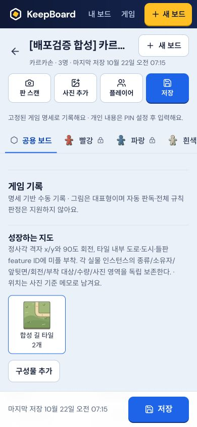

# KeepBoard production 배포 · 2026-10-22

VERIFIED: **https://keepboard-kappa.vercel.app** 에 최신120기록 런타임과 범위복원 turn/보관위치 전체저장 두 fix를 배포했다. 새 합성 미리보기 주소가 아니라 기존 KeepBoard Vercel production 프로젝트다.

- Deployment ID: `dpl_2kLJ9oNq9zs7azgRXuk9AgkzzGAt`
- Vercel 생성시각: **2026-10-22 07:13:29 +09:00**, Ready/production 확인. [inspect.log](inspect.log)
- 고정 배포 URL: https://keepboard-3k2zbcctq-renggyus-projects.vercel.app
- 기존 alias: https://keepboard-kappa.vercel.app, https://keepboard-renggyus-projects.vercel.app
- [실제 배포 로그](deploy.log), [HTTP·모바일·저장 검증](verification.json), [clean static manifest](static-manifest.json)

## 산출물·라우팅

최종 dist를 별도 clean `.vercel/output/static`으로 복사했다. **541파일/25,791,027bytes**, 앱에서 쓰지 않는 public art download zip은 제외했다. 프로젝트 src/server/shared/gamepacks, 연구 PDF/docs, .keepboard, .env, 개인설정·키·사용자 자료는 산출물에 넣지 않았다. 기존 프로젝트 연결 ID와 기존 CLI 인증을 재사용했으며 새 패키지 설치/계정/결제/git commit·push는 없다.

기존 캐시 Vercel CLI로 `deploy --prebuilt --prod --yes --cwd <clean stage>`를 실행해 **exit0**. 소스가 동결돼 전체225테스트/타입/빌드는 앞 단계의 직접 통과 근거를 유지했고 불필요하게 반복하지 않았다. 배포한 JS는 `index-Ca6-pUiM.js`, CSS는 `index-Bd4K20ak.css`다.

API/uploads는 기존 `https://mba-estate-aid-gordon.trycloudflare.com` 터널을 그대로 사용한다. prebuilt 라우트는 API/uploads proxy → filesystem → 정적 경로의 missing404 → SPA 순서다. root `vercel.json`에는 brand/demo를 SPA 제외 경로에 추가한 최소 변경만 있다. 이미지 요청을 index.html로 돌리지 않도록 했다.

## 운영 API 전환과 보존

기존 운영 대상의 실제 PID/port/cwd/data root를 확인했다. 이전4319 PID63966은 health200/catalog404인 구버전이었고, watch 모드나 별도 AI env override가 없었다. 같은 Store를 사용하도록 **4319만 종료 후 최신 소스로 재기동**했다.

현재 체인:

1. Vercel production HTTPS
2. Cloudflare tunnel PID64203 →127.0.0.1:4320
3. 기존 proxy `/tmp/keepboard-preview/gateway.mjs` PID64200 →127.0.0.1:4319
4. 최신 backend PID82226, output session66823: `KEEPBOARD_DATA_DIR=/tmp/keepboard-preview/data PORT=4319 NODE_ENV=production npm run start`

기존 AI gateway PID18287/port4330과 기존 routing/settings 파일은 그대로다. 합성4393/4396/4397 등은 종료·재시작하지 않았다. 작업 전 opaque 로컬 backup을 `/tmp/keepboard-operational-backups/20261022-071219`에 만들고 parent0700으로 유지했다. 기존 데이터 **30파일 모두 전후 bytes 일치/누락0**이며 내용을 문서·로그·배포에 출력하지 않았다. [전환 전](operations-before.json) · [전환 후](operations-after.json)

기존 사용자 보드는 GET 목록/내용을 출력하거나 수정하지 않았다. 검증용으로 새로 만든 아래 합성 기록과 연결 확인용1px 이미지에만 쓰기를 했다. 원본 삭제/리셋/마이그레이션은 없다.

## 공개 주소 검증

- production home/최종 JS/CSS:200 및 dist SHA 일치.
- 승인 cartoon4개 JPG, art assets index/카르카손·루미큐브 mapping/native SVG, manifest:200·정확한 image/JSON/manifest MIME·dist hash 일치.
- 없는 brand asset은404. query deep link는200/index hash 일치.
- production `/api/health`200, `/api/game-catalog`200/**120종**. 새 native 버전 카탄 `2.0.0-essentials-1.51a3a1dd68fe`, 루미큐브 `1.0.0-essentials-1.fb4be402632a` 확인.
- 새 카르카손 세션은 `1.0.0-essentials-1.a2b8788cd3c5`/PIN-before-content/manual recognition/runtime metadata로 반환됐다. 120 자동 판독/규칙 실행 지원이라는 뜻은 아니다.
- 같은 새 합성 세션에서 public evidence POST→HTTPS `/uploads/...` image/png200을 확인했다. 연결 확인용1px이며 실제 게임 사진/AI 인식 실험이 아니다.

## 실제 모바일 조작

Chrome CUA **390×844**에서 공개 주소로 새 게임 선택→카르카손→합성 기록1개 생성했다. 기존 사용자 목록/개인 내용은 출력하지 않고 새 합성 기록 안에서만 화면 캡처했다.

이름: **[배포검증 합성] 카르카손 · 2026-10-22**

[검증용 새 기록](https://keepboard-kappa.vercel.app/?session=ebfa694f-0fc8-4acf-b81d-7cd7f9c539ea)

실제 입력/상단 저장/reload 후 확인:

- 굽은 길 대표 그림·합성 길 타일2개
- `타일을 놓고 미플 선택 전 · 합성 검증`
- `배포검증 봉투 A · 순서 유지` — 별도 위치저장 버튼을 누르지 않음
- packed/restored=false 유지

현재 응답과 snapshot에서도 동일값을 확인했다. 선택한 구성물 그림 렌더·모바일 overflow0/broken images0. viewport override reset. 검증 탭은 남겼다.

[전체 합성 화면](screenshots/production-synthetic-390.jpg)

## 한계·유지 조건

실AI 호출0, gateway 과금 검사0, 카메라 활성화0이다. 실제 사진 인식 품질이나 공개 운영에서의 모든 게임/개인 PIN 흐름을 전수 검증하지 않았다. 두 fix의 내부 계약은 앞 단계225회귀/타입/빌드와 새 운영 API 기동·동일 소스에 근거한다. 이번 공개 UI는 수동 게임의 저장/재열기를 실제 검증했다.

**Vercel은 정적 앱만 호스팅한다. Mac backend4319, proxy4320, Cloudflare tunnel과 필요 시 AI gateway4330이 계속 켜져 있어야 한다.** Mac 절전/프로세스 종료/재부팅 또는 quick tunnel 종료 시 API가 끊길 수 있으며 상시 호스팅으로 이전한 것은 아니다. tunnel URL이 바뀌면 API/uploads 라우팅을 갱신해 다시 배포해야 한다. 데이터가 `/tmp/keepboard-preview/data`에 있다는 기존 운영 특성도 유지돼 OS 임시자료 정리 위험은 별도이며, 이번에 영구 저장소 이전을 수행하지 않았다. 백업은 로컬에만 보관했다.
